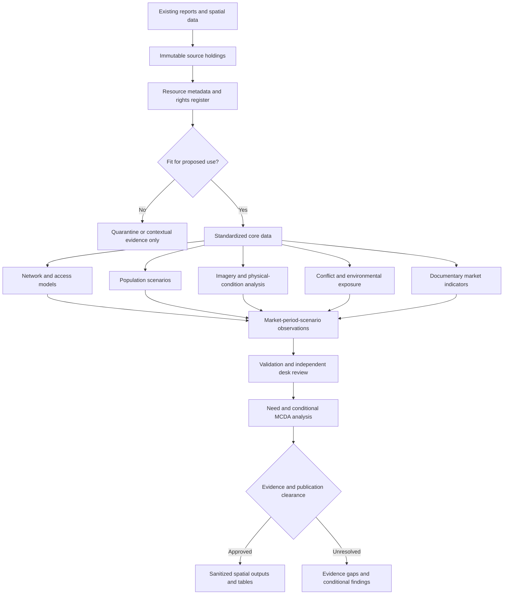
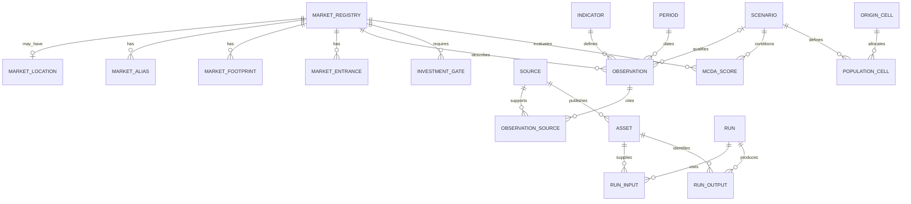
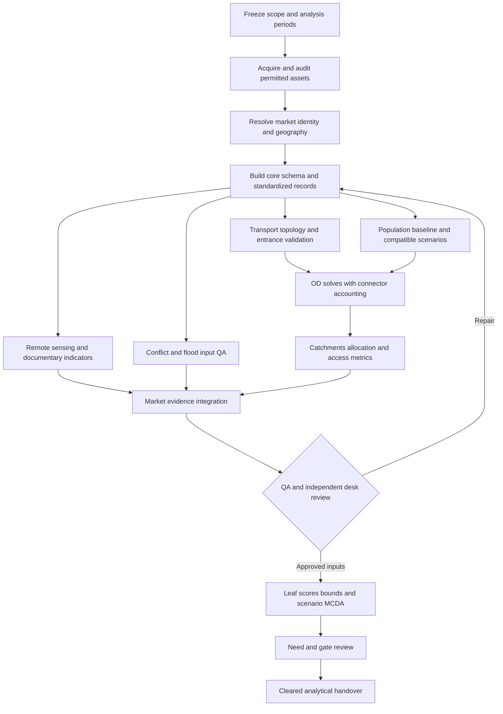
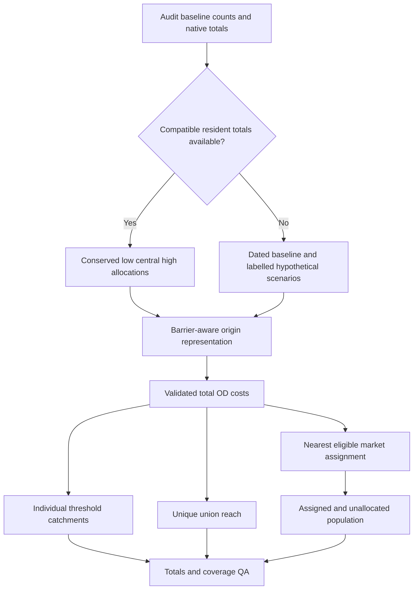

# GIS Analysis Framework and Workflow for the Khartoum Market Assessment

## Technical Basis and Scope

This specification defines the GIS data model, processing sequence, analytical methods, quality controls, and ArcGIS Pro implementation for a secondary-evidence assessment of selected Khartoum State markets. It operationalizes the assessment methodology without assuming that source datasets, verified market locations, remote-sensing products, or licensed ArcGIS processing capabilities are already available.

The framework distinguishes source evidence from derived information and keeps four concepts separate: market recovery need, conditional opportunity/readiness, evidence confidence, and authorization to implement an intervention. No map, proximity measure, composite score, or apparent absence of recorded incidents establishes safe access, structural integrity, explosive-ordnance clearance, lawful tenure, or approved construction feasibility.

This is an implementation specification, not a claim that the geodatabases have been built or the analyses executed. The existing market register contains 14 provisional entries and no verified coordinates. Those records must remain nonspatial until identity and geometry are adequately resolved. The intended fifteenth entry must be clarified from existing records rather than invented.

## 1. Data Architecture

### 1.1 Architectural Principles

The architecture will separate immutable source holdings, standardized working data, analytical outputs, restricted information, and cleared publication derivatives. Data will move between these layers through documented processing steps, with source identifiers and method/run references preserved.

The following principles will apply:

- One authoritative nonspatial registry will retain every market identity, including unresolved entries.
- A market's location, footprint, entrances, sub-sites, and proposed intervention parcels will not be treated as interchangeable geometries.
- Time-varying conditions will be recorded in observations rather than repeatedly overwriting static market attributes.
- Alternative population/network scenarios and methodological versions will remain distinguishable.
- Raw restricted records will not be copied into publicly accessible layers merely because selected fields are hidden in a map.
- Raster information will retain its actual spatial support; resampling will not be described as increased information resolution.
- Null values and explicit missingness will be preserved throughout processing and publication.
- No destructive repair, projection, classification, or clipping will alter the original acquired source.

### 1.2 Logical Architecture



### 1.3 Physical Storage

The following is a proposed structure, not a directory listing of assets already created:

```text
Khartoum_Market_GIS/
  00_governance/       scope, access decisions, methods, schema and approvals
  01_raw/              immutable acquired resources with original metadata
  02_staging/          conversion, parsing, quarantine and temporary working files
  03_core/             KHM_Core.gdb
  04_restricted/       KHM_Restricted.gdb under separate access controls
  05_rasters/          source-aligned and derived TIFF/CRF products and metadata
  06_analysis/         KHM_Analysis.gdb and run-specific scratch geodatabases
  07_models/           ModelBuilder toolbox, parameter exports, network templates
  08_review/           QA results, disagreements, source and model adjudications
  09_publication/      KHM_Publication.gdb and cleared map/summary exports
  10_releases/         immutable dated release packages and manifests
  Khartoum_Markets.aprx
```

Access control will be enforced through organizational storage permissions and publication privileges. A file geodatabase or feature dataset is not a user-level security boundary. Restricted sources will require a separately controlled storage location; grouping them under a different feature-dataset name is insufficient.

### 1.4 Source-to-Output Lineage

Each acquired resource will receive an asset ID separate from its publisher/source ID. One source portal may host many differently dated resources; one resource may generate several analytical products. The minimum lineage chain is:

**Publisher/source -> acquired asset/version -> processing run -> output observation/layer -> reviewed finding -> publication asset.**

The asset register will record original URL, local path, access conditions, license, checksum where practicable, acquisition/observation/publication/retrieval dates, spatial reference, resolution or geographic support, nodata definition, units, and any known restrictions. A portal reviewed online will not be marked as a downloaded Sudan dataset.

## 2. Geodatabase Design

### 2.1 Storage Roles

| Store | Contents | Editing and release rule |
|---|---|---|
| `KHM_Core.gdb` | Adopted geography; authoritative registry; verified locations/entrances; standardized roads, buildings, facilities, origins, source/indicator metadata, documentary observations. | Managed working source of standardized records; changes documented and reviewed. |
| `KHM_Restricted.gdb` | Licensed conflict-event detail and other sensitive source geometries or records. | Access-controlled analysts only; no direct public service dependency. |
| `KHM_Analysis.gdb` | Run/scenario-specific service areas, OD summaries, allocation zones, exposure tables, derived observations, components, scores, and QA records. | Reproducible outputs; do not hand-edit a result to improve a rank. |
| `KHM_Publication.gdb` | Cleared profile geometries and denormalized summary tables with approved fields only. | Generated from reviewed outputs; not the authoritative evidence store. |
| External raster holdings | Native and analysis-ready rasters, mosaics where supported, quality layers, and metadata. | Retain native products; use geodatabase references/asset records rather than large raster BLOB fields. |

Use a file geodatabase for the initial single-team workflow. If concurrent editing, transactional controls, enterprise permissions, or versioned service workflows become necessary, migrate through an approved enterprise geodatabase design. A file geodatabase will not be described as supporting enterprise branch versioning or multiuser access control.

### 2.2 Feature Datasets and Coordinate Systems

Recommended feature datasets within the core geodatabase are `fd_reference`, `fd_markets`, `fd_transport`, `fd_assets`, and `fd_origins`. Their members must use a consistent spatial reference within each feature dataset. Nonspatial tables reside at the geodatabase root, not inside feature datasets.

Use EPSG:4326 for exchange coordinates; store longitude as X and latitude as Y. For local metric analysis, use WGS 84 / UTM zone 36N, EPSG:32636, after checking the actual extent. Web Mercator is a display CRS, not the basis for analytical area or length. Long national corridors should use geodesic calculations or a suitable regional projection where the local UTM choice is not appropriate.

Keep source rasters in native grids and projections unless a specific analysis requires a documented transformation. Configure output extent, mask, snap raster, cell size, and resampling separately for each raster workflow. Do not apply a single 10 m processing grid indiscriminately to population, flood hazard, climate, and nighttime lights.

Geodatabase XY resolution/tolerance will be documented. They describe numeric storage and topology behavior, not positional accuracy. Increasing clustering tolerance must not be used to connect roads across rivers or shift poorly aligned datasets into apparent agreement.

### 2.3 Identifier and Relationship Strategy

Each entity will have an ArcGIS-managed `OBJECTID`, a managed `GlobalID` where supported, and a stable business ID such as `market_id`, `asset_id`, or `obs_id`. `OBJECTID` will not be used as a persistent cross-release join key.

For core relationship classes, use the parent `GlobalID` and a populated child GUID field, such as `market_guid`. Retain the parallel business ID for portable CSV/GeoPackage exchange and QA. Child GUIDs are not populated automatically by merely adding the field: they must be assigned through an approved parent lookup. Validate that the GUID and business-ID pair refer to the same parent.

Rebuild or preserve relationships explicitly when exporting/importing. A process that regenerates GlobalIDs must not leave the old child GUIDs attached to unrelated rows. Add GlobalIDs at the appropriate dataset level according to the supported ArcGIS version. Any export/publication requirements for relationship classes must be tested in the organization's actual platform.

Use simple relationship classes rather than deletion-cascading composite relationships unless a specific lifecycle justifies composition. Removal of a candidate geometry must not delete its documentary evidence or market identity.

### 2.4 Entity Relationships



The diagram shows logical cardinality. Relationship classes cannot enforce every analytical constraint: alternate-key uniqueness, score grain, matching GUID/business IDs, and cross-geodatabase references require validation. Optional scenario links are valid for direct documentary observations that do not depend on a modelled scenario.

### 2.5 Integrity, Indexes, and Topology

Create attribute indexes on stable IDs and commonly queried combinations such as market/period/scenario, indicator/period, and origin/scenario. Treat uniqueness as a validated invariant; do not assume every file-geodatabase index provides a relational-database unique constraint.

Recommended logical constraints include:

- One authoritative registry row per `market_id` and at most one adopted location per market per location version.
- No orphaned market, indicator, period, scenario, source, or run reference.
- One adopted analytical observation per market/indicator/period/scenario/method version, with source claims retained separately when multiple records disagree.
- One population row per origin cell/scenario and one final allocation per origin/scenario/eligible-market-set version.
- No overlapping adopted locality polygons within the reporting area; gaps interpreted according to boundary coverage rather than automatically filled.
- No overlapping duplicate building footprints from combined source inventories without an adjudicated match.
- Entrances related to the correct market and connected only through plausible access paths.
- Road intersections connected only where actual same-level connectivity is supported.

Do not impose a universal no-dangles rule on roads: cul-de-sacs and dead ends are legitimate. Likewise, proposed parcels may intentionally overlap an existing footprint. Topology exceptions require documented explanations rather than indiscriminate geometric repair.

## 3. Feature Classes

### 3.1 Core Feature-Class Catalogue

The following are proposed feature classes. Presence in the design does not mean that data exist to populate them. Z/M values are not required by default; turn/connectivity modeling may use explicit elevation fields where supported. Geometry types will not be mixed within one feature class.

| Feature class | Geometry | Grain/key | Main analytical role |
|---|---|---|---|
| `fc_state_boundary` | Polygon | Adopted state/version | Scope, clipping/reporting, boundary disclaimer. |
| `fc_localities` | Polygon | Locality PCode/version | Population reconciliation and administrative summaries. |
| `fc_market_locations` | Point | Verified market/location version | Adopted representative location; not necessarily an entrance. |
| `fc_market_footprints` | Polygon | Footprint ID | Existing trading area, sub-site, or proposed parcel distinguished by role. |
| `fc_market_entrances` | Point | Entrance ID | Consumer/freight destination access and endpoint validation. |
| `fc_road_edges` | Polyline | Directed-cost-capable source edge ID | Local transport graph and mode restrictions. |
| `fc_access_connectors` | Polyline | Connector ID | Explicit plausible origin/entrance-to-road access geometry and cost. |
| `fc_turn_restrictions` | Turn feature class | Supported turn record | Optional evidenced vehicle-turn restrictions; create using the proper network tool, not an ordinary line surrogate. |
| `fc_rivers` | Polyline | River segment ID | Hydrographic context and crossing QA. |
| `fc_water_barriers` | Polygon | Water/barrier ID | Permanent-water and impassable-crossing screening, distinct from flood scenarios. |
| `fc_building_baseline` | Polygon | Adopted baseline building ID | Observable-condition denominator and asset exposure. |
| `fc_facility_points` | Point | Facility point ID | Mapped institutions/services with function/status kept separate. |
| `fc_facility_areas` | Polygon | Facility area ID | Known facility/warehouse/logistics footprints when genuinely available. |
| `fc_origin_cells` | Polygon | Cell/locality-part ID | Stable population reporting/allocation units. |
| `fc_origin_points` | Point | Origin ID linked to cell ID | Network-origin representation; not an observed household location. |
| `fc_supply_hubs` | Point | Supply-node ID | Documented production/aggregation/logistics origin or hub. |
| `fc_trade_routes` | Polyline | Link/geometry version | Reported geometry where known or separately labelled modelled route. |

Facility points and areas will share a logical facility business ID only where a documented correspondence exists. Do not sum a facility's point and polygon as two institutions. A footprint centroid may serve cartographic display but not substitute for a verified access entrance.

### 3.2 Restricted and Derived Feature Classes

| Feature class | Geometry/store | Grain/key | Interpretation |
|---|---|---|---|
| `fc_conflict_events` | Point/restricted | Provider event ID/version | Source geocode and precision; not automatically an exact event location. |
| `fc_service_areas` | Polygon/analysis | Market/mode/threshold/scenario/run | Display envelopes; retain disk/ring and overlap rules. |
| `fc_reachable_edges` | Polyline/analysis | Edge/market/threshold/scenario/run | Reached network segments for audit and access interpretation. |
| `fc_influence_zones` | Polygon/analysis | Allocated market/scenario/run | Dissolved reporting-cell allocation, not measured consumer preference. |
| `fc_observed_floods` | Polygon/analysis | Event/observation/product | Observed-event extent with exclusions/coverage; not a return-period map. |
| `fc_damage_units` | Polygon/analysis | Baseline asset/interpretation pair | Qualified physical interpretation with observable status. |
| `fc_conflict_summaries` | Polygon/analysis or cleared derivative | Reporting area/window/run | Aggregated recorded exposure, with public detail reviewed. |
| `fc_market_results` | Point/publication | Market/period/scenario/method version | Cleared denormalized results; geometry only for resolved market locations. |

The public profile layer will not contain unresolved entries at invented coordinates. A separate nonspatial directory may list unresolved or excluded markets with reasons.

### 3.3 Nonspatial Tables

| Table | Purpose and logical grain |
|---|---|
| `t_market_registry` | Authoritative market identities, original names, scope and resolution status. |
| `t_market_aliases` | One source-specific name/alias and match decision. |
| `t_sources` | One original publisher/document/source, not every copied posting. |
| `t_assets` | One acquired resource/product/output version with metadata and rights. |
| `t_periods` | One observation/comparison window and season label. |
| `t_scenarios` | One approved combination of population, network, speed, period, and market-set assumptions. |
| `t_indicator_definitions` | One versioned indicator definition, unit, eligibility and calculation. |
| `t_source_claims` | Original scoped claim/value retained before analyst adoption. |
| `t_observations` | Adopted market/indicator/period/scenario observation with uncertainty. |
| `t_observation_sources` | Observation-to-source/claim bridge, support/conflict and lineage. |
| `t_population_totals` | Locality/population-case/period definition and adopted total if defensible. |
| `t_population_cells` | Cell/scenario mass-preserving population allocation. |
| `t_origin_locations` | Origin/network-build/scenario location status and connector review. |
| `t_od_costs` | Origin/entrance/scenario/run route costs and status; raw solver IDs crosswalked. |
| `t_market_od` | Minimum valid origin-to-market cost after entrance reduction. |
| `t_allocations` | One origin/scenario nearest eligible market or explicit unallocated reason. |
| `t_trade_links` | Documented origin/destination/commodity/period link with optional reported quantity. |
| `t_prices` | Comparable market-item-grade-unit-type-date observation and provenance. |
| `t_basket_observations` | Market/basket item/period available-unavailable-unknown observation. |
| `t_market_services` | Market/service category/period operating evidence and uncertainty. |
| `t_exposures` | Market/asset group/hazard definition/scenario/run numerator, denominator and coverage. |
| `t_mcda_components` | Market/elementary component/period/scenario/model version with score bounds and eligibility. |
| `t_mcda_scores` | Market/period/scenario/model version composite, coverage and rank eligibility. |
| `t_investment_gates` | Market/gate/review version with pass/fail/unknown and evidence references. |
| `t_runs` | One processing run with software, parameters, timestamps and status. |
| `t_run_inputs` | Run-to-input-asset bridge. |
| `t_run_outputs` | Run-to-output-asset bridge. |
| `t_qa_issues` | Validation issue, affected object, action, reviewer, closure evidence. |
| `t_publication_manifest` | Cleared output/item, dependencies, rights, owner, dates and approval. |

This is a logical full design. Empty optional entities should not be populated with fictional records. High-volume OD tables may be partitioned by run and origin batch, with identical schemas and a manifest identifying all parts. Performance optimization must preserve analytical keys and completeness accounting.

## 4. Attribute Schema

### 4.1 Types and Shared Fields

Use Unicode-capable Text for bilingual names and original claims, while keeping field names short ASCII identifiers. Use Double for modelled population, distances, radiance, fractions, and scores; population cells can legitimately contain fractional people as expected/modelled allocations. Preserve those values through summation and round only in presentation.

Store external OSM/provider IDs as Text to avoid precision and cross-platform integer limits. Use Short for small codes, Long for ordinary counts where sufficient, GUID for relationship foreign keys, and Date for timestamps. Store true instants in UTC with documented timezone handling. For calendar-only observations preserve ISO text and a `date_precision` field so that a midnight/timezone conversion does not shift the represented day. Newer Date Only/Timestamp Offset types may be used only after client/publication compatibility is verified.

Numeric precision/scale settings in a file geodatabase are not a substitute for range validation or rounding policy. Choose the correct type; enforce meaning through domains and QA.

| Shared field | Type/length | Requiredness and rule |
|---|---|---|
| `OBJECTID` | ArcGIS Object ID | System-managed; not a portable identifier. |
| `GlobalID` | Global ID | System-managed where relationships/publication require it. |
| Entity business ID | Text 40 | Non-null; unique at the declared entity grain. |
| Parent GUID field | GUID | Required where that parent relationship applies; match parent GlobalID. |
| `source_id` | Text 24 | Required for adopted source-derived features, or via a documented many-source bridge. |
| `asset_id` | Text 40 | Acquired/derived asset reference where applicable. |
| `run_id` | Text 40 | Required for generated analytical rows. |
| `method_version` | Text 40 | Required for derived observations and results. |
| `review_status` | Text 24 | Controlled draft/review/approval state. |
| `sensitivity` | Text 20 | `public`, `internal`, or `restricted`, subject to owner approval. |
| `valid_from`, `valid_to` | Date, nullable | Actual applicable interval if known; never default unknown dates to today. |

Defaults will not auto-fill observed facts such as open status, no damage, zero incidents, safe access, or gate pass. Newly created records may default to draft or unknown status only.

### 4.2 Market Registry and Geometries

| Entity | Fields and types in addition to shared fields | Validation |
|---|---|---|
| `t_market_registry` | `market_id` Text 20; `name_ar` Text 255; `name_en` Text 255; `original_name` Text 500; `source_location` Text 255; `market_type` Text 32; `hierarchy` Text 32; `admin2_pcode` Text 32 nullable; `scope_status` Text 24; `geometry_status` Text 24; `resolution_note` Text 2000. | Preserve source wording; unresolved locality remains null; do not combine similar names without adjudication. |
| `t_market_aliases` | `alias_id` Text 40; `market_guid` GUID; `market_id` Text 20; `alias_name` Text 500; `language` Text 8; `claim_id` Text 40; `match_status` Text 24. | Every adopted alias cites source; rejected candidate matches retained separately. |
| `fc_market_locations` | `location_id` Text 40; `market_guid` GUID; `market_id` Text 20; `loc_version` Text 24; `loc_method` Text 40; `loc_error_m` Double nullable; `location_role` Text 24; `verified_on` Date nullable. | One adopted point/version; uncertainty is not GPS accuracy unless actually sourced. |
| `fc_market_footprints` | `footprint_id` Text 40; parent market GUID/ID; `subsite_id` Text 40 nullable; `footprint_role` Text 24; `image_asset_id` Text 40 nullable; `image_date_iso` Text 10 nullable; `area_m2` Double; `tenure_status` Text 24. | Existing/sub-site/proposed distinguished; area calculated in appropriate CRS; no ownership inference. |
| `fc_market_entrances` | `entrance_id` Text 40; parent market GUID/ID; `mode` Text 16; `access_status` Text 24; `connector_id` Text 40 nullable; `barrier_review` Text 24; `evidence_date_iso` Text 10 nullable. | Verified mode-specific entrance; operational access status separate from geometry. |

### 4.3 Network, Assets, and Origins

| Entity | Principal fields and types | Meaning/rules |
|---|---|---|
| `fc_road_edges` | `edge_id` Text 40; `osm_id` Text 32; `from_node`/`to_node` Text 40; `road_class` Text 32; `surface` Text 24; `bridge`/`tunnel` Short; `level_f`/`level_t` Long; `oneway` Text 12; `walk_allow`/`truck_allow` Text 12; `length_km` Double; directional cost fields `walk_ft`/`walk_tf`/`truck_ft`/`truck_tf` Double; `status` Text 24; `status_date_iso` Text 10 nullable. | FT/TF follow geometry orientation. Access/closure restrictions separate from positive travel costs. Layer/elevation values are topology controls, not measured ground heights. |
| `fc_access_connectors` | `connector_id` Text 40; `endpoint_type` Text 16; `endpoint_id` Text 40; `edge_id` Text 40; `mode` Text 16; `length_m` Double; `cost_min` Double; `review_status` Text 24; `assumption_id` Text 40 nullable. | Explicit first/last-mile route; do not assume a straight segment through a barrier is traversable. |
| `fc_building_baseline` | `building_id` Text 40; `provider_id` Text 80; `baseline_asset` Text 40; `baseline_period` Text 24; `confidence_raw` Double nullable; `area_m2` Double; `function_class` Text 32 nullable. | Detection confidence is not damage confidence; unknown building use remains unknown. |
| Facility feature classes | `facility_id` Text 40; `facility_type` Text 40; `name` Text 255 nullable; `mapped_date_iso` Text 10 nullable; `oper_status` Text 24; `oper_date_iso` Text 10 nullable; `status_obs_id` Text 40 nullable; `capacity_num` Double nullable; `capacity_unit` Text 32 nullable. | Institution identity de-duplicated across point/area representation; status linked to evidence. |
| `fc_origin_cells` | `cell_id` Text 40; `parent_cell` Text 40 nullable; `admin2_pcode` Text 32; `grid_version` Text 24; `land_area_m2` Double; `base_pop` Double nullable; `base_asset_id` Text 40. | If cells are partitioned by locality/land barrier, each part receives a unique ID and a conserved population share. |
| `fc_origin_points` | `origin_id` Text 40; `cell_id` Text 40; `point_method` Text 32; `connector_id` Text 40 nullable; `origin_role` Text 24. | Interior/settlement representative point; not a household coordinate. Do not relocate a cell across water to reach a road. |
| `t_population_cells` | `popcell_id` Text 40; `cell_id` Text 40; `scenario_id` Text 40; `population` Double; `allocation_q` Double; `total_id` Text 40 nullable; `population_basis` Text 24. | Nonnegative; administrative totals close; distinguish current-estimate, dated-baseline, and hypothetical scenario. |

### 4.4 Evidence, Observation, and Processing Tables

| Entity | Principal fields and types | Essential constraint |
|---|---|---|
| `t_sources` | `source_id` Text 24; `publisher` Text 255; `title` Text 1000; `url` Text 2048; `publication_iso` Text 10 nullable; `lineage_group` Text 80; `review_status` Text 24; `reuse_status` Text 24. | Original lineage distinguished from reposts; unknown publication date not invented. |
| `t_assets` | `asset_id` Text 40; `source_id` Text 24; `resource_url` Text 2048; `local_path` Text 1024; `sha256` Text 64 nullable; `obs_start_iso`/`obs_end_iso` Text 10 nullable; `retrieved_at` Date; `crs_id` Text 80 nullable; `grid_size` Double nullable; `grid_unit` Text 24; `nodata_note` Text 500; `license_note` Text 2000; `asset_status` Text 24. | Native resolution, actual acquisition status, and rights explicit; generated outputs identified as such. |
| `t_indicator_definitions` | `indicator_id` Text 16; `definition` Text 4000; `unit` Text 40; `grain` Text 255; `numerator_rule`/`denominator_rule` Text 2000; `eligibility_rule` Text 4000; `direction` Text 16; `freshness_days` Long nullable. | Definition version approved before comparison. |
| `t_source_claims` | `claim_id` Text 40; source ID; optional market ID/GUID; `claim_text` Text 8000; `page_ref` Text 80; `value_num` Double nullable; `unit` Text 40; `date_precision` Text 16; `spatial_level` Text 24. | Original claim and analyst adoption remain distinguishable. |
| `t_observations` | `obs_id` Text 40; market GUID/ID; indicator ID; period ID; scenario ID nullable; `value_num` Double nullable; `value_text` Text 2000 nullable; `numerator`/`denominator` Double nullable; `unit` Text 40; `evidence_type` Text 1; `quality_score` Double nullable; `confidence_class` Text 12; `lower_bound`/`upper_bound` Double nullable; `bound_type` Text 24; `missing_reason` Text 32; `eligibility` Text 24. | Known zero distinct from null; numeric and text values follow indicator type; bounds ordered and typed. |
| `t_observation_sources` | `obs_id` Text 40; `source_id` Text 24; `claim_id` Text 40 nullable; `asset_id` Text 40 nullable; `relation` Text 16; `lineage_group` Text 80. | At least one traceable source/input for each non-assumed supported observation. |
| `t_periods` | `period_id` Text 24; `start_iso`/`end_iso` Text 10; `period_role` Text 24; `season` Text 24; `label` Text 120. | End not before start; baseline ends before conflict onset where labelled pre-conflict. |
| `t_scenarios` | `scenario_id` Text 40; `population_case`/`network_case`/`speed_case` Text 32; `marketset_id` Text 40; `network_build_id` Text 40; `period_id` Text 24; `parameter_path` Text 1024; `parameter_hash` Text 64; `approved_by_role` Text 80. | One reproducible parameter bundle; no silently changing scenario definitions. |
| `t_runs` | `run_id` Text 40; `model_id` Text 80; `software_version` Text 120; `started_at`/`finished_at` Date; `parameter_path` Text 1024; `parameter_hash` Text 64; `run_status` Text 24; `message_path` Text 1024. | Failed/partial runs retained; outputs not promoted until QA passes. |
| Run input/output bridges | `run_id` Text 40; `asset_id` Text 40; `role` Text 40. | Both directions of lineage preserved; resource IDs validated. |

Store very long original documents and machine-readable parameter JSON as controlled files referenced by asset IDs, rather than truncating them into arbitrary Text fields. If the chosen field length is exceeded, split structured claims or retain the full document as an asset and reference its location; do not silently truncate evidence.

### 4.5 OD, Allocation, Exposure, and Score Tables

| Entity | Principal fields and types | Required accounting |
|---|---|---|
| `t_origin_locations` | `origin_id` Text 40; network build/scenario IDs; `source_oid` Long nullable; `source_id_na` Long nullable; `pos_along` Double nullable; `side_edge` Short nullable; `snap_dist_m` Double nullable; `loc_status` Text 32; `connector_min` Double nullable. | Network-location fields are valid only for the referenced network build; do not reuse after rebuilding blindly. |
| `t_od_costs` | `od_id` Text 40; origin/entrance/market/scenario/run IDs; `network_min` Double nullable; `origin_min`/`entrance_min` Double nullable; `total_min` Double nullable; `route_status` Text 32; `solver_origin_id`/`solver_dest_id` Long nullable. | Keep entrance and business-ID crosswalks; classify invalid, disconnected, beyond cutoff, and failed solve distinctly. |
| `t_market_od` | `origin_id`/`market_id`/`scenario_id`/`run_id` Text; `best_entrance` Text 40 nullable; `total_min` Double nullable; `reachable` Short nullable; `status` Text 32. | Minimum across eligible entrances only; one row per origin-market scenario in the required analytical universe. |
| `t_allocations` | origin/scenario IDs; `market_id` Text 20 nullable; `best_time` Double nullable; `allocation_status` Text 32; `population` Double; `marketset_id` Text 40. | Exactly one assignment or explicit unallocated state; no duplicate population across assigned markets. |
| `t_exposures` | `exposure_id` Text 40; market ID; `hazard_asset` Text 40; `scenario_id` Text 40; `asset_group` Text 32; `threshold` Double nullable; `threshold_unit` Text 24; `exposed_num`/`valid_den`/`unknown_num` Double; `unit` Text 32; `coverage_frac` Double. | Separate conditional exposed fraction from unknown coverage and from full-denominator bounds. |
| `t_mcda_components` | market/component/period/scenario/model IDs; `raw_obs_id` Text 40; `score_num` Double nullable; `score_low`/`score_high` Double; `effective_weight` Double; `eligible` Short; `missing_reason` Text 32. | Unknown scores remain null; 0-100 bounds for supported scoring design only; weights refer to declared leaf components. |
| `t_mcda_scores` | market/period/scenario/model IDs; `P`/`A`/`F`/`C`/`E`/`R` Double nullable; `covered_weight` Double; `score_low`/`score_high` Double; `point_score` Double nullable; `need_class` Text 24; `gate_status` Text 12; `rank_scope` Text 40; `rank_num`/`rank_min`/`rank_max` Long nullable. | No point rank from incomplete inputs; analytical rank and investment-ready eligibility labelled separately. |
| `t_investment_gates` | `gate_id` Text 40; market GUID/ID; `gate_type` Text 48; `gate_status` Text 12; `obs_id` Text 40 nullable; `review_date` Date; `reviewer_role` Text 80; `expiry_trigger` Text 1000; `required_action` Text 2000. | Unknown by default; a current applicable record is necessary for pass. |
| `t_qa_issues` | `issue_id` Text 40; `entity_name` Text 80; `entity_id` Text 80; `test_id` Text 40; `severity` Text 16; `status` Text 16; `finding`/`resolution` Text 4000; `reviewer_role` Text 80. | Critical unresolved errors block promotion of affected results. |

Counts and special-purpose table fields not repeated above follow their entity grain in Section 3: prices retain item, grade, retail/wholesale flag, unit, currency, date and source; basket rows retain predefined basket/item IDs and availability; service rows retain one declared category and dated status; trade links retain commodity, season, origin/destination, reported/modelled status, and quantity/unit only if supported. None may use a free-text market label as the sole join key.

### 4.6 Domains and Null Rules

```text
evidence_type: D | R | M | A | U
geometry_status: verified | approximate | disputed | unverified
oper_status: documented_open | documented_partial | documented_closed | historical_only | unknown
missing_reason: not_reported | stale | not_applicable | inaccessible | conflicting | unsuitable_scale | insufficient_coverage
gate_status: pass | fail | unknown
review_status: draft | desk_reviewed | approved_internal | approved_public
confidence_class: high | medium | low | unknown
route_status: solved | disconnected | beyond_cutoff | origin_unlocated | destination_unlocated | connector_unresolved | solve_failed | not_attempted
allocation_status: assigned | beyond_threshold | disconnected | data_unresolved | no_eligible_market
```

Unknown access permissions must not be coerced into a binary open/closed factual field; the scenario records the assumption used. Empty strings in imported numeric/date fields will be converted to true nulls with documented missing reasons. No-data raster cells will never automatically become zero population, zero flood depth, no damage, or zero conflict exposure.

## 5. End-to-End Processing Workflow

### 5.1 Stage Gates and Dependencies



### 5.2 Processing Stages

| Stage | Required action | Main output | Stop/hold condition |
|---|---|---|---|
| G01 | Confirm cohort, identity ambiguities, locality geography, cutoff, baseline/current periods and comparison groups. | Scope and market-set version. | Unresolved identity blocks that site's spatial analysis, not the entire evidence search. |
| G02 | Obtain permitted exact resources and original metadata; register rights, hashes, dates and scale. | Asset manifest and acquisition status. | Inaccessible/unlicensed/unsuitable assets remain unavailable or contextual. |
| G03 | Create databases, domains, shared types, parent-child relationships and empty QA tables. | Validated schema template. | Do not load authoritative data into undefined/free-text-only schemas. |
| G04 | Standardize boundaries, markets, footprints, buildings, facilities and source-name crosswalks. | Core inventory with verification states. | No adopted market point from an unverified neighborhood guess. |
| G05 | Prepare network topology, restrictions, entrance/origin connectors and build versions. | Mode-specific routable network and location audit. | Unreviewed river/elevation joins or invalid locations block affected solves. |
| G06 | Select population counts baseline; conserve totals; create defensible scenario allocations. | Population grid/cell tables and total-reconciliation report. | Invalid resident denominator prevents a current-population label. |
| G07 | Execute OD/service-area passes; preserve all origins and location/solve status. | Network costs, service envelopes and allocation input. | A limited nearest-destination solve cannot substitute for full market comparisons. |
| G08 | Interpret adequate imagery and prepare documentary service/availability/price records. | Observable-condition and market-period evidence. | Unsupported image resolution or commodity denominator suppresses that metric. |
| G09 | Calculate conflict and hazard exposure at appropriate spatial/temporal support. | Exposure tables with coverage and exclusion counts. | Coarse geocodes/nodata cannot silently enter exact-buffer or dry-area classifications. |
| G10 | Calculate access, population reach, network roles and qualified functionality components. | Long-form raw/derived observations. | Eligibility and missing reasons required before normalization. |
| G11 | Validate lineage, denominators, topology, interpretation, units and contradictory evidence. | Desk-review and QA gate decisions. | Critical unresolved error blocks affected result promotion. |
| G12 | Apply approved MCDA; calculate bounds/coverage; run sensitivity; separate need and gates. | Scenario score matrix and conditional comparison. | No synthetic values, unapproved rescaling, or compensation for missing mandatory gates. |
| G13 | Produce cleared profile outputs, processing manifest and limitations. | Technical handover, not automatic publication. | Rights/sensitivity and methodological sign-off required. |

Each stage will retain warnings and failed steps, not only successful outputs. A partially completed run will never be presented as complete coverage of all markets.

## 6. Spatial Analysis Methods

### 6.1 Method Selection

| Analytical question | Method | Key implementation control |
|---|---|---|
| Where are sites and assets? | Geolocation, geometry review, Spatial Join to adopted localities. | Preserve disputed/source labels; review boundary cases and approximate coordinates. |
| How much infrastructure is mapped? | Deduplicated counts and footprint area / declared land area. | Presence is not operation; use a fixed denominator and unit such as m2/ha. |
| What services are nearby? | Generate Near Table or reviewed buffers; network distance where appropriate. | Euclidean proximity is not access, availability, or service quality. |
| Which residents can reach which market? | Mode-specific OD routing plus explicit access connectors. | Reach determined from valid network costs, not polygon inclusion alone. |
| How are markets allocated spatially? | Nearest-network-time origin allocation; dissolve cells for display. | One allocation per origin/scenario; not observed choice or exclusive consumer ownership. |
| How vulnerable are routes to failure? | Edge/crossing removal and detour/disconnection comparison. | A route that disappears in the model must not become a finite fake detour. |
| What assets are exposed to floods? | Native-grid raster overlay or documented fractional vector intersections. | Coverage/nodata and raster support remain visible; preserve counts. |
| What recorded violence is nearby? | Precision-reviewed unique-event spatial summaries with time windows. | Buffer counts are not local attack probabilities or safety assessments. |
| What is the market's network role? | Fixed-graph centrality and documented economic hierarchy/functions. | Network centrality may require a vetted graph library/external engine; not a presumed Network Analyst output. |

### 6.2 Infrastructure Density and Facility Context

For a declared market/neighborhood zone $z$, calculate built footprint density as $\sum_b A(b\cap z)/A(z)$, or express it as m2 per hectare. Use an adopted building inventory with source overlaps resolved before summation. Road density is the unique road length within the same declared zone divided by land area; bidirectional traffic attributes do not double the physical road length.

Facility inventories will distinguish health, education, water, finance, storage, transport, and logistics categories, their mapped dates, and actual documentary status. A bank within 5 km is a potential nearby institution, not proof that traders can obtain cash or finance. A building count must not be converted into traders or employment.

### 6.3 Influence Zones and Supply Connections

Influence zones will be derived from unique minimum-time assignments among the specified eligible market set. Raster or polygon displays will retain the underlying reporting resolution and unallocated category. A Voronoi/Thiessen polygon may be used only as a clearly labelled geometric context layer, not a substitute for network allocation across the Nile.

Supply links will use origin/hub/destination relations with commodity and period attributes. Where only endpoints are documented, show a schematic connection rather than inventing a precise road path. A modelled route may be calculated separately and labelled as an alternative. Quantitative flow width requires compatible documented volumes; otherwise all comparable links use equal width.

### 6.4 Statistical Restraint

With a small purposive cohort, maps and descriptive comparisons will take precedence over unsupported inferential statistics. Kernel density of reported incidents may be used as an exploratory contextual surface with bandwidth and reporting caveats, but will not enter scoring as an empirically estimated attack probability. Hotspot significance, trader concentration, and consumer-choice calibration will not be claimed without suitable observations, sample design, and assumptions.

## 7. Remote Sensing Methodologies

### 7.1 Product Selection and Common Controls

| Product family | Appropriate use | Inappropriate inference |
|---|---|---|
| Existing UNOSAT/qualified damage products and adequate archival very-high-resolution imagery | Observable roof/building changes and qualified damage categories. | Structural integrity, hidden defects, ordnance safety, lawful land vacancy. |
| Sentinel-2 Level-2A | Neighborhood land-cover/vegetation/water/burn context at actual band support. | Stall inventory or complete individual-building destruction classification at 10 m. |
| Sentinel-1 GRD | Quality-controlled backscatter change and observed-flood screening where suitable. | Coherence from GRD or automatic damage certification. |
| Sentinel-1 SLC | Compatible interferometric coherence/change workflow if specialist capability and data allow. | Unqualified damage inference from decorrelation. |
| Landsat Level-2 | Surface reflectance and surface-temperature context with quality/scale handling. | Surface temperature as measured air temperature or WBGT. |
| NASA Black Marble/VIIRS | Quality-controlled neighborhood radiance trends. | Market GDP, turnover, jobs, footfall, or isolated individual-market recovery. |

For all products, record acquisition time/window, collection, platform, processing level, native pixel/support, projection, units, scale/offset, quality masks, nodata, and rights. Use matched seasons and comparable viewing/processing conditions where possible. A map tile's apparent visual sharpness is not a license to digitize or a measure of analytical resolution.

### 7.2 Baseline and Current Image Selection

Choose pre-conflict observations from appropriate 2022 and/or January-March 2023 windows and the latest adequate comparable observations. The choice will minimize cloud/shadow, large registration errors, extreme off-nadir differences, and seasonal mismatch. Do not select only the most dramatic post-conflict image and call it a representative current condition.

Create an image-pair suitability record per site. Compare stable control features at the scale of the intended interpretation. If registration uncertainty is comparable to the feature/change being measured, do not classify that feature's damage. No universal subpixel registration claim will be made without measured checks.

### 7.3 Visible Infrastructure Condition

1. Adopt a stable baseline building/structure inventory and market-footprint boundary.
2. Verify that baseline buildings actually correspond to the appropriate observation period; an inference/release date alone is not an acquisition date.
3. Identify which baseline structures are observable in the selected comparison.
4. Interpret categories such as no qualifying visible damage, visible damage, severe visible destruction, possible change, and unobservable, using written definitions.
5. Link each interpretation to baseline/post assets, unit ID, reviewer, confidence, and reason for unobservability.
6. Independently desk-review all candidate-shortlist sites and at least the agreed sample of other sites; adjudicate material disagreements.
7. Publish both the damage statistic and observable coverage, retaining the count denominator and date pair.

$$D_m=100\frac{n_{\mathrm{qualifying\ damage},m}}{n_{\mathrm{observable},m}},\qquad Q_m=100\frac{n_{\mathrm{observable},m}}{n_{\mathrm{baseline},m}}.$$

Do not compute $D_m$ when the observable denominator is zero or invalid. The proposed composite eligibility rule requires $Q_m\geq80\%$, but the damage result remains a visible-condition estimate, not proof that unobserved structures share the same condition. The absence of qualifying visible damage does not imply no rehabilitation need: pre-existing service/layout deficits may still be documented.

### 7.4 Optical Change and Vegetation

For Sentinel-2 Level-2A, apply documented cloud, cloud-shadow, invalid-pixel, and other relevant scene-quality masks before compositing. Use comparable reflectance scaling and maintain band alignment. For a common 10 m NDVI calculation:

$$NDVI=(B8-B4)/(B8+B4).$$

Handle zero/invalid denominators as nodata. Indices using 20 m bands retain their effective 20 m information support even if displayed at 10 m. A matched-season composite must record acquisition dates and valid-observation counts; a median composite should not be described as one specific day's image.

Use vegetation analysis primarily in documented producer areas or for environmental context. NDVI does not establish crop yield, market supply volumes, trader income, or household food security without additional validated models. Spectral change, burn indices, or built-up changes will be reported as candidate disturbance/context, not automatically conflict damage.

### 7.5 Radar Change and Observed Floods

For compatible Sentinel-1 GRD observations, select the same relative orbit/pass and polarization where feasible; apply the appropriate orbit, border/noise handling, calibration, geometric correction, and quality checks for the chosen workflow. Use justified speckle treatment and avoid smoothing away narrow roads or local water features that the analysis needs to interpret.

Compare calibrated backscatter in consistent units. For positive linear power $P$, a log-ratio may be represented as $10\log_{10}(P_{post}/P_{pre})$; if inputs are already dB, compare by subtraction rather than taking their ratio. A threshold will be locally reviewed, not copied as a universal flood/damage value.

For flood interpretation, screen permanent water, radar shadow/layover, steep terrain where relevant, vegetation effects, acquisition timing, and urban double-bounce. Urban flooding may be poorly captured by a simple low-backscatter rule. Preserve uncertain/unobservable areas and avoid coding them dry.

Coherence analysis requires appropriate SLC pairs, co-registration, compatible geometry, and specialist processing such as a supported SNAP workflow. It cannot be calculated from detected GRD data as an equivalent. Decorrelation may reflect vegetation, moisture, acquisition geometry, or construction as well as damage. Where capability is unavailable, use suitable existing specialist products rather than an invalid shortcut.

### 7.6 Nighttime Lights

Choose one science-quality product/collection and platform, or document overlap-based harmonization when a transition is necessary. Gridded Black Marble product spacing, often about 500 m depending on product, is not the native VIIRS DNB resolving power of roughly 750 m. Several small markets may share one effective signal; results should normally be attributed to an explicitly defined neighborhood.

Apply the selected product's mandatory quality, cloud, moon/stray-light, and valid-observation controls. Keep gap-filled values distinguishable from actual observations. For a proposed daily-to-monthly aggregation, start with at least five valid nightly observations and 70% valid area coverage, subject to product-specific documentation and sensitivity review. Do not apply that nightly threshold mechanically to a different precomposited monthly product with different quality semantics.

Use area-aware summaries, not a raw pixel count that assumes equal physical areas in a geographic grid. Report radiance units, valid coverage and acquisition window. Compute percentage change only when the baseline is above the product-specific noise floor; otherwise report absolute change and uncertainty. Screen fire/flaring, grid restoration and residential spillover. Sensor/service continuity must be checked against current provider notices before updates; do not append another platform's series without testing comparability.

### 7.7 Heat, Rainfall, Land Cover, and Water

For Landsat Level-2 surface temperature, apply the exact product's scale/offset and quality flags, retain the actual thermal information support, and distinguish clear-sky daytime sampling from all-day exposure. Convert to Celsius only after the product's physical-unit conversion; never treat stored integers as degrees. ERA5-Land may provide regional atmospheric context but not market-specific measured air conditions.

For CHIRPS, retain a consistent version, final/preliminary status, and climatological reference, such as 1991-2020. Report absolute anomalies and percentage anomalies only where the mean is meaningfully nonzero. Consider upstream basin rainfall separately from local rainfall for Nile-related hazards.

Use categorical land-cover resampling by an appropriate nearest-neighbor method. Historical water occurrence will describe surface-water context, not drinking-water access or groundwater yield. Documented WASH/utility evidence is needed for operational water-service indicators.

## 8. Accessibility Analysis

### 8.1 Network Preparation

Obtain a dated road extract covering the assessment origins plus sufficient external extent for route alternatives. A state-boundary clip can falsely disconnect roads that leave and re-enter the state; national supply routes require wider coverage. Start with a conservative buffer based on the longest modelled travel radius and plausible detours, then test stability against a larger extent. Report persistent boundary effects rather than assume an arbitrary buffer is sufficient.

Retain road class, OSM/source ID, surface, access, foot/motor-vehicle permissions, one-way, bridge, tunnel, layer/elevation tags, and relevant observation dates. Import through a documented OSM conversion workflow preserving topology/tag meaning; an arbitrary line shapefile stripped of those tags may be unsuitable.

Split at supported same-level junctions, not every cartographic crossing. Preserve grade separation using supported elevation/connectivity settings or separate network connectivity groups with verified links. Numeric layer values alone do not automatically configure a correct ArcGIS network. Do not run blanket planarization/Integrate to connect every intersecting line.

Review disconnected components, bridge endpoints, duplicated ways, gaps at tile boundaries, and missing pedestrian links. Legitimate dead ends remain. Status information will be source-dated; unknown bridges/roads will be tested under named assumptions rather than described as open facts.

### 8.2 Impedance and Mode Rules

For a traversable edge:

$$t_e=60L_e/v_e+d_e,$$

where $L_e$ is km, $v_e$ is the scenario speed in km/h, and $d_e$ is a documented or clearly assumed delay in minutes. Costs must be nonnegative and consistent with FT/TF direction. A blocked edge is restricted, not assigned a tiny positive speed that still permits traversal.

| Mode/road case | Illustrative central speed | Sensitivity | Interpretation |
|---|---|---|---|
| Walking | 4 km/h | 2.5 and 5 km/h | Planning assumptions, not measured local or disability-specific behavior. |
| Freight, paved major road | 40 km/h | 20 km/h slower case | No current traffic observation implied. |
| Freight, urban secondary | 25 km/h | 12.5 km/h slower case | Congestion/condition uncertainty remains. |
| Freight, unpaved | 15 km/h | 7.5 km/h and justified wet-season restriction | Surface alone does not establish seasonal passability. |

Pedestrian access will not inherit vehicle one-way or highway rules indiscriminately. Conversely, a road usable by trucks is not automatically a safe/legal foot route. Where crossing or access rules are unknown, record the scenario assumption and test a restrictive alternative. Do not insert security delays or checkpoints as factual values without suitable evidence; avoid exposing sensitive details.

### 8.3 Network Location and First/Last-Mile Costs

Locate verified entrances and representative origins on appropriate network elements with explicit search criteria. For market entrances, an initial 50 m maximum search tolerance and review beyond 25 m are proposed QA settings, not accuracy guarantees. Origins require a documented connector strategy based on reporting-cell scale and road completeness; a large tolerance must not silently jump a river, wall, or railway.

Set travel mode and barriers before loading locations. Preserve input coordinates, adopted snapped location, distance, network build, and location status. A changed barrier/travel mode can change locating; revalidate locations for each relevant scenario. Network source IDs/OIDs and positional fields are build-specific.

Snapping does not automatically add the true first/last-mile journey time. Calculate:

$$t_{gm}=\min_{e\in E_m}\left(c_{g}+t^{network}_{ge}+c_{e}\right),$$

where $E_m$ contains eligible entrances of market $m$, $c_g$ is a reviewed origin connector cost, and $c_e$ is the entrance connector cost. If the network explicitly contains and traverses those connectors, do not add them a second time. Otherwise add them to the OD table after the solver, or use tested supported impedance fields with a documented equivalent treatment.

A straight connector can be an explicit assumption only after barrier screening and sensitivity review. An unresolved connector is a data uncertainty, not zero travel cost. Retain origin/entrance connection failures separately from physical network disconnection.

### 8.4 Required OD Passes

The following passes solve different questions and must not be conflated:

| Pass | Destinations and cutoff | Purpose |
|---|---|---|
| OD-A: threshold catchments | All eligible market entrances; network-time cutoff 60 minutes where connector costs are nonnegative, followed by total-time filtering at 15/30/60 minutes. | Individual/union catchments and unique nearest market within 60 minutes. Keeping all destinations is necessary for every market's catchment. |
| OD-B: local burden and reachability | All candidate entrances for every relevant market; no cutoff and no destination-count limit, or equivalently complete targeted origin-market solves. | Reachable fraction and weighted median for each market's fixed 5 km neighborhood, including reachable trips longer than 60/90 minutes. |
| OD-C: freight links | Documented source hubs to relevant market entrances using freight mode; no arbitrary consumer cutoff. | Supplier-route alternatives, detour and disruption scenarios. |

In ArcGIS Pro, the documented default for OD destination count is no limit, but configure and record it explicitly; a nearest-one result is not a full market catchment table. Per-origin overrides can supersede layer defaults and must be audited. OD-A's network cutoff is only a computational candidate filter: final thresholds use total cost including connectors.

For OD-B, a 60-minute or 90-minute cutoff would misclassify longer reachable paths as unreachable and bias the accessibility score. If solving all pairs at once is impractical, batch origins or run verified market-specific jobs, retaining all required pairs and recording computational failures.

OD straight-line output geometry is a display connection, not the actual route traversed. Use route analysis or appropriate supported traversal outputs when route geometry is needed. Do not overlay straight OD display lines on floods/conflict corridors as though they were road paths.

### 8.5 Service Areas

Use Make Service Area Analysis Layer with direction **Toward facilities** for consumer-to-market access, and define minutes as the travel impedance. Produce 15/30/60-minute disks for cumulative reach, or rings only where clearly labelled. Set overlap behavior intentionally: overlapping areas answer individual market reach, while a dissolved same-threshold union can support a cartographic combined view.

Service polygons generalize from reachable lines and can enclose inaccessible pockets or cross barriers visually. Their trim-distance setting is not a walking connector model. Base population allocation on reviewed OD-origin costs, not polygon membership alone. If entrance connector costs are handled outside the network, the display polygons are network-only envelopes unless appropriately adjusted; label them accordingly and keep total-cost origin results authoritative.

### 8.6 Accessibility Indicators and QA

For market $m$, define a fixed 5 km terrestrial neighborhood and a valid scenario population denominator. The reachable fraction is population with a feasible, validated route divided by neighborhood population. Calculate population-weighted median time among reachable origins by sorting total time and finding where cumulative population reaches half of reachable population.

Do not drop disconnected residents before calculating the denominator. The proposed accessibility score is zero when the known reachable fraction is below 0.5. If there are no reachable residents, the raw median remains null. If routes are reachable but most residents are disconnected, the raw median among the reachable subset may still be reported with the disconnected share; it must not be mislabelled a median for all residents.

For numerical eligibility, unresolved positive-population origins cannot be silently counted as connected or disconnected. Resolve them, or calculate bounds and mark the point statistic ineligible where the uncertainty is material. Do not treat solver omission as physical isolation.

Minimum network QA cases include a known same-side path, a river-separated pair with/without an eligible crossing, a same-coordinate grade-separated crossing, a mode-restricted edge, a disconnected component, an over-60-minute reachable path, multiple entrances of one market, and an unlocated origin. These are engineering checks of implementation behavior, not field validation of real travel speeds or safety.

## 9. Population Catchment Modelling

### 9.1 Select and Audit the Baseline

Select one population product/version, documenting whether values represent counts per cell or density per area and whether distribution is constrained to settlements. Audit full and study-area totals before changing projection or grid. Use WorldPop and eligible HRSL/other products as alternatives for sensitivity, not additive populations.

If values are density, convert using true physical cell areas in the corresponding units. If cells cross the locality/state boundary, allocate by an explicit mass-preserving area or defensible settlement-weight rule. A raster clip based on cell centers may alter totals; quantify that effect rather than hide it.

A 100 m reporting grid is a possible computational choice, not a claim of 100 m current-population accuracy. When a reporting cell spans a river, barrier, locality boundary, or distinct settlement, split or otherwise represent it so that assigning the whole population to one accessible centroid does not create false reach. Allocate parent counts to child parts without duplication, record the allocation assumption, and test a coarser/finer representation where feasible.

### 9.2 Harmonize Population Scenarios

Reconcile all current-resident totals by administrative geography, reference date, coverage, and stock/flow definition. Cumulative returns and IDPs are not simply added to an already projected population. DTM mobility estimates may be valuable but may not provide the total resident denominator for all groups.

For locality $l$, cell/part $g$, and scenario $s$:

$$N_{g,s}=T_{l,s}\frac{B_gq_{g,s}}{\sum_{h\in l}B_hq_{h,s}}.$$

$B_g$ is the adopted baseline count; $T_{l,s}$ is a defensible scenario resident total; and $q_{g,s}$ is a documented redistribution weight. Use $q=1$ unless evidence justifies another weight. Damaged buildings must not automatically imply zero residents. If the denominator is zero while $T$ is positive, halt that locality allocation and document an alternative supported settlement rule; do not divide by zero or distribute arbitrarily.

When a valid contemporary $T$ cannot be constructed, retain the original dated baseline and named hypothetical change scenarios. Do not label the output current residents. Low/central/high cases need documented construction; an arbitrary plus/minus percentage is only a sensitivity assumption, not a measured uncertainty interval.

### 9.3 Catchment and Allocation Equations

For threshold $b$ and scenario $s$, individual-market potential reach is:

$$H_{m,s}(b)=\sum_g N_{g,s}I(t_{gm,s}\leq b).$$

These $H$ values may overlap and cannot be summed as unique residents. Combined reach is:

$$U_s(b)=\sum_g N_{g,s}I\left(\min_{m\in J_s}t_{gm,s}\leq b\right).$$

For unique allocation, assign each valid origin to the eligible market with minimum total time within the declared threshold:

$$P_{m,s}(b)=\sum_g N_{g,s}I(m=j^*_{g,s})I(t_{gm,s}\leq b).$$

Use deterministic market-ID tie-breaking for exactly equal unrounded costs. Multiple entrances collapse to a market before assignment; they are not competing separate markets. Retain the best entrance for audit.

The eligible set $J_s$ will be explicit: all verified physical sites for planning, documented-operating sites for a conservative service scenario, and optional unknown-status assumptions in a clearly named sensitivity case. A changing $J_s$ can change reach and allocations; it must carry its own market-set version.

### 9.4 Catchment Workflow



### 9.5 Conservation and Interpretation Tests

At a minimum, verify:

1. Each administrative scenario sums to its adopted total within a recorded tolerance, proposed as the larger of 0.01 person and $10^{-6}$ of the total before display rounding.
2. Parent cells equal the sum of child partitions; no new population appears during reprojection, clipping, or splitting.
3. Assigned plus beyond-threshold, disconnected, unresolved, and other unallocated categories equals the full modelled population.
4. Unique union reach never exceeds that population, and unique market allocations sum to valid union reach under the same eligible set and threshold.
5. Cross-state reach and population are reported separately if included; administrative truncation is disclosed.
6. Origin failures remain visible; deleting unlocated origins is not an acceptable way to obtain closure.

Catchments describe potential physical reach among the modelled candidates. They do not measure market preference, actual patronage, household purchasing power, or the absence of other markets. No behaviourally calibrated Huff/gravity model will be claimed without suitable choice data; an optional exploratory gravity scenario would require explicit assumptions and separate labelling.

## 10. Conflict Analysis

### 10.1 Source Preparation and Restrictions

Acquire authorized event data and the applicable codebook; retain provider ID, event date and precision, location precision, event type, source information, revision/retrieval date, and original geography. Select qualifying violent-event categories explicitly, consistent with the adopted model. Protests, strategic developments, or duplicate news mentions will not enter the violence metric by default.

Resolve exact duplicate/revised records by provider identifiers and documented update rules. Alternative datasets may corroborate patterns but will not be added as independent counts without an event-matching method; their definitions and observation coverage differ. Recorded fatalities will not be treated as a precise market-risk measure.

### 10.2 Spatial and Temporal Exposure

Use 90/180-day views and a 365-day contextual comparison, and 1/5/10 km distances as sensitivity choices. The scoring base uses the 5 km/180-day setting. Record whether distance is measured from the adopted market point, footprint boundary, or another geometry; use the approved point-based definition consistently for the configured score. Footprint-based sensitivity can be reported separately.

Review geocodes individually where their uncertainty matters to the buffer. A broad locality/place centroid is not an exact event coordinate. Exclude unsuitable records from fine-distance counts while reporting them at the appropriate broader support. If a location uncertainty area intersects a buffer, report appropriate possible-inclusion bounds rather than selecting its centroid as certain. Do not infer uncertainty radii from code values without their documented meaning.

Date uncertainty and reporting lag also affect inclusion. For poorly bounded dates near a window edge, retain a possible-inclusion flag or contextual interpretation rather than falsely exact recency weights. Kernel density may supplement context but not replace this record-level precision review.

### 10.3 Recency-Weighted Metric

For unique qualifying events with an eligible location/date and age $a_e$ in days:

$$x_m=\sum_{e:\,0\leq a_e\leq180,\ d(e,m)\leq5\mathrm{km}}2^{-a_e/90}.$$

This defines a 90-day half-life, not a forecast of attack risk. The inverse scoring transform is:

$$C_m=100\left[1-\operatorname{clip}\left(\frac{\ln(1+x_m)}{\ln21}\right)\right],$$

with $\operatorname{clip}(z)=\max(0,\min(1,z))$. The upper anchor of 20 weighted events is a provisional normalization choice requiring approval, not a danger threshold.

A valid no-record result can yield the model's upper inverse-exposure score but must be labelled **no qualifying recorded events**, not safe. If access, precision, coverage suitability, or the dataset itself is inadequate, retain missingness or bounds. Do not convert an unavailable dataset into zero exposure.

### 10.4 Corridor Disruption and Public Outputs

Market buffers and supply-corridor exposure answer different questions. Corridor analysis will use actual modelled/reported route geometry where available, a declared analytical proximity distance, and appropriate event precision. An OD display line is not a route. Documentary closures or restrictions will remain source-dated evidence, not automatically replicated as multiple conflict events.

Public outputs will normally show approved generalized summaries and methodological caveats, not sensitive live checkpoints, troop positions, vulnerable-person movements, or unverified safe-route recommendations. Low exposure never satisfies the security or explosive-remnant investment gate.

## 11. Flood-Risk Analysis

### 11.1 Analytical Scope

The analysis will produce flood hazard and exposure screening, with vulnerability/mitigation discussed from existing evidence. It will not claim quantified monetary flood risk without compatible asset values, vulnerability/damage functions, hazard probabilities, and validation. A depth map is not itself a loss model.

Use the **global** JRC/CEMS river-flood resource covering Sudan, with specified version, return period, depth units, resolution, nodata convention, and model limitations. Do not use a Europe-only observed-flood product as though it covers Khartoum. Keep dated UNOSAT/Sentinel flood observations as a separate event evidence layer.

### 11.2 Hazard and Exposure Definitions

Choose a limited set of relevant return periods, for example 10/50/100-year scenarios subject to actual product availability. A 100-year scenario corresponds to approximately 1% annual exceedance under the model assumptions, not a flood scheduled once in a century. Return-period rasters are nested hazard scenarios, not independent events whose exposed assets can be added.

For a declared depth threshold $h$, such as a proposed screening value of 0.3 m, report market area, building footprint/count, road length, and potential resident exposure. The threshold is an analytical choice, not a structural damage or vehicle-safety rule.

For footprint $M$ and valid hazard area $V$:

$$E_A(h)=\frac{A(M\cap\{d>h\})}{A(M\cap V)},\qquad Q_A=\frac{A(M\cap V)}{A(M)}.$$

Publish $E_A$ as the exposed fraction **within valid coverage** together with $Q_A$. If coverage is incomplete, also provide whole-footprint exposure bounds from exposed area to exposed plus unknown area; do not silently divide by the full footprint and classify unknown as dry.

For population, calculate $\sum_g N_{g,s}f_{g,h}$ where $f$ is the supported exposed fraction/allocation within the cell, conserving counts. Whole-cell center classifications can distort edge exposure; declare the chosen fractional method and its assumptions. Asset exposure counts will distinguish any-intersection, centroid, or area-fraction criteria rather than mix them.

### 11.3 Raster Processing and Asset Overlay

1. Audit native depth values, units, coverage and nodata before classification.
2. Keep the native hazard grid for classification; where reprojection is unavoidable, document interpolation effects and compare thresholded extents. Do not claim a 30 m flood surface by resampling a coarser product.
3. For small market footprints, prefer native-cell intersection/area weighting or an equivalent documented method. Zonal Statistics alone may omit or poorly represent polygons smaller than a cell; do not interpret a missing zone statistic as dry.
4. Intersect classified hazard cells/polygons with market footprints and baseline assets. Keep raster-cell boundaries/resolution visible in interpretation; sliver precision is computational, not hydraulic accuracy.
5. Intersect unique road segments with the hazard definition to summarize exposed length. Distinguish exposure from passability; do not close a road based on depth without a separate approved scenario assumption.
6. Overlay population scenarios using mass-preserving allocation. Report the scenario and population reference date independently from the hazard climatology.
7. Repeat for available return periods and depth-threshold sensitivity, retaining coverage and unknowns.

### 11.4 Observed Flood Extents and Local Constraints

Observed extents will carry event/acquisition date, analysis method, permanent-water treatment, coverage, and uncertainty. Missing urban flood detections do not establish lack of flooding. A one-event observed map will not be interpreted as a complete historic flood frequency or equivalent to a return period.

Document local drainage, waste blockage, embankment changes, topographic uncertainty, and utility conditions from existing reports where available. A DEM-based low-elevation or flow-accumulation map can be a susceptibility screen only; it is not a validated urban flood-depth model. Hydroconditioning and a suitable hydraulic/drainage model would require separate evidence and calibration.

For an illustrative flood-disruption network scenario, document exactly which edges are restricted and why, then rerun access/population reach. Label assumed closures as a scenario, not an observed impassable route. Feed the resulting dependencies into environmental feasibility and options appraisal without adding an undisclosed seventh MCDA weight.

## 12. Market Functionality Indicators

### 12.1 Evidence Assembly

Use a market-period evidence table combining documented operation, type-appropriate commodity availability, qualified visible physical condition, and supporting-service records. Preserve finance, price stability, competition, food quality, protection, and other assessment dimensions as explicit findings or gaps even where they are outside the compact scoring proxy.

Do not assign locality/state commodity or service observations to each market without marking their actual support. A market-specific status from an old report may inform history but not automatically current operation. Apply the agreed freshness alerts and observation-period compatibility review.

### 12.2 Functionality Components

| Component | Raw indicator and scoring | Eligibility |
|---|---|---|
| V: documented availability | $100\times$ explicitly available eligible items / items with valid availability observations. | Predeclared type-specific basket; at least 80% observation completeness; price rows alone insufficient. |
| I: visible physical readiness | $100\times(1-\mathrm{qualifying\ visible\ damage\ fraction})$. | Suitable baseline/pre-post products; at least 80% observable baseline structures; not structural safety or all infrastructure quality. |
| O: documented operation | Closed = 0, partial = 50, open = 100. | Applicable recent market-specific observation and compatible definition; historical, disputed and unknown statuses remain missing. |
| U: supporting services | Four equally weighted category scores of operating = 100/non-operating = 0, retaining unknown as missing. | Categories: water, sanitation/waste, electricity or reliable alternative, loading/storage; definitions frozen and current evidence required. |

$$F_m=0.30V_m+0.30I_m+0.25O_m+0.15U_m.$$

Where a service category contains several elements, use a predefined category-level adequacy rule, not whichever element produces a better score. For example, an operating loading area must not automatically prove storage is available if the declared category requires both for that market role. Role-specific rules must be approved before results and kept comparable within the scoring group.

### 12.3 Additional Market Indicators

Compile the following without forcing them into the composite:

- Commodity-specific nominal price changes and volatility from comparable series, not mixed units or retail/wholesale averages.
- Observed-basket completeness and nutritious assortment, separate from food safety and affordability.
- Facility presence versus dated operating status, including finance, digital and business services.
- Existing evidence of trader numbers, participation, barriers, working capital and institutional rules, with definitions and denominators.
- Documented supply diversity and interruptions, kept separate from physical route alternatives.
- Recovery trajectories based on repeated observations, not one image or lighting change.

No unreported trader count, sales, inventory days, women/youth share, or income will be filled using population, buildings, or radiance. Unknown is an assessment result with decision implications.

## 13. MCDA Methodology

### 13.1 Scope and Configuration

The existing proposed configuration is retained in [scoring_model.json](scoring_model.json), with detailed policy interpretation in [04_Market_Prioritization_Framework.md](04_Market_Prioritization_Framework.md). The following specifies GIS implementation of that model, not an alternative set of weights.

| Criterion | Code | Weight | Positive interpretation |
|---|---|---|---|
| Potential population reach | P | 0.20 | Greater unique modelled resident reach. |
| Accessibility | A | 0.15 | Lower local time burden with broader validated reachability. |
| Adapted functionality | F | 0.20 | Evidence-supported viable physical/operating/service base. |
| Inverse recorded conflict exposure | C | 0.15 | Lower qualifying recorded exposure, not certified safety. |
| Economic significance | E | 0.15 | Documented system role and potential network significance. |
| Rehabilitation feasibility | R | 0.15 | Better documented preparation and viable implementation pathway. |

$$S_m=0.20P_m+0.15A_m+0.20F_m+0.15C_m+0.15E_m+0.15R_m.$$

### 13.2 Normalization and Subcriteria

With $\operatorname{clip}(z)=\max(0,\min(1,z))$, the configured provisional population transform is:

$$P_m=100\operatorname{clip}\left(\frac{\ln(\max(p_m,1000)/1000)}{\ln(100000/1000)}\right).$$

$p_m$ is unique potential resident allocation within 60 minutes, not actual customers. The 1,000/100,000 anchors are proposed planning choices, not measured Khartoum percentiles or UNDP standards.

For local reachable fraction $f_m$ and weighted median time $t_m$ among reachable origins:

$$A_m=\begin{cases}0,& f_m<0.5,\\100f_m\operatorname{clip}((90-t_m)/75),& f_m\geq0.5.\end{cases}$$

No valid population denominator or material unresolved origin/connector evidence means A is not a complete point input. OD-B, not a 60-minute threshold solve, supplies these statistics. F is calculated as in Section 12 and C as in Section 10.

Economic significance uses:

$$E_m=0.40H_m+0.30B_m+0.30D_m.$$

H assigns the approved documented hierarchy rubric: neighborhood 25, district 50, locality 75, metropolitan/regional 100. B is $100\operatorname{clip}(b_m/0.10)$ for normalized betweenness on a fixed declared graph. D awards 25 per positively documented retail, wholesale, producer-aggregation and onward-distribution role. A specialized market is not automatically regional; commodity count is not function diversity.

Centrality implementation will declare directed/undirected choice, graph extent, edge weighting, parallel-edge treatment, endpoint convention, disconnected-component treatment, and node matching. If a graph library such as NetworkX is used outside Pro's GUI, preserve its version and graph-building rules. Standard network-routing tools alone are not assumed to produce the configured betweenness statistic. The 0.10 scaling anchor must be reviewed against the fixed graph before approval, not changed to improve a site's result afterward.

Feasibility uses:

$$R_m=0.30L_m+0.25G_m+0.25M_m+0.20Z_m.$$

L is land/permission preparation, G engineering preparation, M viable O&M arrangements, and Z environmental/social mitigation feasibility. Documentary maturity levels are 0, 25, 50, 75, 100 using the approved rubric: blocking condition; major barrier with unproven remedy; feasible pathway with unresolved requirements; supported practical option with most preparation complete; relevant component preparation/approval complete. No record means null, not 0 or 50. Relevant completed paperwork does not substitute for separate investment gates or future required inspections.

### 13.3 Leaf-Level Missingness and Bounds

Expand composite criteria into fixed-weight elementary components before computing coverage. For example, V has total weight $0.20\times0.30=0.06$; each supporting-service category has $0.20\times0.15/4=0.0075$. Do not treat a partially observed U or R as a fully observed criterion or dynamically renormalize away missing elements.

For eligible known component set $K_m$:

$$S_m^- = \sum_{k\in K_m}w_ks_{mk},\qquad S_m^+=S_m^-+100\sum_{k\notin K_m}w_k,$$

$$\mathrm{Coverage}_m=\sum_{k\in K_m}w_k.$$

If known scores themselves have supported intervals, propagate their lower/upper contributions as well. Unknown leaf score values remain null in the evidence table; 0/100 enter only the bound calculation. Do not report the midpoint as a measured score or divide the available weighted total by covered weight.

### 13.4 Eligibility, Need and Investment Gates

- Complete point scoring requires all required components eligible and definitions comparable.
- Provisional screening requires at least 80% total covered weight, at least 50% coverage within each criterion, and at least 75% within F and R. It displays bounds, not a definitive point ranking.
- Insufficient-evidence cases receive no point score/rank and remain visible in the evidence-resolution/need portfolio.
- Complete-model analytical comparisons may be reported as such, but an investment-ready rank additionally requires the relevant gates to pass and an evidenced rehabilitation case.
- Gate fail or unknown cannot be compensated by the weighted score. No physical deficit or additionality evidence means no established rehabilitation case, even if a large well-functioning market scores highly.

The five gate groups are identity/scope; authorized security/access/explosive-remnant conditions; tenure/permission; technical/environmental-social conditions; and economic additionality/O&M. Keep need classification separate so high-need/blocked locations are not erased from recovery planning.

### 13.5 Sensitivity and Robustness

Run the approved base configuration first, then compare low/central/high population, speed and road-status cases, wet-season/bridge scenarios, exposure windows/buffers, and supported uncertainty bounds. Change each top-level weight by plus/minus 20% **relative**, renormalizing the others proportionally. Compare equal-weight and declared alternative policy scenarios separately.

Test normalization anchors and graph/candidate extent where they affect results. Freeze anchors, market-set and graph version within a published comparison. Prefer rank bands/ties when ordering is unstable; a complete point score does not guarantee a robust rank. If A's lower bound exceeds B's upper bound it robustly outranks B on this model; overlapping bounds do not establish that order.

Optional Monte Carlo/scenario sampling requires declared distributions, dependencies, a reproducible seed, and enough draws, with 1,000 as an initial robustness design rather than a statistical guarantee. Top-k frequencies describe model robustness, not real-world probability of livelihood benefit. Where results are incomplete, display score bounds and evidence gaps instead of manufactured rank distributions.

## 14. ArcGIS Pro Implementation Workflow

### 14.1 Environment and Licensing

Record the installed ArcGIS Pro version, license level, extensions, supported tool versions, data-storage capacity, and organizational publication privileges before implementation. Check the entitlement required for **solving** local network datasets, not merely the availability of a tool that creates an analysis layer. Verify Spatial Analyst/Image Analyst/other requirements for the actual raster and topology tools selected.

ArcGIS Online routing may require sign-in, privileges, credits, and service input limits; coverage does not guarantee current Sudan road conditions. Never route restricted points through an external service without authorization. The preferred offline network workflow gives direct control over restrictions and scenarios where licensing and data permit it.

If capabilities are unavailable, use an approved alternative such as QGIS/GRASS/GDAL, a vetted routing engine, or SNAP for specialized SAR work, then import standards-compliant outputs with lineage. These are alternative execution paths, not evidence that the ArcGIS environment has been tested. Python/arcpy automation, if later developed, must use the actual selected environment and verified tool APIs; no unexecuted script is presented here as a working pipeline.

### 14.2 Project and Schema Construction

1. Create a dedicated project and connect the proposed controlled folders; set default workspace and run-specific scratch geodatabase.
2. Use Create File Geodatabase, Create Feature Dataset, Create Table, and Create Feature Class or their supported Catalog equivalents to establish the design.
3. Use Add Fields, Create Domain, Add Coded Value To Domain, and Assign Domain To Field; select types and nullability before loading data.
4. Add GlobalIDs at the appropriate dataset/table level; populate matching child GUIDs and create supported relationship classes.
5. Add attribute indexes; configure editor tracking where applicable, distinguishing edit time from observation time.
6. Import the market CSV as a table. Do **not** run XY Table To Point on blank coordinates or accept default 0/0 positions. Only verified adopted coordinate rows proceed to a point feature class.
7. Import source/indicator metadata and scope decisions; validate keys/domains and register schema version.
8. Export an empty schema XML workspace document if needed for repeatable deployment, excluding restricted data. This document describes the export requirement; an XML workspace has not been generated here.

### 14.3 Tool-to-Process Matrix

| Module | ArcGIS Pro tools or supported operation | Required parameters/checks | Output |
|---|---|---|---|
| Adopt boundaries | Export Features, Project, Check Geometry, Spatial Join. | Correct transformation; PCodes; known source CRS; no misuse of Define Projection to transform coordinates. | Adopted geography and market locality joins. |
| Load market geometry | Table import, filtered XY Table To Point, manual evidence-based digitizing. | Verified coordinates only; X longitude/Y latitude; separate entrances/footprints. | Adopted spatial market objects. |
| Asset inventory | Project, Select/Export Features, Find Identical or equivalent reviewed matching, Calculate Geometry Attributes. | Preserve originals and IDs; review duplicate candidates before deletion; metric units. | Deduplicated buildings/facilities/roads. |
| Network build | Create/configure Network Dataset and Build Network; supported turn/connectivity editors. | Actual same-level connectivity, restriction evaluators, FT/TF costs, elevation/group setup, travel modes. | Versioned local network dataset. |
| Locate analysis inputs | Calculate Locations where appropriate; Add Locations after mode/barriers are set. | Search sources/query/tolerance, valid network-build reference, connector audit, no unnoticed relocation. | Origin/entrance network locations and status. |
| OD routing | Make OD Cost Matrix Analysis Layer, Add Locations, Solve; supported `arcpy.nax` alternative if later implemented. | All destinations; distinct cutoff and unrestricted passes; explicit invalid-location handling. | Costs and crosswalks, not actual route shapes. |
| Service areas | Make Service Area Analysis Layer, Add Locations, Solve. | Toward facilities; minutes; disks/rings and overlap stated; connector limitation. | Reach envelopes and network segments. |
| Route geometry | Make Route Analysis Layer and appropriate supported traversal tools. | Correct hub/entrance pairs, mode and scenario; not OD display lines. | Modelled route geometry. |
| Population units | Create Fishnet or Generate Tessellation if needed; reviewed overlay/partition; Extract/Summarize operations. | No duplicated cell mass; projected area; native-count conservation; origin representation. | Cells/parts, origin points and population tables. |
| Exposure overlay | Intersect/Pairwise Intersect where licensed; Tabulate Area or equivalent native-cell intersections; Summary Statistics. | Coverage/units; counts conserved; avoid small-zone raster omission. | Flood/asset/road/population exposure tables. |
| Remote sensing | Raster functions/appropriate raster tools; selected product preparation; SNAP where SLC workflow requires it. | Product-specific masks, scale, registration and actual capabilities verified. | Qualified change/index/temperature/radiance outputs. |
| Conflict summaries | Select Layer By Attribute, Buffer, Spatial Join/Intersect and Summary Statistics on eligible records. | Precision/time/category filters; distinct event IDs; point versus footprint distances. | Recorded exposure and exclusions. |
| Indicator integration | Join Field or controlled relational joins; Summary Statistics; Calculate Field/Calculate Fields. | Declared grains; no many-to-many inflation; null checks. | Raw observations and score components. |
| Scoring | Calculate Fields, controlled joins/pivots, or later validated script tools. | JSON-configured weights/anchors; leaf bounds; gates; no available-weight renormalization. | Scores, bounds, coverage and eligibility. |
| Release preparation | Export Features/Table, metadata update, approved layer/layout export. | Explicit field/record allowlist; independent review; classified data excluded. | Cleared analytical handover. |

Availability and exact parameter labels can vary by Pro release/license. Confirm in installed-version help before execution. Define Projection assigns a known CRS label to otherwise correctly understood coordinates; it must not be used instead of Project to convert coordinates.

### 14.4 Network Dataset Configuration

Within `fd_transport`, configure the edge and any connector/turn sources, connectivity policy, and elevation model before building. Define impedance attributes such as `WalkMinutes` and `TruckMinutes`, with correct along/against evaluators mapped to FT/TF cost fields. Define separate access, closure, and applicable directional restrictions. Test values by inspecting sample edges in both directions.

Use travel modes to package the relevant restrictions/cost attributes. Unknown-status cases can be implemented with separately built scenario cost/restriction inputs or supported, validated barriers/parameters. If barriers are used, record their exact geometry and affected network elements; a broad barrier must not accidentally block unrelated roads. A source excluded from service polygon generation may still be traversable; traversal must be controlled through restrictions, not appearance settings.

Load barriers before origins/destinations because locating considers mode and barriers. Precalculated locations must match the network build and scenario. Configure automatic relocating intentionally and compare original/final network location if it occurs; an automatic snap to another road must not silently make an inaccessible entrance accessible.

### 14.5 OD Solve and Summary Procedure

1. Create OD-A using the adopted network and travel mode, with no destination-count limit and the declared 60-minute network candidate cutoff.
2. Load barriers, origins and eligible entrances with stable IDs mapped into names or explicit crosswalk fields; inspect every invalid status before solving.
3. Decide whether invalid locations cause a batch failure or are deliberately excluded into a tracked unresolved table. Default solver skipping of invalid locations is not acceptable as unreported omission.
4. Solve and export costs/status and origin/destination ID crosswalks. Add reviewed connector times exactly once and apply total-time thresholds.
5. Reduce entrance-level costs to one minimum cost per origin/market/scenario; retain ties/adopted entrance deterministically.
6. Reconcile all input origins and required pairs against exported results. Missing lines can mean beyond cutoff, location failure, solve failure, or disconnection; use the location/solve logs and unrestricted passes to classify correctly.
7. Run OD-B without cutoff/destination limit for local burden/reachability, batching if needed. Do not infer full network reachability from OD-A omissions.
8. Calculate individual catchments, union reach and unique allocation; join population once at the final origin grain.
9. Run freight route/OD scenarios separately and retain actual route geometries when exposure along routes is analysed.
10. Archive solver messages, travel modes, network-build ID and settings with the run manifest.

### 14.6 ModelBuilder Organization

Use a modular toolbox rather than a single opaque chain:

| Model | Responsibility | Main precondition |
|---|---|---|
| `B01_InitializeSchema` | Create/validate stores, types, domains and metadata tables. | Approved schema and storage permissions. |
| `B02_StandardizeInputs` | Boundary/identity/asset import and source crosswalks. | Acquired permitted resources. |
| `B03_PrepareNetwork` | Reviewed topology, costs/restrictions, connectors and build. | Verified access geometries and supported network capability. |
| `B04_PreparePopulation` | Baseline audit, cell partition, totals and scenarios. | Valid population definitions and conservation rules. |
| `B05_RunAccessibility` | OD-A/OD-B/service-area passes and status accounting. | Passed network/location checks. |
| `B06_InterpretImagery` | Asset registration, quality/mask products and reviewed physical interpretations. | Suitable imagery/products and qualified review; not fully automatic damage classification. |
| `B07_ConflictExposure` | Eligible event summaries and precision exclusions. | Authorized data and reviewed codebook/precision. |
| `B08_FloodExposure` | Hazard/event-specific asset and population screening. | Correct global product, units and coverage. |
| `B09_BuildIndicators` | Documentary and derived market-period observations. | Valid grains/denominators and reviewed source mapping. |
| `B10_RunMCDA` | Configured leaf scores, bounds, gates and sensitivity cases. | Approved model version and input eligibility. |
| `B11_ValidateRelease` | Cross-layer checks, manifest and approved output export. | Independent review and publication clearance. |

Expose study area, period, market-set, source assets, network build, travel mode, population case, hazard definition, score-model version, output store and run ID as parameters. Use preconditions and explicit QA decisions to prevent downstream models running on failed inputs. Human interpretation/approval steps will remain review gates, not be represented as completed because ModelBuilder returned successfully.

## 15. Validation, Reproducibility, and Acceptance

### 15.1 Required Analytical Tests

| Test group | Passing criterion | Failure response |
|---|---|---|
| Registry/schema | No duplicate business IDs/orphans; all domains, types and relationship mappings valid. | Quarantine offending records or correct with logged evidence. |
| Geometry | Valid adopted geometry; correct CRS and X/Y; approximate/unresolved sites excluded from unsupported fine analyses. | Resolve or suppress affected outputs. |
| Network | No false river/grade connections; directional/mode restrictions behave; barrier and connector tests pass. | Repair that network build and rerun affected models. |
| OD completeness | Every origin and required analytical pair accounted for with status; OD-A and OD-B not confused. | Reconcile source/solver crosswalks; do not fill missing times with zero. |
| Connector costs | Access times charged exactly once; barrier plausibility reviewed. | Invalidate optimistic costs until corrected. |
| Population | Locality/parent-cell totals conserved and assigned/unallocated closure achieved. | Withhold current/resident-reach statistics until reconciled. |
| Damage | Adequate product/baseline and observable coverage; reviewer adjudication complete. | Downgrade to contextual change or unknown. |
| Exposure | Hazard units/coverage valid; coarse conflict geocodes excluded from exact counts; no duplicated assets/events. | Correct or report uncertainty at supported scale. |
| Functionality | Basket/service definitions frozen; explicit availability/status; unknowns remain unknown. | Suppress ineligible component instead of guessing. |
| MCDA arithmetic | Top-level/subweights sum to one; transformations monotonic in declared directions; bounds ordered and 0-100. | Correct model and rerun all affected comparisons. |
| Rank eligibility | Complete point inputs and appropriate comparison; investment gates/additionality explicitly evaluated. | Publish bands/gaps/conditional portfolio, not investment-ready rank. |
| Public handover | Only cleared fields/records/assets; rights and dates visible; no hidden restricted dependencies. | Hold release or produce sanitized alternative. |

### 15.2 Synthetic Implementation Tests

Before processing real rankings, test the implemented arithmetic against the existing synthetic cases: criterion vectors (80,60,50,70,90,40) and (60,80,75,40,70,80) must yield 65.0 and 67.5 respectively. Removing the first vector's R yields lower/upper 59/74 and covered weight 0.85, not a renormalized point score. These are fictional cases and must never enter real market layers.

Also test population assignment on a small synthetic network: one disconnected origin, one total trip beyond 60 minutes, two entrances of the same market, one origin with nonzero connector time, and two markets tied in cost. The expected behavior is an explicit unallocated reason, correct threshold filtering, no entrance-driven market duplication, connector cost once, and deterministic tie-breaking. This validates implementation logic, not the real-world network.

### 15.3 Reproducibility Manifest

Each accepted run will contain input asset IDs/checksums, software/tool versions, CRS/transformation, raster environments, network build/travel modes, selected market set, observation periods, origin/connector rules, model parameters, failure/exclusion counts, output keys/counts, validation results, reviewer/adjudication records, and approval date/role. An analyst must be able to reproduce a result without relying on an undocumented layer selection or a temporary in-memory join.

Fixed random seeds and sampling distributions are required for any stochastic robustness analysis. Changing an input, anchor, graph extent, or market set produces a new version, not an overwrite of the previous release. Map symbology/rounding changes must not alter stored analytical values.

## 16. Technical Handover and Implementation Boundaries

### 16.1 Expected GIS Handover

The implemented workflow should deliver: a documented core/restricted/analysis/publication architecture; an empty and populated schema appropriate to acquired data; resolved market geometry and retained unresolved records; network/connector and population reconciliation reports; OD tables with complete status accounting; catchment/unique-allocation outputs; qualified remote-sensing interpretations; conflict/flood exposure with coverage; market-period indicators; MCDA inputs/bounds/scenarios; and a reviewed processing/release manifest.

The GIS contribution is an evidence-qualified analytical foundation. A layer with geometry and numbers is not automatically a valid market assessment, and an exported geodatabase does not demonstrate that safeguards or outcome claims have been verified.

### 16.2 Preconditions Not Yet Established

Actual implementation still requires approved scope and verified market identities, acquired fit-for-purpose resources and rights, an available processing environment and entitlements, defensible population/network assumptions, existing documentary market evidence, specialist desk review, and organizational release clearance. If those prerequisites cannot be met, the proper output is an explicit data/decision gap or a limited contextual result, not fabricated geometry or scores.

The source market register, scoring configuration, and other assessment deliverables remain unchanged by this specification. No file geodatabase, raster stack, routable network, actual catchment, conflict/flood metric, or real market rank has been generated as part of drafting this document.

### 16.3 ArcGIS Technical References

The following official pages were consulted on 27 October 2026 for tool behavior. The installed organizational version must still be checked; the online latest documentation is not proof of installed software or licensing.

- [Make OD Cost Matrix Analysis Layer](https://doc.esri.com/en/arcgis-pro/latest/tool-reference/network-analyst/make-od-cost-matrix-analysis-layer.html): destination/cutoff behavior, invalid-location handling, and output line geometry.
- [Make Service Area Analysis Layer](https://doc.esri.com/en/arcgis-pro/latest/tool-reference/network-analyst/make-service-area-analysis-layer.html): travel direction, overlap/ring/disk choices, polygon trim, and analysis storage.
- [Add Locations](https://doc.esri.com/en/arcgis-pro/latest/tool-reference/network-analyst/add-locations.html): mode/barrier-aware locating, search rules, and automatic relocating.
- [ArcGIS field data types](https://doc.esri.com/en/arcgis-pro/latest/help/data/geodatabases/overview/arcgis-field-data-types.html): numeric/text/date compatibility and GlobalID/GUID relationships.

These references support software configuration, not substantive findings about Khartoum market conditions.