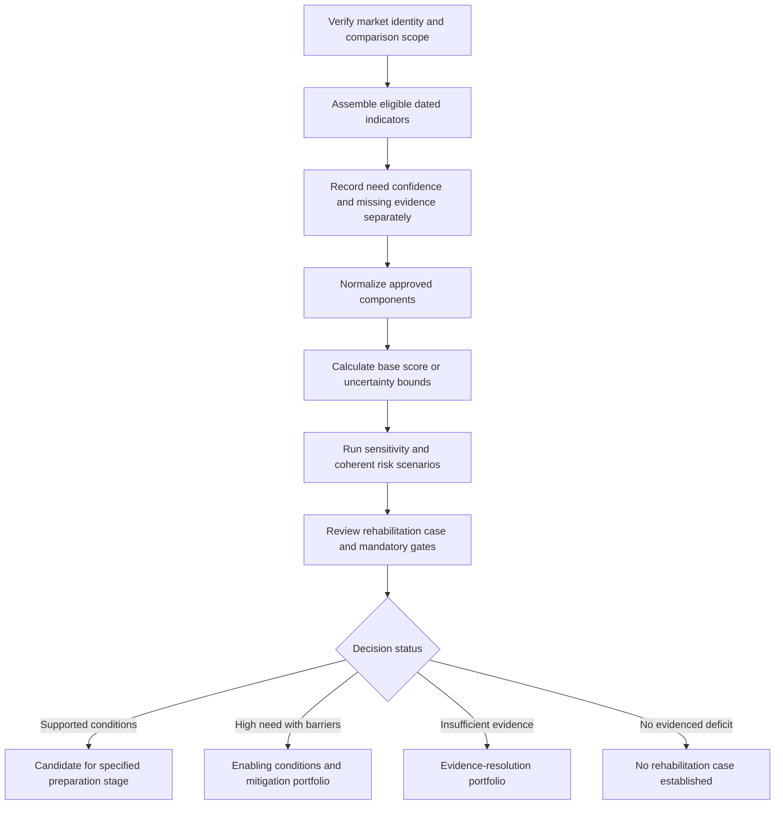

# Market Prioritisation and Ranking Framework for Khartoum Markets

## Framework Status

This document defines Deliverable E: a transparent, evidence-qualified framework for comparing market rehabilitation opportunities under secondary-data constraints. It specifies scores, weights, normalization, equations, worked examples, sensitivity, uncertainty, risk treatment, dashboard outputs, and implementation controls.

The framework retains the agreed base model in [scoring_model.json](scoring_model.json). Its anchors and thresholds are proposed analytical choices, not empirically calibrated Khartoum distributions or UNDP corporate standards. They require documented approval before actual results are ranked. The existing configuration and other deliverables remain unchanged.

All numerical market examples in this document and [Deliverable_E_Synthetic_Test_Cases.json](Deliverable_E_Synthetic_Test_Cases.json) are fictional. They are calculation and quality-assurance fixtures, not findings for named Khartoum markets. No actual market ranking, safety clearance, investment approval, or expected livelihood impact is asserted.

## 1. Decision Logic and Scope

### 1.1 Decision Supported

The model will identify where secondary evidence supports further rehabilitation preparation, which conditions limit implementation, and which comparisons remain uncertain. It will compare potential reach, physical accessibility, evidence-supported functionality, recorded conflict exposure, economic-system role, and documented rehabilitation feasibility.

The unit of comparison is a verified market, observation period, defined scenario, and model version. An entrance, shelter, east/west section, or proposed parcel is not automatically a separate competing market. Different intervention options at the same market should be compared in an options appraisal after the market-level screen, not counted as additional markets.

### 1.2 Four Distinct Judgments

| Judgment | Meaning | Required treatment |
|---|---|---|
| Recovery need | Documented deficit, exclusion, disruption, vulnerability, or livelihood constraint. | Retain a separate evidence-based narrative/category; high need does not imply immediate feasibility. |
| Conditional opportunity/readiness | Relative performance on the six-criterion model. | Report score/components only with eligibility, dates, assumptions, and uncertainty. |
| Evidence strength | What is documented, remotely observed, modelled, assumed, or unknown. | Keep confidence and completeness separate from performance; do not reward documentation intensity as if it were welfare. |
| Investment eligibility/decision | Whether a specific preparation or implementation stage has the necessary case, safeguards and approvals. | Apply independent conditions and program judgment; a high score is not authorization. |

The framework is not a measure of humanitarian worth, a representative market survey, a trader-grant selection mechanism, or a cost-benefit analysis. No conversion of MCDA points into money, jobs, income, safety probability or causal recovery impact is justified.

### 1.3 Decision Sequence



### 1.4 Rehabilitation Additionality

A large, accessible, functioning market can score well without having a justified construction need. Every proposed rehabilitation candidate must therefore identify an evidenced unmet constraint, the expected mechanism of improvement, a plausible utilization rationale, and alternatives including no-build/service options.

Conversely, a damaged or closed market may have high recovery need but a low readiness score. It must remain visible for enabling work, service support or future preparation rather than being described as a population of low priority. A closure result of zero in the functionality component is not a statement that recovery there is unimportant.

## 2. Scoring System and Indicator Hierarchy

### 2.1 Scale and Interpretation

All normalized components use a 0-100 scale. Higher values indicate stronger conditional opportunity/readiness on the stated criterion. Zero is a supported low-end score, not a missing value. Unknown values remain null with a reason; their uncertainty is handled through bounds.

The scale is cardinal for the approved aggregation but remains a constructed decision index. A score of 80 does not mean twice the welfare benefit of 40. An ordinal rubric mapped to 0/25/50/75/100 assumes equal increments for aggregation; that policy assumption must be acknowledged and tested rather than presented as a measured interval scale.

### 2.2 Six Criteria

| Criterion | Code | Weight | Raw evidence and indicator links | Positive interpretation |
|---|---|---|---|---|
| Potential population reach | P | 0.20 | Unique modelled residents within 60-minute walking reach; I10. | Greater potential resident reach among the modelled candidates. |
| Accessibility | A | 0.15 | Fixed-neighborhood reachable fraction and population-weighted walking time; I08/I09. | Lower travel burden and broader physically feasible reach. |
| Adapted market functionality | F | 0.20 | Availability, visible condition, documented operation and services; I13, I03/I04, I02, I06. | A supported operating/physical/service base for recovery. |
| Lower recorded conflict exposure | C | 0.15 | Precision-reviewed qualifying violent events and recency; I19. | Lower recorded recent exposure, not certified safety. |
| Economic significance | E | 0.15 | Documented hierarchy, network position, market functions; I28/I29/I42. | Potential wider system role, not measured turnover. |
| Rehabilitation feasibility | R | 0.15 | Land/permission, engineering preparation, O&M, environmental/social mitigation; I33-I36. | A more documented and viable preparation pathway. |

### 2.3 Hierarchical Components

Use the following fixed subweights:

$$F=0.30V+0.30I+0.25O+0.15U,$$

$$E=0.40H+0.30B+0.30D,$$

$$R=0.30L+0.25G+0.25M+0.20Z.$$

V is explicit basket availability; I visible physical readiness; O documented operation; U supporting services. H is documented hierarchy; B normalized graph betweenness; D documented functional diversity. L is land/permission preparation; G engineering preparation; M viable O&M; Z environmental/social mitigation feasibility.

The U service categories are water, sanitation/waste, electricity or a reliable alternative, and loading/storage. Each category has equal weight within U. Definitions of adequacy must be fixed for the relevant market type before scoring; one convenient service element must not stand in for all requirements of a category.

D contains four positively evidenced roles: retail, wholesale, producer aggregation, and onward distribution. Unknown role evidence is not a zero observation. If a credible source explicitly establishes that a role is absent in the relevant period, a supported zero can be recorded. Lack of a source remains unknown.

### 2.4 Twenty Elementary Components

Use elementary, or leaf, components for missingness and contribution accounting:

| Leaf ID | Component | Effective total weight |
|---|---|---|
| P | Potential resident reach | 0.20000 |
| A | Accessibility | 0.15000 |
| C | Inverse recorded exposure | 0.15000 |
| F_V | Availability | 0.06000 |
| F_I | Visible physical readiness | 0.06000 |
| F_O | Documented operation | 0.05000 |
| F_U_WATER | Water service | 0.00750 |
| F_U_SANITATION | Sanitation/waste service | 0.00750 |
| F_U_ENERGY | Power/reliable alternative | 0.00750 |
| F_U_LOADING | Loading/storage | 0.00750 |
| E_H | Documented hierarchy | 0.06000 |
| E_B | Network betweenness | 0.04500 |
| E_D_RETAIL | Retail role | 0.01125 |
| E_D_WHOLESALE | Wholesale role | 0.01125 |
| E_D_AGGREGATION | Producer-aggregation role | 0.01125 |
| E_D_DISTRIBUTION | Onward-distribution role | 0.01125 |
| R_L | Land/permission preparation | 0.04500 |
| R_G | Engineering preparation | 0.03750 |
| R_M | O&M viability | 0.03750 |
| R_Z | Environmental/social mitigation | 0.03000 |

These weights sum to one. The total U contribution is 0.03 and total D contribution is 0.045. Do not assign the full criterion weight to every subcomponent or count a partly observed U/D as fully covered.

### 2.5 Comparability Requirements

Market types need role-appropriate commodity baskets and service definitions. Food retail, wholesale, livestock and fish markets cannot be judged by identical raw commodity counts. Type-specific availability measures can be combined only under a declared construct such as adequacy relative to a predefined role-specific basket, with coverage differences visible and within-type results available.

Do not silently remove a criterion for one specialized market and rescale the others. A justified applicability change requires a model version, comparison-group definition and explanation of whether cross-group ranks remain defensible. Where equivalence cannot be established, use separate group comparisons and a common narrative need/readiness portfolio.

## 3. Weighting Methodology

### 3.1 Base Weight Rationale

The requested base weights are retained. Population reach and functionality each receive 20% to balance potential people reached and a viable base for restoration. Access, inverse recorded exposure, economic role, and feasibility each receive 15%, giving them equal secondary influence.

This is a declared program-policy choice, not a causal model estimated from observed Khartoum benefits. Neither the 20/15 split nor the subweights demonstrate donor consensus, community preference or empirically optimal allocation. In a secondary-only assessment, such agreement must not be manufactured through invented consultations.

### 3.2 Approval Process

1. Define the decision and eligible candidate set before reviewing score outcomes.
2. Review criterion meanings, endpoints, directions and overlaps using existing evidence and the program's authorized governance process.
3. Confirm that the proposed weights express the value placed on an improvement across each criterion's defined range, not simply how important its title sounds.
4. Record the approved weight vector, subweights, anchors, comparison groups, date and responsible approval role.
5. Freeze that configuration for the release; any revision produces a new model version and side-by-side results.

Program approval of decision preferences is governance, not new collection of market-condition evidence. It must not be used to solicit new trader estimates, current operating observations, or beneficiary preferences outside the secondary-only scope.

Swing-weight reasoning can be used to examine trade-offs across the defined endpoint ranges. Pairwise/AHP or other elicitation is not necessary to implement the agreed weights. If later adopted through an approved governance exercise, preserve the actual judgments and consistency checks; do not invent a pairwise matrix to give existing weights an appearance of empirical derivation.

### 3.3 Correlation and Double Counting

Potential reach and accessibility are related but use different constructs: P describes unique resident magnitude within 60 minutes, while A describes local burden/reachability within a fixed neighborhood. Network centrality may correlate with both. Functionality, visible damage and feasibility may also share causal influences.

Inspect contribution patterns and correlations where data permit, without treating a small purposive cohort as a robust statistical estimation sample. A high correlation is a diagnostic, not automatic grounds to change weights. Determine whether two components represent genuinely distinct decision consequences or duplicate the same evidence.

Do not insert accessibility again into F; do not use nightlights in both F and E; do not add a generic conflict-risk penalty after C without demonstrating a distinct residual effect. Scenario impacts may alter several criteria when they represent real separate pathways, but each pathway and its input must remain traceable.

## 4. Indicator Normalization

### 4.1 General Rules

Define $\operatorname{clip}(z)=\max(0,\min(1,z))$. For an increasing linear value function:

$$v(x)=100\operatorname{clip}\left(\frac{x-a}{b-a}\right),\quad b>a.$$

For a decreasing function, use $100[1-\operatorname{clip}((x-a)/(b-a))]$. These are general templates; the adopted P/A/C transforms below are more specific and must not be replaced by an arbitrary per-run minimum/maximum scaling.

Use fixed approved anchors rather than sample min-max normalization, which can change a market's score when an unrelated candidate is added. Reject negative populations, invalid fractions, malformed dates and invalid denominators before normalization. Clipping is for valid out-of-anchor observations, not for concealing bad data. Preserve raw values and saturation flags.

### 4.2 P: Potential Population Reach

Let $p_m$ be the uniquely allocated potential residents within 60-minute walking reach under the approved scenario:

$$P_m=100\operatorname{clip}\left(\frac{\ln(\max(p_m,1000)/1000)}{\ln(100000/1000)}\right).$$

| Raw value | Normalized value | Meaning |
|---|---|---|
| 0-1,000 valid modelled residents | 0 | At/below the proposed lower scaling anchor; not zero humanitarian need. |
| 10,000 | 50 | Midpoint on the declared logarithmic scale. |
| 100,000 or more | 100 | At/above upper anchor; retain the raw reach and saturation flag. |

The transform limits dominance by very large catchments. The 1,000/100,000 anchors are proposed assumptions. A missing location, invalid population denominator or unresolved allocation is missing, not $p=0$. Do not sum overlapping catchments to create $p_m$, and disclose omitted competing markets in a selected-cohort model.

### 4.3 A: Accessibility

Let $f_m$ be the proportion of modelled residents in a fixed 5 km terrestrial neighborhood with a valid feasible path, and $t_m$ the population-weighted median total walking time among reachable origins:

$$A_m=\begin{cases}0,&f_m<0.5,\\100f_m\operatorname{clip}\left((90-t_m)/75\right),&f_m\geq0.5.\end{cases}$$

The 15/90-minute anchors and 50% reachability threshold are proposed choices, not observed preferences or humanitarian access standards. OD routing must include first/last-mile cost exactly once and use an unrestricted local-reachability pass; a 60-minute cutoff cannot distinguish longer reachable paths from disconnection.

If no valid neighborhood population denominator exists, A is missing. If all relevant paths are conclusively disconnected, a supported $f=0$ yields A=0 and the raw median remains undefined. Material unlocated or connector-unresolved population requires resolution or bounded analysis rather than forced connection/disconnection.

The rule has an intentional discontinuity at $f=0.5$. Test cases close to this threshold: a small modelling change can produce a large score change. Report that sensitivity and do not quietly smooth the rule without a new approved model version.

### 4.4 F: Functionality Inputs

**Availability:** let $a$ be explicitly available eligible items, $o$ items with valid availability observations, and $b$ the predefined type-specific eligible basket:

$$V=100a/o,\qquad Q_b=o/b.$$

V is eligible for the proposed composite when $o>0$, $b>0$, counts are valid and $Q_b\geq0.8$. Missing price rows are not availability observations. Publish both V and $Q_b$; sufficient completeness does not prove the observed items are an unbiased sample.

**Visible physical readiness:** with qualifying damaged structures $d$, observable baseline structures $v$ and all identified baseline structures $n$:

$$I=100(1-d/v),\qquad Q_v=v/n.$$

Eligibility requires a valid appropriate-resolution baseline/pair and $Q_v\geq0.8$. This measures visible condition among interpretable baseline structures, not structural safety, service adequacy or a complete building census.

**Operation:** current applicable documentary open=100, partial=50, closed=0. Historical-only, disputed and unknown status are missing. "Partial" must retain a compatible definition, not an invented percentage of businesses operating.

**Supporting services:** each predefined service category is 100 if documented operating/adequate under the approved definition, 0 if explicitly non-operating/inadequate, and null if unknown. With all categories known, U is their arithmetic mean. With any category unknown, propagate leaf-level bounds rather than divide only by observed services.

### 4.5 C: Inverse Recorded Conflict Exposure

For eligible unique violent events within 5 km and 180 days, with age $a_e$ in days:

$$x_m=\sum_e2^{-a_e/90},\qquad C_m=100\left[1-\operatorname{clip}\left(\frac{\ln(1+x_m)}{\ln21}\right)\right].$$

Use the approved violence categories, adequate spatial/date precision, and source coverage. The half-life is 90 days; 20 weighted events is the provisional upper scaling anchor. Broad-place centroids or imprecise dates cannot be treated as exact without review. Retain exclusions and possible-inclusion uncertainty separately.

For an eligible dataset/window with zero qualifying records, C=100 means **no qualifying recorded events**, not safe. If coverage/access/precision is unsuitable, C is missing or bounded. Do not turn an inaccessible event export into zero exposure or convert recorded counts into attack probabilities.

### 4.6 E: Economic-System Significance

| Subcomponent | Normalization | Evidence condition |
|---|---|---|
| H: documented hierarchy | Neighborhood 25; district 50; locality-wide mixed/aggregation 75; documented metropolitan/regional wholesale or specialized node 100. | A specialist commodity alone does not establish regional role; historic hierarchy needs current/scenario relevance. |
| B: graph centrality | $100\operatorname{clip}(b_m/0.10)$ for declared normalized betweenness. | Freeze graph extent, directedness, cost/endpoint convention, components, parallel-edge handling and market-node match. |
| D: function diversity | $25\sum_{j=1}^4r_j$, with $r_j=1$ supported presence and $r_j=0$ supported absence. | Unknown roles propagate bounds; role count is not commodity count. |

The 0.10 centrality anchor is provisional and depends on a fixed graph definition. Review it before approval, not after seeing which market benefits. None of H/B/D measures observed turnover or supplier volume. Centrality cannot establish business operation.

### 4.7 R: Documentary Feasibility

Apply the following maturity rubric separately to L, G, M and Z, with evidence IDs and two-person adjudication for shortlisted cases:

| Score | Evidence requirement |
|---|---|
| 0 | A documented blocking condition without a currently viable lawful/technical/financial mitigation. |
| 25 | A major documented barrier; a possible remedy exists but viability is not demonstrated. |
| 50 | A documented feasible pathway/option with unresolved approvals, design, financing or other component requirements. |
| 75 | A supported practical option with an identified responsible owner and most component-specific preparation complete. |
| 100 | The relevant component's required documentary preparation/approvals are complete and current for the proposed scope. |
| Unknown | No adequate record, incompatible scope/date, unresolved contradiction or unavailable evidence. Store null, not 0/50. |

L requires valid land/permission evidence; G existing qualified technical/option/cost preparation; M a viable responsibility/funding arrangement; Z environmental/social mitigation feasibility including flood/drainage/waste/inclusion implications. A record scoring 100 is not universal safety certification. Gate requirements still apply to the specific intended stage.

## 5. MCDA Equations and Ranking Rules

### 5.1 Aggregation

For complete eligible criterion values:

$$S_m=0.20P_m+0.15A_m+0.20F_m+0.15C_m+0.15E_m+0.15R_m.$$

Equivalently, for the twenty leaves:

$$S_m=\sum_{k=1}^{20}w_ks_{mk},\qquad\sum_kw_k=1.$$

A leaf's point contribution is $c_{mk}=w_ks_{mk}$, measured in MCDA points. Contributions sum to S, but are not shares of actual economic benefit. Keep full precision in storage and calculations; use one decimal or appropriate bands in displays.

### 5.2 Bounds and Coverage

For each leaf define $[l_{mk},u_{mk}]$. An exact eligible value has $l=u=s$; an unknown leaf has the full score range $[0,100]$ solely for bounding. A supported uncertain value may have an appropriately justified narrower interval:

$$S_m^-=\sum_kw_kl_{mk},\qquad S_m^+=\sum_kw_ku_{mk}.$$

If the only uncertainty is missing leaves:

$$S_m^- = \sum_{k\in K_m}w_ks_{mk},\qquad S_m^+=S_m^-+100\sum_{k\notin K_m}w_k.$$

$$W_m=\sum_{k\in K_m}w_k.$$

$W_m$ is weighted eligible evidence coverage, not confidence. The possible score width due only to missing components is $100(1-W_m)$. Where uncertain known values also vary, the full width may be greater. Report bounds under their actual assumptions; no statistical confidence level is implied.

### 5.3 Coverage Classes

| Class | Requirement | Permitted comparison |
|---|---|---|
| Complete comparable | Every required leaf eligible; periods, definitions and type rules compatible. | Point score and analytical scenario rank, with confidence/sensitivity and separate gate status. |
| Provisional screening | At least 80% total covered weight; at least 50% within each criterion; at least 75% within F and R. | Bounds and evidence-gap discussion only; not a definitive point ranking. |
| Insufficient evidence | Any lower coverage or critical validity failure. | Need/evidence-resolution track; suppress point score/rank. |

Within-criterion coverage is the sum of its covered effective leaf weights divided by that criterion's total weight. An overall 85% can fail because one whole criterion is missing. Do not divide a partial weighted score by $W_m$, fill a midpoint, or multiply S by source confidence.

### 5.4 Order, Ties and Rank Stability

Rank only comparable, complete point results within a named candidate set, period, scenario and model version. Use unrounded values to calculate ranks; rounded displays may show indistinguishable differences that do not justify a substantive distinction. Do not use a hidden tie-break on market name, funding convenience or data richness. If an administrative display needs stable ordering for ties, label it as sorting, not a difference in priority.

For bounds, market a robustly outranks market b only if $S_a^->S_b^+$. Otherwise their ordering is not established by those bounds. A conservative rank range for market m is:

$$r_m^{best}=1+\#\{n\ne m:S_n^->S_m^+\},$$

$$r_m^{worst}=1+\#\{n\ne m:S_n^+>S_m^-\}.$$

These are conservative pairwise bounds under the represented intervals, not a guarantee that every intermediate or joint ordering is attainable when inputs are dependent. Report ties/indeterminate comparisons and avoid midpoint league tables. Scenario min/max ranks use actual complete comparable scenario results, not these interval formulas interchangeably.

### 5.5 Investment Gates

Keep five gate groups: verified identity/scope; authorized current security/access/explosive-remnant conditions; tenure/permission; technical/environmental-social conditions; and economic additionality/O&M. Each is pass, fail or unknown with applicable evidence, reviewer role, date and trigger for re-review.

Any fail/unknown prevents an **investment-ready rank**. Complete analytical scores may still be shown for understanding, explicitly labelled not investment-ready. Do not multiply a blocked market's S by zero and then call it lowest need. Identify the condition to resolve and the decision stage that cannot proceed.

## 6. Worked Example Calculations

All cases below are fictional and must remain excluded from real market layers and published findings.

### 6.1 Example A: From Raw Inputs to a Composite

Assume the following complete, eligible illustrative inputs:

| Variable | Fictional input | Calculation/result |
|---|---|---|
| Unique potential residents | 10,000 | P=50. |
| Local reachable share/time | $f=0.90$; $t=30$ minutes | $A=100(0.9)(90-30)/75=72$. |
| Availability | 8 available among 10 observed items in a 12-item basket | V=80; observed completeness 10/12=83.33%, above proposed threshold. |
| Visible condition | 17 qualifying damaged among 85 observable of 100 baseline structures | I=80; observable coverage 85%. |
| Documented operation | Partial | O=50. |
| Supporting services | Three operating; one explicitly non-operating | U=75. |
| Recorded events | Eligible ages 0, 90, 180 days | $x=1+0.5+0.25=1.75$; $C\approx66.7731$. |
| Hierarchy/centrality/roles | H=75; normalized betweenness 0.05; three supported roles and one supported absence | B=50; D=75; E=67.5. |
| Feasibility | L=75; G=50; M=75; Z=50 | R=63.75. |

$$F=0.30(80)+0.30(80)+0.25(50)+0.15(75)=71.75.$$

$$E=0.40(75)+0.30(50)+0.30(75)=67.50.$$

$$R=0.30(75)+0.25(50)+0.25(75)+0.20(50)=63.75.$$

$$S=0.20(50)+0.15(72)+0.20(71.75)+0.15(66.7731)+0.15(67.5)+0.15(63.75)\approx64.8535.$$

The displayed result is 64.9 MCDA points. It is not 64.9% recovery, probability of success or investment approval. Even this complete fictional calculation has unknown actual gate status; a point calculation does not make it investment-ready.

### 6.2 Example B: Criterion Contributions and Ordering

| Fictional case | P | A | F | C | E | R | Total |
|---|---|---|---|---|---|---|---|
| Example X | 80 | 60 | 50 | 70 | 90 | 40 | 65.0 |
| Example Y | 60 | 80 | 75 | 40 | 70 | 80 | 67.5 |

| Contribution | X | Y |
|---|---|---|
| Population | 16.0 | 12.0 |
| Accessibility | 9.0 | 12.0 |
| Functionality | 10.0 | 15.0 |
| Lower recorded exposure | 10.5 | 6.0 |
| Economic role | 13.5 | 10.5 |
| Feasibility | 6.0 | 12.0 |

Y scores 2.5 points above X under this complete base vector. X has higher potential population/economic role and inverse-exposure scores, but that does not outweigh Y's other strengths under the approved weights. This example demonstrates a trade-off, not an actual preference between Khartoum sites.

### 6.3 Example C: Missing an Entire Criterion

If X's R is unknown, the known weighted total is $65-0.15(40)=59$:

$$S_X\in[59,74],\qquad W_X=0.85.$$

The 85% overall coverage does not pass provisional screening because R has zero within-criterion coverage. Do not report 59 as an observed final score, 66.5 as a midpoint score, or $59/0.85$ as a renormalized score. The comparison with Y=67.5 is indeterminate under this interval and X has no point rank.

### 6.4 Example D: One Unknown Service Leaf

Return to Example A. Change its one explicitly non-operating service to **unknown**, keeping the other three documented operating. U is now bounded by 75-100, not an observed 75. F is bounded by 71.75-75.50. Because the missing service leaf has total weight 0.0075:

$$S_A\in[64.8535,65.6035],\qquad W_A=0.9925.$$

Within-F covered weight is $1-0.0075/0.20=0.9625$. All provisional thresholds are met, but any missing required leaf still prevents complete point ranking. Show a narrow interval and the service gap, not an unjustified midpoint. The width is 0.75 MCDA points; acquiring an eligible observation for this leaf can remove at most that missing-leaf width, not guarantee a better score.

### 6.5 Example E: Weight Sensitivity and Break-Even

For X/Y, vary only C's weight to $u$, rescaling all other weights proportionally from their original total of 0.85:

$$S_X(u)=54.5(1-u)/0.85+70u,$$

$$S_Y(u)=61.5(1-u)/0.85+40u.$$

| C weight | Change from base | X | Y | Ordering |
|---|---|---|---|---|
| 0.12 | Minus 20% relative | 64.8235 | 68.4706 | Y above X. |
| 0.15 | Base | 65.0000 | 67.5000 | Y above X. |
| 0.18 | Plus 20% relative | 65.1765 | 66.5294 | Y above X. |

Solving equality gives $u=7/32.5\approx0.2153846$. Above approximately 21.54% C weight, X would overtake Y for these fixed scores. This is a policy trade-off threshold, not a recommended change to the requested 15% base or evidence that conflict should dominate the decision.

### 6.6 Example F: Scenario-Based Risk Screening

The following are fictional complete score outcomes, not outputs from an actual Khartoum network rerun:

| Coherent scenario | X | Y |
|---|---|---|
| Reference | 65.0 | 67.5 |
| Wet-season disruption | 60.0 | 61.0 |
| Selected bridge restriction | 54.0 | 58.0 |
| Renewed disruption | 48.0 | 52.0 |

The worst-case opportunity index is 48 for X and 52 for Y within this declared set. Maximum score degradation from reference is 17 and 15.5 respectively. Those results are not annual expected losses or probabilities. Real scenario scores must be obtained by rerunning affected inputs and preserving evidence/gate conditions, not subtracting invented points from a real market.

## 7. Sensitivity Analysis

### 7.1 Purpose and Required Test Set

Sensitivity analysis asks whether the comparison depends strongly on choices that can reasonably vary. It does not repair unsuitable data or confer statistical representativeness.

| Test | Required variation | What must be recomputed |
|---|---|---|
| Weights | Each top-level weight plus/minus 20% relative; proportional adjustment of others. | Aggregate scores/contributions and eligible ranks. |
| Alternative policy views | Equal weights and explicitly approved reach/readiness-emphasis vectors. | Separate labelled comparison, never silent replacement of base. |
| Population | Defensible low/central/high cases and suitable alternative product. | Population allocation, P, relevant A denominator/weights and exposure. |
| Speed/access | Walking 2.5/4/5 km/h where appropriate; unknown-route assumptions. | Total OD costs, catchments, P/A and relevant network effects. |
| Network failure | Defined wet-season and crossing/corridor scenarios. | Graph/OD allocation and dependencies; do not simply cut the final score. |
| Conflict | 1/5/10 km; 90/180/365-day views; eligible precision assumptions and reporting caveats. | Raw exposure and the relevant approved transform/window variant. |
| Scaling anchors | Plausible plus/minus 20% anchor changes while maintaining valid ordering. | Score transforms; declare that a changed window also changes raw exposure, not just its anchor. |
| Structural model | Basket/type rules, observation completeness near thresholds, graph/node convention and candidate extent. | The affected raw/normalized components and comparison-group eligibility. |
| Feasibility rubric | Supported adjacent-level uncertainty where documents genuinely permit it. | R bounds or alternative adjudicated scenarios; never randomize unknown as measured. |

The lower/upper availability and visibility thresholds must also be tested where a site is close to 80%. A below-threshold indicator becoming missing can change the evidence class rather than merely reduce performance.

### 7.2 Weight Perturbation Equation

For criterion j with original weight $w_j$, set $w'_j=w_j(1+\delta)$ for relative $\delta=\pm0.20$. For every other criterion:

$$w'_k=w_k\frac{1-w'_j}{1-w_j},\qquad k\ne j.$$

Reject invalid values outside [0,1] and confirm the vector sums to one. Do not add or subtract 0.20 from the weight; that is a different and much larger policy change.

### 7.3 Reporting Robustness

For complete comparable scenario scores, report min/median/max score, rank range, shortlist/top-k appearance frequency where the candidate count permits it, and which assumptions changed the ordering. Rank-correlation statistics may supplement the analysis but should not hide changes in shortlist membership.

Denominators must identify the comparable scenarios included. A market excluded from a scenario by missing data or failed gates is not automatically bottom-ranked. Report availability/eligibility frequency separately and explain when a changing candidate set makes rank frequencies incomparable. Fix k before interpreting top-k frequencies and state the actual comparison universe.

### 7.4 Optional Probabilistic Sampling

Use Monte Carlo or other sampling only when distributions and dependencies can be justified as modelling assumptions or source uncertainty. Preserve the seed, number of draws, parameter distributions and correlation structure. Use at least 1,000 draws as an initial robustness design, then examine convergence of the reported frequency/rank summaries rather than imply that 1,000 is a universal adequacy guarantee.

Scenario frequencies are not probabilities of real success. Uniformly sampling a plausible range is a sensitivity assumption, not measured uncertainty. Do not independently draw a bridge condition, P, A and centrality when those quantities should all derive from the same graph realization. Unknown gate status remains unknown regardless of favorable draws.

## 8. Uncertainty Analysis

### 8.1 Uncertainty Register

| Type | Examples | Required treatment |
|---|---|---|
| Missingness | No valid availability record, clearance record, or service observation. | Explicit null/reason and bounding range; no undocumented imputation. |
| Measurement/reporting | Image interpretation disagreement, imprecise conflict geocodes, partial monitoring. | Supported intervals, excluded/possible records, source limitations and review. |
| Temporal | Mixed observation dates, stale operation reports, population movement. | Compatible periods, freshness alerts, historical labels and update triggers. |
| Spatial | Approximate market location, raster support, missing road links, locality mismatch. | Appropriate scale, location/connector scenarios and suppression where invalid. |
| Model structure | Nearest-market assignment, speed, graph extent, log transform, basket definition. | Coherent alternative models and sensitivity with clearly stated constructs. |
| Decision preference | Criterion/subcriterion weights and rank tie conventions. | Declared governance choices and alternative policy views. |
| Future conditions | Renewed conflict, floods, outages, demand/return changes. | Stress scenarios and conditional implementation, not invented forecasts. |

### 8.2 Quality Is Not a Score Discount

Use the assessment's provenance, spatial, temporal and methodological appraisal to classify observation confidence. Do not calculate $S\times Q$ as a purported corrected benefit score. That would systematically favor data-rich markets and could make the same market appear to improve merely because a report was published.

Where poor evidence makes a component invalid, mark it ineligible and widen bounds or retain historical context. Where evidence is eligible but uncertain, use a supported range and explain its source. Source confidence, score uncertainty and missingness coverage remain different fields.

### 8.3 Partial Observation Within an Eligible Indicator

An 80% completeness rule is a screening threshold, not proof of the unobserved remainder. In Example A, V=80 is availability **among 10 observed items**. For the different target of availability across all 12 basket items, the two unobserved items imply bounds:

$$V_{full}^- =100(8/12)=66.67,\qquad V_{full}^+=100(10/12)=83.33.$$

These are construct-specific bounds for the full basket. They must not be mixed into the base V definition without a declared alternative model. Similarly, Example A has visible readiness 80 among 85 observable structures, but readiness across all 100 baseline structures is bounded by 68-83 if the 15 unobservable structures are allowed either status. Observable readiness and full-inventory readiness are different targets.

These cases demonstrate why denominator/coverage must accompany apparently precise numbers. Optional sensitivity can use a conservative full-basket/full-inventory target, but changing targets requires explicit labelling and comparator consistency.

### 8.4 Propagation and Dependency

Monotone transforms allow endpoint propagation when the input interval and other arguments are fixed: for increasing $v$, use $[v(x^-),v(x^+)]$; for decreasing $v$, reverse the endpoints. For A with joint uncertainty in f and t, consider coherent joint cases, not impossible endpoint combinations. Threshold crossing can change eligibility discontinuously.

Simple weighted interval sums give valid conservative bounds when each interval is valid, but may be wider than attainable joint outcomes. Population allocation and network quantities are coupled across markets: assigning an origin to one market removes it from another in a unique-allocation model. Do not treat all P upper bounds as simultaneously attainable without checking a coherent scenario.

Distinguish source-provided statistical intervals from uncertainty bounds, scenario ranges and rank robustness. None of the latter automatically carries a 95% confidence interpretation.

### 8.5 Evidence-Resolution Priorities

An unknown leaf with weight $w_k$ can contribute at most $100w_k$ points of missingness width. Use this as a decision-relevance screen for seeking existing evidence, together with the cost/time and likelihood of finding a valid record. It is not an expected value of information or a guarantee of rank change.

Prioritize evidence that could resolve a mandatory gate or change an indeterminate decision. A small score-width service gap may be less decision-critical than an unknown tenure or clearance record even if the latter has no additional numerical penalty. Requests must concern existing records; this framework does not authorize new interviews or inspections.

## 9. Risk Adjustment Methodology

### 9.1 Default Approach

Use three ordered treatments:

1. **Non-compensable requirements:** independent gate pass/fail/unknown for the proposed stage.
2. **Risk represented in the base model:** C and relevant documented feasibility/operating inputs, with an explicit representation register.
3. **Coherent stress scenarios:** rerun affected graph, population/access, service and feasibility inputs; compare opportunity deterioration and alternative responses.

This is the recommended risk treatment. It preserves the agreed six weights and does not apply an arbitrary blanket haircut. Risk adjustment can change decision status and robustness without pretending that one number represents every hazard.

### 9.2 Risk Representation Register

| Risk/constraint | Base representation | Scenario/decision treatment | Double-counting control |
|---|---|---|---|
| Recorded recent violence | C with precision/coverage limits. | Current authorized access/clearance gate; coherent renewed-disruption case if justified. | No generic conflict penalty applied again to the same event count. |
| River flood/drainage | Z reflects mitigation preparation; hazard exposure remains explicit. | Flood-related access/service scenario and qualified technical/environmental requirements. | Do not treat exposure, assumed road failure and a second arbitrary flood haircut as independent losses. |
| Bridge/corridor dependency | P/A/B derive from reference graph; documented economic role/context. | Edge/crossing restriction reruns all affected inputs consistently. | Do not independently subtract final score points for the same lost connection. |
| Water/power/storage interruption | U and applicable O&M/mitigation evidence. | Explicit outage/service scenario where plausible and documented. | Differentiate current non-operation from a future additional event. |
| Tenure/permissions | L documents pathway maturity. | Independent lawful-permission gate. | Unknown tenure is not both a fabricated zero score and a numerical safety probability. |
| Maintenance funding/affordability | M and economic additionality evidence. | Option comparison and gate; no-build/service alternative. | No revenue inferred from residents or radiance. |
| Inclusion/protection/hazardous debris | Relevant existing evidence and Z where appropriately defined. | Independent specialist/implementation conditions; high-need visibility. | No safety or consent inference from low exposure or good design scores. |

The register should identify risk ID, source/period, affected criterion/pathway, scenario, gate/owner, overlap with other risks, unresolved information, mitigation and review trigger. An ordinal risk matrix can help organize discussion but is not a source of event probabilities or expected percentage loss.

### 9.3 Scenario-Based Risk Indices

For a declared comparable stress set $\mathcal S$ with eligible scores:

$$S_m^{robust}=\min_{s\in\mathcal S}S_{m,s},$$

$$\Delta_m^{max}=S_{m,ref}-\min_{s\in\mathcal S}S_{m,s}.$$

If the reference is included, degradation is nonnegative. Label $S^{robust}$ the worst-case opportunity index **within the selected scenarios**, not a universal worst case or probability-adjusted benefit. The result depends on the scenario set and should accompany, not replace, the base score and need/gate information.

For incomplete scenario inputs, report robust bounds $[\min_sS^-_{m,s},\min_sS^+_{m,s}]$ under the represented set and assumptions; do not produce a point risk-adjusted score. If a relevant scenario cannot be evaluated at all, disclose coverage and the untested condition. Do not drop the difficult scenario to improve robustness.

Where independently justified scenario probabilities exist, $\sum_sp_sS_{m,s}$ is a probability-weighted score under those assumptions, not an expected monetary benefit. Policy weights assigned to scenarios yield only a **policy-weighted scenario index**. Neither ACLED counts nor a single flood return-period map establish the joint scenario probabilities needed for an expected-score calculation.

### 9.4 Optional Incremental Residual-Risk Adjustment

Only if a decision-maker requires a separate residual-risk view, define an extension with its own model/scenario version. Document the additional risk consequence, evidence, units, uncertainty and why it is not already represented by C, R, F or the scenario inputs.

For a justified incremental proportional performance loss $\ell_m\in[0,1]$:

$$S_m^{residual}=S_m^{scenario}(1-\ell_m).$$

This is an additional decision value function on an MCDA index, not a calibrated physical/economic loss model. For fictional S=65 and a separately justified illustrative $\ell=0.10$, the extension yields 58.5. The 10% is not derived from Khartoum evidence and must not become a default parameter. The extension is **disabled in the base model**.

With valid nonnegative bounds, $S^{residual}$ lies within $[S^-(1-\ell^+),S^+(1-\ell^-)]$; dependency may make this conservative. Unknown $\ell$ is not zero. Multiple loss fractions cannot be summed or combined as independent probabilities without a justified joint/conditional model. Prefer explicit combined scenarios where risks interact.

Do not multiply by confidence or a gate pass probability. If additional consequences cannot be defensibly quantified, retain the risk narrative/mitigation condition instead. A separately labelled optional index cannot overwrite the approved base score.

### 9.5 Option and Portfolio Response

Use risk results to compare interventions: modular or staged works, service restoration, layout/access changes, storage/energy arrangements, or postponement pending clearance may perform differently under the same scenarios. This options appraisal requires actual scope, cost, utilization and O&M evidence; market-level S is not enough to optimize a budget.

Do not select a portfolio by summing overlapping reachable populations or assuming market benefits are independent. If later budget allocation is required, use explicit project costs, marginal reach/complementarity, geographic/inclusion considerations and safeguards. That would be a separate approved optimization/appraisal, not a hidden alteration to this ranking.

## 10. Dashboard Visualisations

### 10.1 Publication and Data Architecture

Precompute the approved base and scenario outputs in ArcGIS Pro or a validated processing environment. Publish cleared summary layers/tables for ArcGIS Dashboards or Experience Builder; retain long-form evidence and restricted records in appropriately controlled stores. StoryMaps can explain and embed/link these views but is not assumed to implement a custom live MCDA engine.

Filters must share market, period, scenario, candidate-set and method-version keys. A default state must select one approved scenario/version, not sum them. Hiding fields in a popup is not security: sensitive records and attributes must be excluded from the public service/export.

### 10.2 Required Views

| View ID | Visual | Fields/measure | Reader question and safeguards |
|---|---|---|---|
| EV01 | Conditional opportunity map | Verified market geometry; complete/provisional/insufficient status; eligible opportunity band; gate/need details. | Where are candidate opportunities and unresolved cases? No guessed points or low-score color for missing evidence. |
| EV02 | Contribution/ranking matrix | Six criterion contributions; point score only if complete; bounds; coverage; need; gate status. | Why does the model compare sites differently? Separate analytical and investment-ready comparisons. |
| EV03 | Interval/dumbbell chart | Score lower/upper and coherent scenario values. | Is an ordering established? Do not show a fabricated midpoint or call scenarios confidence intervals. |
| EV04 | Need-readiness portfolio | Evidence-supported need categories and preparation/gate status. | Which high-need sites require enabling actions? Unknown need remains a separate category. |
| EV05 | Component scorecard | Raw value; transform; normalized score; weight/contribution; source date; confidence and missingness. | What supports this score? Unknown radar axes are not filled at zero. |
| EV06 | Evidence coverage panel | Covered total/within-criterion weights; missing leaves; stale/conflicting inputs. | What prevents a comparable result? Confidence and coverage not combined into one score. |
| EV07 | Sensitivity/tornado view | Score/rank changes under approved parameter/weight tests. | Which assumptions matter? Changing candidate eligibility/set is visible. |
| EV08 | Risk/scenario comparison | Reference versus stress scores/bounds; max degradation; scenario coverage. | How does opportunity withstand disruption? No invented probabilities or safety labels. |
| EV09 | Gate and action register | Pass/fail/unknown; actual applicable record date; responsible role; required action. | What decision stage can proceed? No averaged gate percentage interpreted as authorization. |
| EV10 | Evidence/data-resolution table | Indicator, missing reason, maximum score-width contribution, gate relevance, permitted existing-source request. | Which evidence request is decision-relevant? Not a quantitative expected-value-of-information claim. |

### 10.3 Controls and Default Behavior

Provide market/locality/type, period, approved scenario, model version, evidence class, and decision-status selectors where supported. Display active units, dates and candidate universe. Exact widget availability and URL/deep-link behavior must be tested in the organization's actual platform.

Default sorting may show complete eligible cases by the selected analytical score and a separate unranked section for provisional/unknown cases. Do not move unknowns silently to the bottom as low need. A gate-failed market can retain an explanatory analytical score but no investment-ready rank.

Use clear empty states such as "Point ranking unavailable: required service evidence missing" or "Not investment-ready: tenure record unresolved." No observation should display as 0 merely because a chart widget lacks a null label. Use symbols/text as well as color, readable legends, keyboard/mobile alternatives and static summaries for blocked embeds.

### 10.4 Aggregation and Public Claims

Market count means distinct market IDs, not score rows or entrances. Population summaries use one coherent allocation/union; criteria contributions and MCDA points are not additive beneficiary numbers. Do not average market medians to obtain a state travel median, sum exposure counts across overlapping buffers, or average ordinal scores across unrelated market types without interpretation.

The dashboard footer must identify model version, observation/model windows, secondary-only design, uncertainty semantics, source/rights status and refresh owner. Restricted operational details must not appear through downloads, REST queries, chart tooltips or linked evidence files.

## 11. Implementation Guidance

### 11.1 Data Tables

| Table | Required fields/grain | Purpose |
|---|---|---|
| `market_registry` | Market ID, verified geometry status, type, scope and locality. | Preserve unresolved sites without fabricated coordinates. |
| `indicator_observations` | Market/indicator/period/scenario/version; raw value/unit/denominator; source; dates; evidence/confidence/missingness. | Authoritative supported inputs. |
| `normalization_rules` | Component ID, formula/rubric, direction, anchors, eligibility, method version. | Prevent per-market ad hoc scoring. |
| `component_scores` | Market/leaf/period/scenario/model; score or bounds; effective weight; eligibility; observation IDs. | Twenty-leaf contribution/coverage accounting. |
| `scenario_scores` | Market/period/scenario/model; P/A/F/C/E/R; total/bounds; coverage class; analytical rank eligibility. | Reproducible complete/provisional results. |
| `investment_gates` | Market/gate/version; pass/fail/unknown; evidence/date/owner; condition. | Separate non-compensable implementation conditions. |
| `risk_representation` | Risk ID, represented components, pathway, scenario, overlap, mitigation and applicability. | Prevent duplicate risk penalties and hidden extensions. |
| `rank_stability` | Market/comparable scenario set; score/rank range; scenario availability and eligibility; top-k definition. | Honest robustness reporting. |
| `decision_log` | Model/candidate version; overrides; approvals; restrictions; rationale and reviewer. | Distinguish model result from final program judgment. |

These are logical tables compatible with the typed geodatabase design in [Deliverable_B_GIS_Analysis_Framework_and_Workflow.md](Deliverable_B_GIS_Analysis_Framework_and_Workflow.md). Use one controlled physical mapping rather than creating duplicate contradictory stores.

### 11.2 Step-by-Step Calculation

1. Freeze market set, type rules, period, configuration and source versions. Validate IDs, joins, raw units, dates and geometry eligibility.
2. Validate raw inputs before transformation; reject invalid population/fraction/time values and incompatible baskets/periods.
3. Identify supported, uncertain, ineligible and unknown leaves. Preserve a reason for each; do not infer missing operation or services from mapped presence.
4. Normalize eligible P/A/C and the F/E/R subcomponents using the approved rules and full precision.
5. Expand services and documented functions into the twenty fixed-weight leaves. Calculate point contributions or lower/upper contributions and coverage.
6. Apply per-criterion/overall coverage rules. Create a point score only for complete comparable inputs; otherwise store bounds without midpoint/rank.
7. Produce the base analytical comparison. Apply need/additionality and independent gates for investment-stage status, not by zeroing the score.
8. Run coherent upstream stress scenarios and declared sensitivity sets; calculate only the eligible comparable summaries.
9. Review risk representation before any optional residual extension. Keep base, scenario, robust and residual fields/version labels separate.
10. Independently review shortlisted cases, contradictions, sensitivity and conditional recommendations; log overrides and required actions.
11. Publish cleared summary outputs and test widget aggregation/nulls/filters/permissions before use.

### 11.3 Spreadsheet Implementation

A controlled spreadsheet may prototype the calculations, but blank cells must not be allowed to behave silently as zero. Use explicit eligibility columns and missing reasons; guard logarithms, divisions and fractions. For a known nonnegative population in a named variable p, the conceptual P formula is `100*MAX(0,MIN(1,LN(MAX(p,1000)/1000)/LN(100)))`; execute it only after input eligibility is established.

Use `SUMPRODUCT` for known weighted contributions and separate lower/upper vectors for bounds. A blank required leaf needs 0/100 in the bound vectors and null in the observed score, not an empty cell passed into an ordinary total. Criteria coverage sums the correct effective weights, not the percentage of nonblank columns. Disable point-score/rank output if any required leaf is ineligible.

Separate raw inputs, evidence, configuration, leaf scores, scenarios and outputs into controlled sheets/tables. Protect formula/configuration areas, document version and validate imports. Do not use an available-row average or a spreadsheet error replacement such as `IFERROR(...,0)` as a missing-data policy.

### 11.4 ArcGIS Pro and Publication

Join observations on market ID plus period/scenario/model keys, not market ID alone. Use Calculate Field/Fields or a later validated script/model to apply transforms and flags. Inspect null semantics in the chosen expression engine rather than assuming spreadsheet/SQL/Python/Arcade behavior is identical. Do not run scoring on a one-to-many joined feature table that repeats population or contributions.

Aggregate long-form leaf records to one market-period-scenario-model result only after validating the grain. Store Double values and raw/normalized/bound fields separately. Use the existing JSON as the base parameter reference; any optional extension needs a distinct, approved configuration rather than modifying that file without authorization.

Create a sanitized denormalized output for dashboards. Attribute aliases, popups and symbology should explain conditional readiness, missingness and gates. Public file/service fields must exclude sensitive clearance/tenure/personal details even if an internal score references a controlled record ID.

### 11.5 Pseudocode

```text
for each market, period, scenario and model version:
    validate identity, comparison group and raw inputs
    obtain twenty leaf definitions and fixed effective weights
    for each leaf:
        if eligible and supported:
            normalize value or propagate a justified interval
            mark leaf covered
        else:
            leave observed score null
            use [0, 100] only for missing-score bounds
            record missing reason and mark leaf uncovered
    sum weighted lower and upper contributions
    calculate overall and within-criterion coverage
    classify complete, provisional or insufficient evidence
    emit point score/rank only for complete comparable inputs
    evaluate need, additionality and independent gate status
    determine permitted decision stage without zeroing blocked scores
    retain all inputs, assumptions, scenarios, review and lineage
```

## 12. Quality Assurance and Decision Governance

### 12.1 Required Calculation Tests

| Test | Expected behavior |
|---|---|
| Weights | Six top-level weights and all relevant subweights sum to one; twenty effective leaves sum to one. |
| Domains | Valid normalized values within 0-100; nonnegative populations/times; fractions within 0-1; no clipping of invalid raw data. |
| Direction | P increases with valid reach; A decreases with time at fixed f; C decreases with qualifying exposure. |
| Endpoints | P=0 at/below lower anchor and 100 at upper; C=100 at eligible zero exposure and 0 at/above upper anchor. |
| Thresholds | Availability/visibility eligibility and A's 0.5 discontinuity behave exactly as declared. |
| Hierarchy | Service/function unknowns reduce the correct leaf coverage; totals agree with hierarchical aggregation when complete. |
| Arithmetic | Example A approximately 64.8535; X=65; Y=67.5; missing R gives 59-74; one unknown service gives 0.75-point width. |
| Sensitivity | Perturbed weight vectors remain valid; X/Y example C-weight values and break-even match the worked equations. |
| Risk | Base unchanged; reference included for degradation; failed/unknown gates do not generate investment-ready ranks; optional residual extension not silently applied. |
| Publication | No synthetic case in real market layers; complete/provisional/gate labels correct; filters do not duplicate or sum alternative scenarios. |

### 12.2 Review and Overrides

The assessment lead and independent reviewer should examine all proposed shortlisted cases, influential assumptions, critical gaps, interpretation disputes, and risk/need implications. Overrides to an analytical ordering must state the actual program reason, such as a complementary connection, inclusion constraint, cost feasibility, or mandated preparation requirement, with approval. Do not alter source values or weights to make the override appear model-generated.

Use the synthetic fixture for arithmetic validation, not as evidence that the actual GIS pipeline, source quality, probabilities, market conditions or investment decisions have been validated. New data can change input eligibility as well as performance; explain both in a revision log.

### 12.3 Release and Refresh

Release a ranking only with its candidate set, comparison group, observation/model periods, methods/configuration version, raw-to-score traceability, evidence coverage/confidence, sensitivity, need and gate status. If no site has a defensible complete comparison, release the gap/preparation portfolio and method instead of a fabricated ranking.

Refresh on the approved schedule and after material population, access, service, conflict, flood, tenure or technical changes. Keep previous versions accessible to authorized reviewers. Changes in score due to data replacement, anchor revision or candidate set must not be described as real-world improvement without supporting evidence.

The framework is complete as a design. Actual Khartoum scoring still requires the source acquisition, geolocation, analytical processing, documentary records, independent review and institutional approvals specified in the assessment package.