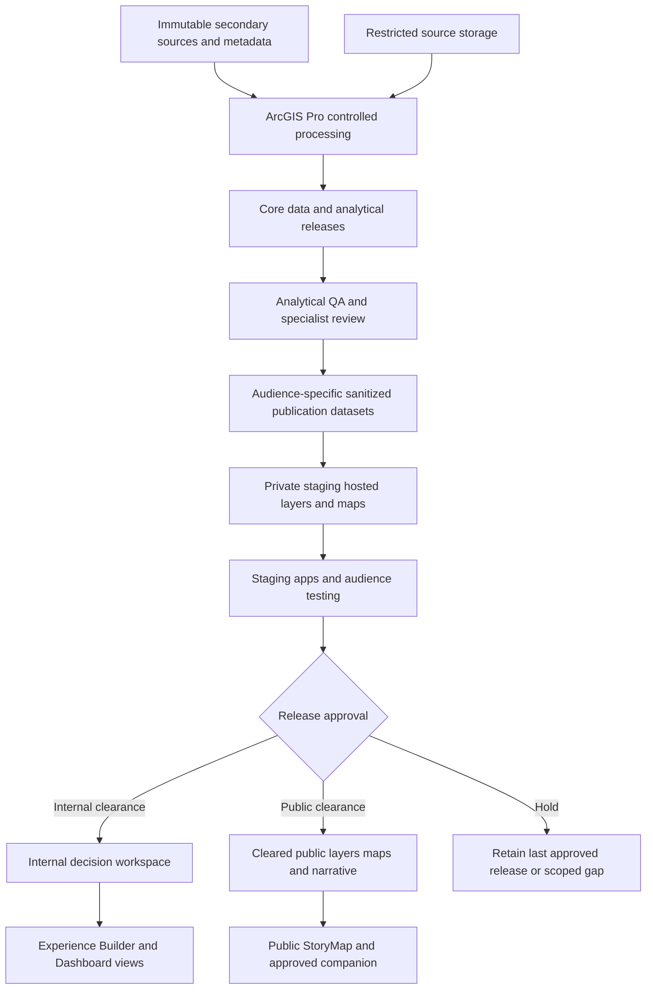
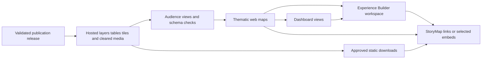
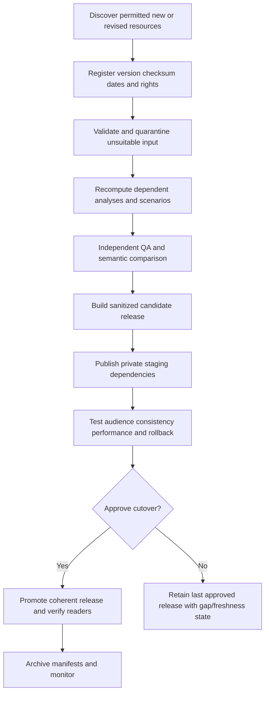

# ArcGIS Implementation and Deployment Guide

## Delivery Basis

This document defines Deliverable G: the implementation, publication, operation and deployment runbook for a UNDP Khartoum Markets decision-support platform using ArcGIS Pro, ArcGIS Online, ArcGIS Experience Builder, ArcGIS Dashboards and ArcGIS StoryMaps.

The platform will expose reviewed secondary-evidence findings, scenarios and conditional rehabilitation options. It must not imply a completed field survey, current universal coverage, safe routes, certified engineering, cleared land, approved works or achieved livelihood outcomes. Raw sources, analytical outputs, public summaries and communication assets will remain distinct.

This is detailed implementation guidance, not a deployed system. No organizational tenant, software entitlement, acquired analytical dataset, verified market geometry, hosting permission, ArcGIS item ID or production URL has been supplied or configured by drafting this runbook. All live acceptance tests in [Deliverable_G_Deployment_QA_Checklist.csv](Deliverable_G_Deployment_QA_Checklist.csv) begin as **not_run**. Structural document checks are not platform acceptance.

The guide implements the existing [GIS framework](Deliverable_B_GIS_Analysis_Framework_and_Workflow.md), [StoryMap storyboard](Deliverable_C_ArcGIS_StoryMap_Structure_and_Storyboard.md), [data inventory](Deliverable_D_Data_Inventory.csv), [prioritisation framework](Deliverable_E_Market_Prioritisation_and_Ranking_Framework.md) and [visual product register](Deliverable_F_Visual_Product_Register.csv). Those deliverables and [scoring_model.json](scoring_model.json) remain unchanged.

## 1. Operating Model and Governance

### 1.1 Product and Audience Model

Deliver one governed decision-support service with clearly separated audience tiers, rather than a collection of independently maintained maps. The intended components are:

- An ArcGIS Pro analytical project and controlled source/analysis stores.
- ArcGIS Online hosted publication datasets and thematic web maps.
- An internal decision workspace in Experience Builder with reviewed profile, access, risk and comparison views.
- Dashboard views for repeated monitoring/comparison tasks, integrated or linked where useful.
- A cleared public or restricted StoryMap according to actual institutional approval, supported by static accessible alternatives.

Public access is optional and requires affirmative clearance. A donor-facing audience is not automatically public, and organization-wide sharing is not equivalent to a small authorized project group. Where a dataset cannot be hosted in the approved environment, publish only an allowed derivative or omit it with a stated gap.

### 1.2 Responsibilities

| Role | Main responsibilities | Separation/control |
|---|---|---|
| Program/product owner | Approve intended decisions, audience, model-policy choices and final release. | Does not override missing technical/safety evidence by changing display labels. |
| Assessment/market lead | Approve interpretation, market comparability, livelihood constraints, conditional recommendations and evidence limits. | Review model output versus actual decision case. |
| GIS/data steward | Maintain schema, source manifests, analytical versions, QA and refresh dependencies. | Preserve source records and reproducibility. |
| Remote-sensing/technical reviewers | Review suitable imagery, observable condition and specialist limitations. | Desk interpretation is not structural/ordnance certification. |
| Protection/environmental/security/tenure specialists | Review relevant existing records, sensitivity and stage-specific requirements. | Unknown gate remains unknown without valid applicable evidence. |
| Platform administrator | Tenant policy, identities, access, licenses, budgets, monitoring and recovery permissions. | Administrative power is tightly limited and auditable. |
| Publisher/release manager | Build staged items, track dependencies, execute approved cutover/rollback. | No unreviewed direct production data changes. |
| Independent QA reviewer | Verify calculations, audience behavior, release consistency and acceptance evidence. | Should not approve only their own authoring or processing. |
| Operations/support owner | Monitor freshness, incidents, costs, backups, user support and handover continuity. | Named role and backup assigned before production. |

Roles may be combined in a small team, but critical data/interpretation/security sign-off requires an independent check. Names, escalation contacts and actual permissions will be populated by the organization; none are invented here.

### 1.3 Identity, Secrets and Approval

Use organizationally managed identities, SSO/MFA and least-privilege roles where supported by policy. Do not share a personal publisher account or embed passwords, API keys, refresh tokens or privileged URLs in a notebook, app, StoryMap, CSV, project package or document. A noninteractive automation identity, if permitted and licensed, requires controlled credential storage and rotation; it is not assumed to be available.

Technical error reporting and scope/document clarification are permitted administrative functions. A new feedback form asking traders or officials for current conditions would be primary collection and remains outside this secondary-only assessment unless separately authorized. Do not enable public editing or collection widgets for convenience.

## 2. Platform Architecture and Environments

### 2.1 Architecture



Restricted raw records are never automatically uploaded merely because ArcGIS Online supports hosting. Organizational data-residency, classification, sharing, procurement and provider-license requirements take precedence. An approved ArcGIS Enterprise deployment may be required for some information; it is a separate architecture decision, not a capability assumed within ArcGIS Online.

### 2.2 Development, Staging and Production

Use separate organizations/portals when organizational governance and entitlements permit. If one organization must host all stages, use explicit item naming, private folders/groups, separate datasets/items, least-privilege memberships and a deployment manifest. A folder is not a security boundary; groups and item sharing are audience controls, not isolation from tenant administrators.

| Environment | Data and access | Promotion rule |
|---|---|---|
| Development | Approved test/synthetic or permitted nonpublic working data, private to authorized builders. | No public sharing; synthetic fixtures cannot be promoted as observations. |
| Staging/UAT | Sanitized release candidate with production-like schema, permissions and dependencies. | Analytical, audience, performance and business acceptance required. |
| Production internal | Reviewed authorized analytical summaries for named groups/partners. | No broad org sharing unless expressly approved. |
| Production public | Cleared records/fields/geometries/media and approved narrative only. | Anonymous access and negative-access tests required before and after cutover. |

No public product may depend on an author-only service and be considered complete because it works in the author's browser. Conversely, making a story public must not cause restricted underlying content to be shared in response to a dependency prompt without separate approval.

### 2.3 Audience and Sharing Matrix

| Asset tier | Default storage/sharing | Editing/export rule |
|---|---|---|
| Raw restricted events, personal trader details, sensitive tenure/clearance | Approved access-controlled storage; no public hosting. | Authorized analysts only; retention/use governed by source and policy. |
| Authoritative working registry/evidence | Controlled data store and limited authoring access. | Managed edits with review; not a public source service. |
| Internal analytical publication | Private source/appropriate group views containing authorized fields only. | Read-only for decision users; exports reviewed, not assumed unrestricted. |
| Public analytical derivative | Physically sanitized dataset and/or correctly defined ordinary hosted view with approved geometry and records. | Read-only; no anonymous editing; readable records treated as retrievable. |
| Public static/image/download | Cleared derivative with dates, rights and evidence limits. | Inspect embedded metadata, hidden sheets, filenames and attachments as well as visible content. |

Disabling a user-interface export button is not a confidentiality control for publicly readable feature data. Public queries may still reveal records. Sensitive content must be excluded from the accessible data, not merely removed from a popup, chart or app page.

## 3. Geodatabase Structure and Publication Data Contract

### 3.1 Storage Layout

Retain the agreed separation:

```text
Khartoum_Market_GIS/
  00_governance/       approved schema, models, rights and release decisions
  01_raw/              immutable acquired assets and original metadata
  02_staging/          conversion and quarantine
  03_core/KHM_Core.gdb
  04_restricted/KHM_Restricted.gdb
  05_rasters/          native/analysis-ready raster assets and quality masks
  06_analysis/KHM_Analysis.gdb
  07_models/           controlled ModelBuilder toolbox and parameters
  08_review/           QA, adjudications, acceptance and test evidence
  09_publication/KHM_Publication.gdb
  10_releases/         immutable releases and item/dependency manifests
  Khartoum_Markets.aprx
```

This is a target design, not an assertion that those geodatabases exist. Enforce file/drive permissions separately; file geodatabases do not provide enterprise per-user security or branch versioning. Move to a suitable approved enterprise architecture if concurrent transactional editing or other enterprise requirements justify it.

### 3.2 Core and Analysis Objects

| Location | Main contents | Operating rule |
|---|---|---|
| Core `fd_reference` | Adopted state/locality boundaries, rivers and relevant baseline geography. | Fixed release/version and CRS; source labels preserved. |
| Core `fd_markets` | Adopted locations, footprints, entrances and verified sub-site/proposed objects. | Registry remains authoritative; unresolved markets stay nonspatial. |
| Core `fd_transport` | Reviewed road edges, connectors, relevant turn sources and network dataset. | Mode/grade restrictions and network-build version retained. |
| Core `fd_assets` | Deduplicated baseline buildings and permitted facility points/areas. | Physical presence separate from current operation. |
| Core `fd_origins` | Stable population reporting cells/parts and representative origins. | Modelled points are not household coordinates; population conserved. |
| Core root tables | Registry/aliases, sources/assets, indicators, observations, periods, scenarios and source bridges. | Nonspatial tables reside at geodatabase root, not inside feature datasets. |
| Restricted store | Authorized detailed event and other sensitive records. | No direct public dependency; controlled IDs may support cleared summaries. |
| Analysis store | Run/scenario OD, service areas, allocations, image interpretation, exposures, leaf scores, bounds, gates and QA. | Derived outputs reproducible; do not hand-edit a result to improve a rank. |

The full typed schema and relationships are specified in Deliverable B. Use stable business IDs plus managed GlobalIDs where relationships require them, populated child GUIDs, and validation of both. OBJECTID is not a stable cross-release key. Geodatabase copy/export behavior must preserve or explicitly remap relationships rather than assume automatic continuity.

### 3.3 Publication Objects

Do not upload the entire analytical geodatabase. Build intentionally small audience-specific publication datasets:

| Logical publication object | Grain | Intended clients |
|---|---|---|
| `pub_market_directory` | One approved identity record per market; geometry only for adopted locations. | Directory, locator, profiles. |
| `pub_market_profile` | Market/observation period/scenario/model/release. | D01 and profile widgets. |
| `pub_market_indicators` | Market/indicator/period/scenario/model/release. | Evidence and trend views; permitted sources only. |
| `pub_access_summary` | Market or approved union/geography/mode/scenario/period/release, explicitly distinguished. | D02/D03 and access charts. |
| `pub_access_geometry` | Market/mode/threshold/scenario/release envelope or approved route. | M03-M05 and scenario maps. |
| `pub_risk_summary` | Approved reporting area/window/hazard/scenario/release. | Cleared M07/M08 and D04. |
| `pub_recovery_summary` | Approved market/neighborhood/indicator/period/release. | D05 and recovery context. |
| `pub_mcda_summary` | Market/period/scenario/model/release. | M12 and comparison/gap views. |
| `pub_gate_actions` | Market/gate/review/release, sanitized text/roles only. | Conditional decision/next-action views. |
| `pub_options` | Approved conditional option/market/release. | M13 and intervention concepts. |
| `pub_release_status` | One record per release/audience with state and dates. | Freshness/version context and operational checks. |

These are logical names. The publisher must register their actual feature layer/table item IDs, sublayer/table IDs, schema and ownership. No specific hosted-service arrangement is assumed created.

### 3.4 Common Contract Fields

Include stable applicable keys, `release_id`, `schema_version`, `model_version`, `period_id`, `scenario_id`, `marketset_id`, `source_obs_start`, `source_obs_end`, `processed_at`, `published_at`, `evidence_type`, `confidence_class`, `coverage_class`, `missing_reason`, `review_status` and an approved provenance reference. Distinguish date-only observations from true UTC instants to avoid timezone-induced day changes.

A numeric zero remains a supported zero. Null plus reason means unavailable or ineligible; no serializer, table pivot, display expression or API update may silently replace it with zero. Preserve lower/upper score, covered weight, point-score eligibility, need and investment-gate status separately. Round only in display, not source calculations.

All derived objects referenced by an active app must belong to a coherent release or an explicitly supported mixed-history query. A shared `release_id` is an integrity check, not an automatic multi-service transaction or access control.

## 4. ArcGIS Pro Implementation

### 4.1 Environment Preparation

1. Record the actual installed Pro version, license level, extensions, approved processing environment and storage capacity.
2. Verify Network Analyst solving entitlement for local networks and the requirements for selected raster, topology, publishing and imagery tools. A layer-creation tool appearing in the interface does not demonstrate solving rights.
3. Use organizationally approved accounts, portal connection and certificates. Verify the destination organization explicitly before any publication.
4. Configure controlled folder/geodatabase connections, relative project paths where appropriate, scratch stores and protected raw data.
5. Set analysis CRS, transformation, units, extent, masks, snap raster and cell size per model; do not force all rasters onto a 10 m analytical grid.
6. Preserve parameter/run manifests, software versions, model hashes and source IDs. Automated Python/ArcPy workflows, if later written, must be tested in the actual licensed environment; this guide does not provide an executed automation pipeline.

Use suitable open/specialist tools only as approved alternative paths where required, such as SNAP for a qualified SLC workflow. Import results with original method/quality metadata; an alternative execution engine must not change the stated inference or bypass validation.

### 4.2 Build and Validate the Analytical Project

Create the schema, domains, relationships and indexes before loading authoritative records. Import the provisional CSV as a table; blank coordinates must not become 0/0 points. Only adopted verified geometry proceeds to location-dependent analysis.

Run the modular B01-B11 workflow from Deliverable B with stage gates. Specific risks include false river/grade connections, unreviewed snaps, double-counted connectors, skipped OD origins, nonconserved population, inappropriate damage resolution, coarse event geocodes in small buffers, and flood nodata treated as dry.

Use the approved MCDA rules and fixtures from Deliverable E. Retain all six requested weights, twenty-leaf missingness, bounds and independent gates. Do not generate real scores from synthetic fixtures or calculate a midpoint score for incomplete evidence.

### 4.3 Prepare Separate Authoring Maps

Maintain purpose-specific Pro maps for publication rather than sharing a complex analyst workspace containing scratch joins and restricted layers. Use a standard naming/metadata scheme such as `KHM_<product>_<audience>_<release>` as a proposal, not an existing institutional convention.

For each map/layer:

- Use only approved publication features/tables and explicitly selected fields.
- Resolve temporary joins, unsupported expressions and duplicate grains into tested physical summaries where appropriate.
- Set stable numeric sublayer/table IDs where supported and record them; layer order/ID changes can break consumers.
- Configure aliases, domains, null/unknown labels, units, time support, scale ranges, sensible extent and readable symbology.
- Keep full-resolution/raw analytical layers local or restricted; create appropriate generalized publication geometry without altering the source.
- Include approved metadata, source/observation dates, licensing, model/scenario and boundary disclaimer.

### 4.4 Publish Candidate Services

Choose the supported sharing operation for the actual destination, normally a hosted web feature layer for queryable vectors/tables, appropriate tile/vector tile products for heavy static context, and eligible imagery publication only where entitlements and rights permit.

Use Share As Web Layer or the supported publication path; verify organization, folder, audience, item naming, capabilities, editing/sync/export choices, source mapping and sublayer IDs. Run Analyze, resolve blocking errors, and document accepted warnings. Publish initially to a private staging audience, not Everyone.

An exported service definition or project package may contain source details, cached data or connection information. Review it before sharing and do not place secrets or restricted raw holdings in a public handover. Publishing success is only a transport test; inspect the actual hosted records, fields, geometry, nulls, units and query results against the local candidate.

## 5. ArcGIS Online Configuration

### 5.1 Organization and Ownership

The administrator must confirm approved tenant/data residency, organizational policies, hosting/publishing privileges, user types, authentication, partner access, cost/credit budgets and public-sharing permissions. These are prerequisites, not assumptions of entitlement.

Use durable institutional ownership and a documented backup owner/transfer process permitted by policy. Do not make production depend indefinitely on a departing consultant's personal account. A transfer of ownership must revalidate source/view relations, app references, automated refresh rights, sharing and credentials; it is not automatically transparent.

Use private authoring/review groups and named decision-user groups. Shared-update groups grant broad item-management powers and should not be used as ordinary viewer groups. Enable delete protection on production dependencies where supported; record group membership and periodic access review.

### 5.2 Source Layers and Ordinary Hosted Views

An ordinary hosted view can restrict included sublayers, records, area and exposed fields where supported. It has separate sharing/edit/export settings from its source, although some properties are inherited. Configure these deliberately rather than rely on assumed defaults.

Recommended patterns:

1. A private institutional source containing only data authorized for hosting.
2. A read-only internal view for the approved analytical audience.
3. A physically sanitized public source and/or ordinary read-only public view with a true record/field allowlist.

Never host prohibited raw information simply because a view could hide it. System/nonnullable fields and inherited settings may constrain what a view can exclude. If the required field restrictions cannot be enforced, publish a sanitized physical derivative instead. Inspect direct service responses as each audience, including anonymous access for public content.

### 5.3 Joined View Limitations

The official hosted-view documentation reviewed for this guide states that joined hosted views cannot edit, use offline maps, define filters/areas or restrict included fields in the same way, and constrain source schema changes and overwrites. Their one-to-many joins may duplicate features; one-to-one "first matching record" is not a substitute for an approved latest-period/scenario rule.

Accordingly, default dashboard publication to controlled precomputed summaries with explicit grain. Use a joined hosted view only after confirming current feature restrictions, source ownership, cardinality, permissions, refresh behavior and analytical meaning in staging. It is not the default public confidentiality boundary.

### 5.4 Metadata and Capability Settings

Complete item title, summary, description, tags/categories, owner/contact role, source dates, methodology/version, sensitivity/rights, attribution, extent, limitations and refresh owner. Distinguish service data-updated timestamps from observation dates; a recent upload does not make an old observation current.

Disable unnecessary editing, public collection, sync/offline and attachments. Controlled source editing may be required operationally, but decision-user views should be read-only. Export settings are separate on relevant items/views and cannot make public readable data confidential. Inspect fields, attachments, related records and downloadable source files, not only popup configuration.

## 6. Publishing Workflow and Dependency Management

### 6.1 Bottom-Up Publication



Publish dependencies before consumers and test the complete audience chain. Public datasets should already be sanitized before exposing any dependent app. A successful app preview is not evidence that the final reader can access every map, table, image and download.

### 6.2 Item and Dependency Manifest

For each actual item record: logical role/product ID, environment, audience, item ID, portal URL, service URL, sublayer/table IDs, source item IDs, owner, group IDs/sharing, schema version, fields/types, relationship keys, release/model/scenario/market-set IDs, observation range, published date, dependencies/consumers, source rights, approval, refresh owner, previous item/source and rollback reference.

Manifest URLs/IDs must be populated from actual items after publication. Do not invent 32-character item IDs or live links as placeholders. Track both item IDs and numeric sublayer IDs; a stable top-level item does not protect an application from changed sublayer structure.

### 6.3 Candidate Validation

Before promotion, compare local and hosted row counts, distinct business keys, spatial extent, sampled attribute values, nulls, units, score bounds and date representation. Query all needed pages/IDs rather than assume the first service response is the full dataset. Check related tables and field aliases/domains where used.

Revalidate maps, popups, renderers, layer IDs, actions, charts, URL parameters, public query/export behavior, and licensing/classification. Never treat a server-side filter in a widget as the only control preventing cross-release or restricted access; the publication source itself must be appropriate.

### 6.4 Update Mechanism Selection

| Mechanism | Suitable use | Required cautions |
|---|---|---|
| Append/upsert by stable business key | Compatible new/changed records under an approved service/API workflow. | Prove key uniqueness and idempotence; handle deletions explicitly; no duplicate scenarios or non-atomic refresh assumed. |
| Supported overwrite | Small compatible full replacement where source/publication path permits and downtime is accepted. | Validate schemas, source filenames/feature classes and ownership rules; dependent joined views/sync/settings may prevent it; hosted edits can be lost. |
| Ordinary-view source swap | Compatible staged replacement with retained view identity and documented rollback. | Must meet all actual source/view requirements; not joined views or a generic pointer swap. |
| New release items and consumer rebinding | Schema changes or an unsupported swap/overwrite path. | Rebind every dependency and test new IDs; preserve/redirect official entry point according to platform capability. |
| Cached layer/media rebuild | Static tiles, imagery derivatives and figures. | Invalidate/rebuild appropriate caches, preserve observation/version labels, and synchronize with app release. |

Do not assume source overwrite behavior from Pro is identical to item-page overwrite. The reviewed documentation warns that overwrites may remove hosted edits, require compatible filenames/schema, affect field/index settings and cause temporary unavailability. Recheck supported operations against the actual publication source, dependencies and current platform version.

### 6.5 Ordinary Hosted-View Source Swap

This is a supported option only after checking ownership, same spatial reference, matching sync settings, same sublayer count/order/IDs, same geometry types, and required fields with matching types. The reviewed guidance also excludes joined views, current offline use and dependent raster/vector tile layers. Verify the complete current requirement list and actual item state before proceeding.

Publish the compatible new source privately, validate it, and record old/new source IDs. Where the supported interface exposes the operation, use the hosted view's Update View/Swap source workflow, then verify the definition and every dependent consumer. Repeat with the old source for rollback only if it remains compatible and retained.

The operation may retain the view identity but does not make all other services, maps, caches or applications switch atomically. Do not create a dependent tile layer on a view and simultaneously assume that view remains eligible for source swapping. Maintain separate approved publication roles where needed.

### 6.6 Coherent Release Cutover

Choose one tested release pattern:

- **Parallel release:** publish a complete new candidate dependency graph, validate it, and switch the controlled official entry point or approved app configuration. Retain the old release for rollback.
- **Compatible stable views:** update validated compatible sources behind stable ordinary views within a coordinated maintenance/release procedure, with explicit version checks and rollback.
- **Controlled in-place refresh:** only for a proven compatible service/update path with a documented outage/partial-update policy and tested recovery.

ArcGIS Online does not provide an assumed atomic transaction across independent services and apps. Use a maintenance/frozen-release state when necessary; never allow a new population total to be combined silently with an old access graph or MCDA result. A UI banner alone does not enforce consistency: dependency configuration, data filtering/materialization and release validation must implement it.

## 7. ArcGIS Experience Builder Implementation

### 7.1 Workspace Structure

Use the organization-supported hosted Experience Builder where it meets the needs. Do not assume Developer Edition, custom hosting or custom widgets are licensed, approved or necessary.

Recommended pages/views are:

| Workspace area | Content | Main dependencies |
|---|---|---|
| Market Directory | Verified map, searchable directory, unresolved nonspatial list, selected profile. | M01/D01 and registry/profile summaries. |
| Access and Catchments | Potential resident reach, walking/freight burden and approved disruption scenarios. | M03-M05/D02/D03. |
| Risk and Recovery | Cleared recorded conflict, flood/environmental context, prices/services/activity evidence. | M07-M11/D04/D05. |
| Comparison and Preparation | Eligible scores/bounds, need, evidence coverage, gates, sensitivity and conditional options. | M12/M13 and shared IG/CH/VC/EV assets. |
| Evidence and Methods | Approved source/indicator metadata, dated methodology, limitations and cleared downloads. | Publication-safe metadata and actual release documents. |

The main story need not embed every view. Start with a useful default directory/context, not a marketing screen or an unfiltered grid of all scenarios.

### 7.2 Data Source and Selection Configuration

1. Add approved audience-specific web maps and hosted data sources; record the actual item/sublayer references.
2. Set an explicit default release, period, model, eligible market set and scenario. Ensure empty/null selection does not mean all mutually exclusive scenarios.
3. Bind list/table/profile/chart widgets to controlled data views with the correct grain; avoid independently querying different versions of the same logical dataset.
4. Use stable `market_id` and scenario/model/period keys for data actions and selection changes. Do not rely on OBJECTID surviving refresh.
5. Configure selection and filter messages only where the actual widgets/data source types support them; test every intended action.
6. Keep filter versus selection versus map extent semantics distinct. A selected feature is not automatically the full analytical denominator.
7. Reset incompatible downstream selections when a population/network/market-type scenario changes, and display the active context.
8. Provide neutral empty states with reason/date rather than zero-filled indicators.

Precompute approved scenarios by default. A live weight slider or custom recomputation tool is a separate development and validation scope; it must not silently overwrite official base scores. Use the existing model configuration and version labels.

### 7.3 URL and Cross-App Behavior

Where supported, use tested URL/state parameters to open a market or scenario from a StoryMap/profile. Treat URL input as untrusted: validate allowed IDs, resolve nonexistent/out-of-scope values to a safe default/not-found state, and never allow a query parameter to expose an otherwise unauthorized layer.

Do not assume filters propagate between Experience Builder and separately embedded Dashboards, or that browser state persists across apps. Either configure a supported explicit link/message mechanism and test it, or use static links and independent visibly selected context. Authentication and permissions remain enforced by the actual data sources, not by the link.

### 7.4 Responsive Design and Deployment

Use supported breakpoints and mobile-specific rearrangement so map, profile, selectors and legends remain readable. Test at least a narrow mobile viewport around 360 px and representative desktop/tablet sizes. Avoid scroll traps, off-screen legends and a map that consumes the entire mobile view without its analytical context.

Preview/save/publish and sharing controls must be verified in the deployed version. Treat draft, published app item and underlying data as separate states. Test the final published URL using intended reader accounts and anonymously where public; author preview is insufficient. New configuration changes must be republished where required by the actual authoring workflow.

## 8. ArcGIS Dashboards Implementation

### 8.1 Data and View Configuration

Implement D01-D05 from Deliverable F as separate dashboards or coherent app pages according to performance and user tasks. Reuse shared summary datasets and the approved definitions; do not create divergent dashboard formulas for the same metric.

| View | Data rule | Critical widget check |
|---|---|---|
| D01 Profiles | One selected market/period/scenario/model profile plus linked source evidence. | Distinct market counts; no entrance/observation inflation. |
| D02 Potential reach | Unique allocation/union or explicitly non-additive individual catchment. | No sum of overlaps, population products or alternative scenarios. |
| D03 Accessibility | Origin-weighted statistics and explicit unreachable/unresolved states. | No state median calculated as mean of market medians; connectors counted once. |
| D04 Recorded conflict | Distinct eligible event IDs within the selected union/window. | No overlap-buffer double counts or zero-records-equals-safe wording. |
| D05 Recovery context | Comparable item/grade/unit/currency/type prices and separate status/radiance support. | No mixed units, interpolated missing observations as measured, or GDP/job conversion. |

Use selectors, maps, indicators, lists/tables, charts and rich text only where supported. If an advanced matrix, interval plot, tornado chart or robust null presentation is not available natively, use an approved pre-rendered figure, supported app alternative or separately validated extension. Do not promise arbitrary chart behavior from Arcade alone.

### 8.2 Aggregation and Expressions

Precompute weighted medians, unique union totals, complex MCDA bounds and coherent risk summaries in the controlled analytical pipeline. Dashboard expressions should format or safely combine already defined metrics, not become an undocumented second analytical engine.

If Arcade data expressions or data formatting are used, verify their profile/context, functions, runtime support, result grain, null behavior, execution/load cost and access permissions. A formatting expression is not an edit to source data. Keep expression source/version and test inputs with the release manifest.

Default widget aggregates can be misleading: count may count rows rather than markets, sum may add scenarios, and average may blend unlike groups. Test each widget against approved expected values for at least one valid, partial, missing and filtered state.

### 8.3 Filters, Refresh and Sharing

Configure selector cascades and actions deliberately; each relevant widget must honor the same release/period/scenario/model context. Define what an unselected state means and prevent a clear/reset action from quietly aggregating every scenario. Show active units, denominator and observation window near the result.

A browser/dashboard refresh interval only re-queries current services; it does not acquire external data, rerun Pro, validate sources or republish analyses. Use sensible display refresh intervals consistent with actual release cadence, rather than minute-by-minute polling of monthly data. Distinguish last publication, last successful analytical refresh and observation dates.

Save/publish/share behavior depends on the deployed version. Test the actual released item and each dependency as reader/partner/anonymous audiences; no unauthorized editing, restricted fields or source file access may be granted to solve a broken embed.

## 9. ArcGIS StoryMaps Implementation

### 9.1 Authoring and Dependency Assembly

Use the nine-section structure and original reader-facing copy in Deliverable C. The public story should use only cleared, supported findings and a small set of useful views from Deliverable F, not all 67 specification records as simultaneous embeds.

Before assembly:

1. Confirm the title, audience, actual scope, analysis cutoff, heterogeneous source dates and approved names.
2. Approve the actual maps/figures/media/source links and static/text alternatives.
3. Ensure each embedded or linked app/map has a matching approved audience and actual valid URL.
4. Remove production notes, unresolved template fields and fictional scoring examples from reader-facing results.
5. Preserve evidence distinctions and conditional recommendations; no new finding is introduced by an image caption or closing summary.

Use supported cover, text, map, sidecar, image/gallery/swipe and embed/link options. Confirm actual organization/version capabilities. A swipe requires comparable dates/extents/rendering and clear scenario versus observed labeling; it is not proof of cause or current structural condition.

### 9.2 Publication Review

Review every change that requests broader sharing of dependent content. A public StoryMap may need publicly accessible approved maps/media, but restricted sources should be replaced with cleared derivatives or appropriate omitted/gap treatment, not automatically shared.

Check captions, alt text, rights, visible observation dates, approved Arabic/English names and boundary disclaimer. Do not copy uncleared reference photographs, quotations, source services or edit URLs. An image with an unknown date may illustrate place only; a generated documentary-style image is not evidence.

Treat saved draft and published narrative as distinct until verified. After supported publication/update steps, reopen the published reader URL in the intended access state and test the actual version, links, embeds and mobile layout. A preview or unpublished draft is not final deployment.

### 9.3 Public and Internal Variants

If internal and public content differ materially, use separately governed story/app variants with a shared approved source-of-truth narrative and explicit release mapping. Do not rely on invisible blocks, collapsible panels or a secret URL to protect sensitive content.

Provide a concise method/source appendix, contact role, publication/review dates and refresh ownership. Full technical documents linked from the workspace must first become approved hosted downloads with tested URLs; local file paths are not production web links.

## 10. Performance Optimisation

### 10.1 General Strategy

Optimize the specific bottleneck and preserve analytical meaning. A cohort of roughly fourteen unresolved/planned sites does not justify a heavy public raw-data system; the expensive inputs are raster stacks, building/road inventories, origin OD matrices, event detail and many concurrent embeds. Keep those analytical assets controlled and publish concise reviewed summaries.

| Component | Recommended optimization | Accuracy/behavior safeguard |
|---|---|---|
| Feature geometry | Scale-dependent drawing, appropriate generalization or supported multiscale optimization on publication copies. | Keep authoritative geometry; do not change catchment/exposure calculations from generalized display shapes. |
| Static context | Suitable tiles/vector tiles where supported and licensed. | No restricted attributes in tile payloads; do not assume a view can still source-swap with dependent tiles. |
| Filters/queries | Index actual query keys and request only needed fields/extent/statistics. | Validate index persistence after updates; pagination/transfer limits cannot truncate totals. |
| Application datasets | Preaggregate at valid market/period/scenario/model/release grain. | No lost denominators, merged periods, or default zero missing values. |
| Population/access | Publish summaries and suitable display zones, not the full raw OD matrix. | Unique union/allocation and complete status accounting retained. |
| Imagery | Use permitted optimized/tiled imagery or cleared static derivatives; limited scale ranges. | Native information support, date/quality and rights remain visible. |
| Charts | Server/controlled-pipeline summary tables and tested expressions. | Avoid querying many full layers for every widget/filter interaction. |
| StoryMaps | Few meaningful embeds; responsive imagery; static alternatives. | No analytical message available only inside a failed iframe. |
| Downloads | Cleared compact format appropriate to use; separate large technical archive. | Inspect hidden sheets/attachments/metadata and preserve version/source definitions. |
| Refresh | Coherent scheduled releases and sensible client polling. | A short polling interval is not a more current observation. |

### 10.2 Pro and Data-Processing Performance

Partition OD origins by stable IDs and retain a complete batch manifest; failed/skipped batches remain explicit. Use a network extent sufficient for valid detours and test boundary effects before trimming. Keep explicit all-destination and unrestricted passes required by the analysis; optimizing by nearest-one or short cutoff can change the question.

Use appropriate raster windows/tiling, quality masks and supported storage formats, document environments, and retain mass conservation. Parallel processing/memory settings should fit the actual workstation and tool support, not be set blindly to maximum. Avoid destructive in-place updates, repeated large conversions and unreviewed geometry densification.

### 10.3 Proposed Performance Acceptance Targets

Agree actual targets before UAT on representative devices/connectivity; the following are initial proposals, not measured performance or vendor guarantees:

| User task | Proposed target under agreed normal test conditions |
|---|---|
| Main app initial usable profile/map | At most 8 seconds for the agreed initial extent/data and reference network. |
| Common market/scenario filter completion | 95th percentile at most 3 seconds under the defined test sample/load. |
| StoryMap first meaningful content | At most 5 seconds on the reference network, with useful text available while optional embeds load. |
| Missing/failed optional embed | Clear static/text alternative; no loss of essential recommendation. |
| Supported mobile/keyboard task | Readable controls/legend and successful completion without overlap or inaccessible essential information. |

Record network, device, viewport, cold/warm cache, account/audience, concurrent-reader assumption and measured sample. Test a constrained-bandwidth scenario separately and report results rather than silently relaxing targets. Cost/storage/query telemetry should inform optimization and scale decisions; no production traffic or load test is authorized until an actual environment and plan are approved.

## 11. Data Refresh Strategy

### 11.1 Distinguish Four Clocks

Track provider updates, observation dates, analytical recomputation and published-release/client reload separately. A dashboard can refresh successfully while the source observation is stale. A provider may revise historic records without adding new observation dates, which can still require recomputation.

### 11.2 Proposed Review Cadence and Triggers

| Data/output family | Proposed review/release pattern | Additional trigger/dependency |
|---|---|---|
| Identity/boundaries | At inception and authorized version changes. | Market-name/location/locality correction reruns affected joins and routing. |
| Road/bridge/status context | Review weekly where valid existing sources permit; release after QA. | Major access/bridge event reruns topology/OD/access and dependent P/A/E/risk outputs. |
| Population/movement | Each compatible relevant provider release. | Definition/geography/total change requires reconciliation, not simple addition of returns. |
| Prices/availability/operation | Monthly or actual existing-monitoring cadence. | Source revision/unit/type/status change affects comparability and functionality. |
| Imagery/physical condition | Monthly/quarterly or when suitable observations arrive. | Major damage/flood or qualified new product; no promise of clear usable coverage. |
| Conflict/disruption | Review weekly and after material events where authorized data permit. | Revisions and precision changes can alter historic counts; no live safety advice. |
| Flood/climate/environment | Provider/product/event-specific. | Major flood, new hazard version, rainfall-product transition or quality correction. |
| Finance/services | Applicable existing status/product changes. | Operation/fees/liquidity reporting is date-specific, not POI update frequency. |
| Tenure/engineering/gates/O&M | Record validity and event/change-driven review. | Expiry, scope change, unresolved dispute or new requirement invalidates affected stage status. |
| MCDA and platform release | Quarterly review or material input/method change. | Recompute affected inputs and comparable scenarios, not only repaint the ranking. |

These are proposed team review cadences, not claims about guaranteed provider delivery. When data are not refreshed, retain the last successful observation date and stale/gap status; do not reset freshness by republishing the same values.

### 11.3 Refresh Pipeline



### 11.4 Idempotence, Deletions and Failure

The same input/version processed twice should produce the same keys/counts/values within declared numerical tolerances. Upserts must match stable composite business keys, not new OBJECTIDs. Record deletions/corrections and remove superseded candidate rows deliberately; append-only loading can duplicate history and inflate statistics.

Prevent overlapping refresh jobs through a documented lock/status mechanism on the controlled runner. Use bounded retries/backoff for transient service/rate-limit failures, preserve logs and avoid repeated publication attempts that create orphan duplicates. Never schedule an unvalidated automation job with a privileged account merely to meet an advertised cadence.

Failure leaves the last approved release visible where it remains safe/authorized, with an accurate freshness note; urgent sensitivity/rights failure may require unsharing or withdrawal instead. Alert the responsible roles. Do not publish partially recomputed components, zero-filled errors or a falsely current completion timestamp.

### 11.5 Dependency Recalculation

A source change can propagate through more than one product. Population changes affect allocation/reach and weighted burden; network changes affect P/A and possibly centrality/corridor exposure; function/service observations affect F and interpretation; clearance/tenure records affect gates independently of score. A source rights change can require withdrawal even without a numeric change.

Store and evaluate this dependency graph in the run/release manifest. Recompute the appropriate coupled scenarios rather than independently perturbing already derived values. Preserve fixed model anchors/candidate sets within a release; a policy/model revision is not ordinary observation refresh.

## 12. QA/QC Procedures

### 12.1 Four Acceptance Layers

1. **Data and analytical QC:** provenance, geometry, units, dates, denominators, topology, masks, uncertainty, component/rank logic and independent interpretation.
2. **Publication QC:** fields/records/relationships/metadata, audience access, schema/source compatibility and coherent release identity.
3. **Application QC:** actual filters/actions/aggregations, null/empty states, links, mobile/keyboard/contrast, embeds and performance.
4. **Decision/editorial acceptance:** findings support, need/readiness/safeguards, approved scope/rights and accountable recommendations.

No layer substitutes for another. Arithmetic tests do not validate actual Khartoum conditions; a successful service query does not validate analytical denominators; an author-visible map does not prove public access; a high score does not validate clearance.

### 12.2 Mandatory Test Register

The checklist contains **40 specified tests**, GQA01-GQA40, with phase, responsible role, method, expected result, severity and evidence to retain. All are not_run until the real implementation is tested. Blocker failures prevent release; high issues require correction or an explicit documented restriction that removes the affected capability before approval.

| Test group | IDs | Scope |
|---|---|---|
| Data/analysis | GQA01-GQA12 | Schema, CRS, network, connectors, population, prices, imagery, events, floods, scoring, eligibility and lineage. |
| Publication/access | GQA13-GQA20 | Allowlist, anonymous/internal negative access, editing, export, relationships, source swap and dependencies. |
| Application/editorial | GQA21-GQA30 | Experience filters/URLs, D02-D05 aggregation, unknown score states, StoryMap media/embeds and accessibility. |
| Performance/cost | GQA31-GQA34 | Initial load, filter latency, scale/payload and credit/storage policy. |
| Refresh/recovery/handover | GQA35-GQA40 | Idempotence, failures/freshness, release consistency, rollback, ownership/backup and business acceptance. |

### 12.3 Audience Test Matrix

Use clean sessions for owner, authorized internal viewer, partner viewer if applicable, unauthorized signed-in user and anonymous reader. Verify what each **must** see and what each **must not** see at the app, map, view, source service, attachment and download levels.

Public tests include direct service metadata/query responses, field lists, related records and allowed exports, not just rendered app pages. Negative tests must use an actually unauthorized identity; the owner/admin cannot test least-privilege visibility by hiding controls in their browser. Do not expose production secrets in test captures or logs.

### 12.4 Analytical Reference Cases

Use the existing synthetic score fixtures only in development/testing. Complete vectors must yield 65.0 and 67.5; missing R in the first case yields 59-74 and 0.85 coverage without renormalization; a required unknown leaf prevents a complete point rank. Gate unknown/fail prevents investment-ready status without zeroing need or supported analytical values.

Network tests include same-side paths, no false river crossing, grade-separated intersections, mode restrictions, disconnection, over-60-minute reachable paths, multiple entrances and unresolved origin connectors. Population tests close assigned plus unallocated totals. Keep these cases separate from the real market universe and remove synthetic records from every production source/derivative.

### 12.5 Test Evidence and Defect Closure

Record test ID, actual environment/item/release, timestamp, identity/audience, actual result, expected result, evidence reference, severity, issue owner, remediation/retest and approval. A pass requires observed evidence, not a checked box in a planning CSV. Automated test logs require review and do not authorize a release by themselves.

## 13. Final Deployment Workflow

### 13.1 Go-Live Preconditions

Before deployment, confirm actual platform entitlements and audience approval; resolved analysis scope or explicit exclusions; acquired suitable data/rights; approved model and evidence; named ownership/support; staging acceptance; tested recovery; and a defined public/internal release decision. A methodology-only platform can be released only when explicitly labelled and approved, without fake result widgets.

### 13.2 Release Runbook

| Step | Action | Acceptance/hold point |
|---|---|---|
| DEP01 | Freeze release scope, data/model/schema/candidate versions and audiences. | No unresolved ambiguity about what this release represents. |
| DEP02 | Archive source manifests, analytical outputs, Pro project/models and prior production dependencies. | Backup readable and restore approach tested. |
| DEP03 | Complete analytical/specialist/editorial/rights reviews and resolve blocker issues. | Unsupported findings or missing permissions excluded or release held. |
| DEP04 | Build sanitized publication release with stable grains, keys and release fields. | No raw restricted records, personal fields or synthetic results. |
| DEP05 | Publish candidate layers/tables/tiles/media privately and register actual IDs. | Hosted/local schema, values and counts reconcile. |
| DEP06 | Configure audience views/web maps and record every dependency. | Allowlist and negative-access tests pass. |
| DEP07 | Bind staged Experience Builder, Dashboards and StoryMap to the candidate graph. | No unreviewed old/new mix or unsupported cross-app assumptions. |
| DEP08 | Execute GQA tests and intended-audience UAT, including mobile/low-bandwidth and invalid states. | Measured results accepted; no not_run test treated as pass. |
| DEP09 | Rehearse cutover and rollback using the actual supported update mechanism. | Old release/source and configuration recovery verified. |
| DEP10 | Obtain role-based go/no-go approval and agree maintenance/notification window. | Authority and conditions recorded; no automatic approval by model score. |
| DEP11 | Promote in dependency order or switch the approved coherent graph/stable views. | Appropriate sharing applied only to already cleared items. |
| DEP12 | Reopen final reader URLs as each required audience; verify release IDs, totals, dates and restrictions. | Failed security/consistency check triggers hold or rollback. |
| DEP13 | Publish approved entry links and provide operational orientation to responsible users. | No fake URLs, local-path downloads or unpublished drafts. |
| DEP14 | Archive final item/dependency/configuration manifest, approvals and monitoring baseline. | Named owner/backup, refresh plan and support escalation active. |

### 13.3 Cutover Verification

Check the entire reader path: official entry -> StoryMap/app -> maps/views -> services/tables/media/downloads. Confirm the default market/period/scenario/model/release state, displayed numbers and point/bound/gate semantics. Test browser caches and existing bookmarks where relevant. Refreshing an already open browser is not proof every user has a coherent updated dependency graph.

Keep the previous approved release/source and configurations for the institutionally agreed retention period. Do not delete the old source immediately after a view swap or new publication. Retaining source datasets alone is insufficient if maps/app configurations, domains, indexes or sharing have changed.

## 14. Operations, Backup and Incident Recovery

### 14.1 Monitoring

Monitor service/item availability, broken dependencies, unauthorized sharing changes, edit capability, refresh job failures, data-age/status drift, expected versus actual release IDs, query/record completeness, reader errors, performance and credit/storage usage. Provider metadata changes, source withdrawals and sensitive-content incidents require attention even when the app is technically online.

An uptime check should test a meaningful permitted query and expected release/value shape, not only HTTP success. Do not log personal records, tokens or restricted payloads into a broadly shared monitoring dashboard. Set alert thresholds with actual baseline usage; no traffic or storage baseline is assumed here.

### 14.2 Backup Contents and Restore Tests

Retain approved raw-source manifests/rights, permitted source files, geodatabases/raster derivatives, Pro project/toolbox/parameters, model/schema configurations, analytical result tables, media/alt text, item metadata, app/map/dashboard/story configuration backups where supported, service/sublayer/view definitions, group/sharing/ownership references, and release/dependency/approval records.

An exported feature dataset is not a full app backup. A saved item JSON is not by itself a complete restore of hosted data, attachments, media, credentials, permissions or application behavior. Use supported backup/clone/export workflows and test limitations in the actual environment; cloning must remap dependencies and preserve rights rather than blindly copy restricted content.

### 14.3 Recovery Objectives

Agree recovery time objective and recovery point objective with the institutional service owner. A starting planning proposal is restoration of the last approved read-only release within one business day and no loss of an approved release package, subject to actual capabilities and policy. These are proposed objectives, not measured guarantees or substitutes for an actual restore drill.

Offline printable outputs may provide temporary decision continuity only within their date/scope/rights limitations. They are not an offline safe-route or live market-status service.

### 14.4 Incident Procedure

1. Identify whether the issue is availability, analytical correctness, release inconsistency, confidentiality, rights or obsolete safety/condition interpretation.
2. Contain it: freeze refresh/cutover; remove affected public access when necessary; do not keep a disclosure live merely to preserve uptime.
3. Preserve permitted logs/manifest evidence and notify the responsible institutional roles under actual incident policy.
4. Restore the last compatible approved release/source/configuration where safe and authorized, or publish a scoped unavailable/gap state.
5. Re-run affected QA and audience tests; document root cause, corrections, user notification and re-approval before reopening.

Rollback is a controlled restoration of dependencies/data/configuration and permissions, not deleting or resetting arbitrary items. A source change may require cache/map/app correction as well as data restoration. Revoke/rotate compromised credentials through approved administrative channels; never place them in support messages or the assessment files.

## 15. Handover and Acceptance Package

### 15.1 Required Handover

Deliver the controlled analytical/metadata stores appropriate to acquired data; Pro project and models; schema/domain/relationship definitions; source/resource and rights manifests; parameter/model/scenario versions; actual item/dependency inventory; sanitized publication datasets; web maps/apps/dashboard/story items and approved URLs; media/licenses/alt text; QA/UAT/performance evidence; release/cutover/rollback log; operations/refresh/backup procedures; cost/entitlement assumptions; and support ownership/transfer documentation.

Include a role-based walkthrough: analysts refresh/validate; publishers stage/promote; decision users distinguish need/readiness/uncertainty; administrators verify access/costs/recovery. Training does not authorize users to reinterpret model outputs as safe access or works approvals.

### 15.2 Acceptance Decision

The product owner accepts the **actual implemented release and its restrictions**, not this guide's existence. Identify any intentionally deferred capability, remaining evidence gap, unsupported public component or unperformed acceptance test. A partial methodology/evidence-gap platform can be valid if its scope is explicit; it must not be handed over as a fully populated completed market assessment.

The 40-test checklist is an initial specification. Additional tests may be required by organizational security/data policy, provider license or actual custom development. Do not mark the test status pass solely because document structure, CSV parsing or synthetic arithmetic checks succeeded.

## 16. Technical Reference and Verification Notes

Official ArcGIS Online pages successfully reviewed on 27 October 2026 for this guide include:

- [Create hosted views](https://doc.arcgis.com/en/arcgis-online/manage-data/create-hosted-views.htm): field/record definitions, separate settings and joined-view limitations.
- [Manage hosted feature layers](https://doc.arcgis.com/en/arcgis-online/manage-data/manage-hosted-feature-layers.htm): schema/data update distinctions, editing/export/index/optimization operations.
- [Swap a hosted view source](https://doc.arcgis.com/en/arcgis-online/manage-data/swap-view-source.htm): explicit compatibility requirements and reverting to a retained previous source.
- [Overwrite a hosted feature layer](https://doc.arcgis.com/en/arcgis-online/manage-data/overwrite-hosted-feature-layer.htm): publication-path constraints, schema/source compatibility, hosted-edit/settings risks and temporary unavailability.

Attempted retrieval of the selected Experience Builder, Dashboards and StoryMaps publication pages did not yield usable content, including a StoryMaps documentation redirect. Their specific button labels, widget capabilities and draft/publish behavior are therefore deliberately subject to installed/deployed-version verification, not represented as fully checked here. General dependency/access/release requirements still apply.

No real tenant, credentials, licenses, services, apps, performance, data refresh, audience permissions, source swap or rollback was tested in producing this runbook. It is complete as implementation guidance; platform execution and institutional acceptance remain subsequent authorized work.