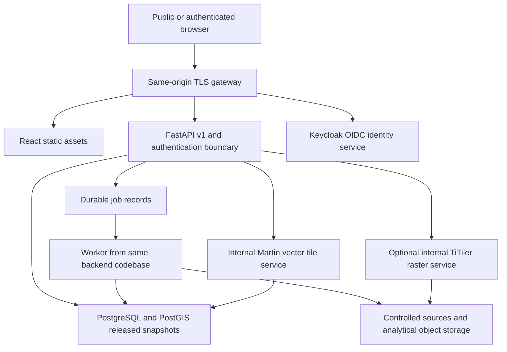

# B. Technical Architecture

## 1. Architecture Decision

Use a **modular monolith** for domain logic with three independently deployable workloads: API, analytical worker and tile/raster services. Split a domain into its own microservice only after measured scaling, isolation or organizational requirements justify the distributed transactions and operational cost.

Required application stack: React, TypeScript, Tailwind CSS, D3.js, MapLibre GL JS, Deck.gl and Framer Motion; FastAPI; PostgreSQL/PostGIS; GeoJSON and vector tiles; Docker deployment on approved Azure or UNDP infrastructure. No ArcGIS service, proprietary map access token or paid chart library is required.



The browser never directly reaches a database, restricted analytical files, worker queue, unrestricted tile-server catalogue or arbitrary raster URL. Tile services are private network workloads exposed only through approved release-aware routes.

## 2. Frontend Architecture

Use Vite/React with React Router for routes, TanStack Query for server-state caching, URL search parameters for shareable analytical state, and a small state store only for transient UI such as panel expansion. Validate API responses against generated TypeScript contracts and runtime schemas at trust boundaries. Pin compatible library versions and lockfiles after an integration spike; do not assume any latest-version combination is compatible.

React owns component lifecycle, focus and DOM structure. D3 calculates scales/layouts/shapes within React-owned SVG or an explicitly owned isolated drawing group. MapLibre owns the base map. Deck.gl uses a tested interleaved overlay integration for compatible versions; it does not create an uncontrolled second synchronized camera. Choose one event/selection owner and resolve picking between map/deck layers.

Feature areas: overview, explorer, profiles, risk, prioritisation, recommendations, report, evidence, restricted review and authentication. Shared packages contain design tokens, locale strings, API types, evidence formatting, release context and pure display/scoring-preview helpers. Do not scatter MCDA formulas across chart components.

### Component Hierarchy

```text
Application
  ErrorBoundary / QueryProvider / LocaleProvider
  ReleaseProvider / AuthenticationBoundary
  AppShell
    InstitutionalHeader / PrimaryNavigation / ReleaseContextBar
    RouteOutlet
      OverviewPage
      ExplorerPage -> FilterPanel + GeoCanvas + MarketResults
      MarketProfilePage -> EvidenceTabs + ChartPanels + OptionList
      RiskPage -> RiskTabs + LayerControls + ExposurePanels
      PrioritiesPage -> OfficialResults + AnalystSandbox
      RecommendationsPage -> PortfolioFilters + ConditionalOptions
      ReportPage -> ChapterNavigation + NarrativeScenes
      EvidencePage / ReviewPage / SignInPage
    EvidenceDrawer / AccessibleDataDialog / StatusRegion / Footer
```

Mount heavy map/chart modules lazily, abort obsolete requests and clear stale selections on incompatible scenario change. A release switch must not leave the old profile next to a new map. Query keys include release, scenario, model, layer and filters; user/audience partitions are included for protected data.

### Proposed Repository

```text
apps/web/
  src/app/                 routing providers error boundaries
  src/features/            domain pages and local components
  src/components/          accessible shared UI
  src/maps/                MapLibre/deck adapters layer registry
  src/charts/              D3 layouts and chart components
  src/api/                 generated types client runtime validation
  src/i18n/                en and ar strings and formatting
  src/styles/              Tailwind theme and approved token mapping
  tests/                   component accessibility and browser tests
services/backend/
  app/api/                 FastAPI routers dependencies errors
  app/domain/              market evidence scenario scoring release rules
  app/repositories/        parameterized SQLAlchemy/SQL operations
  app/security/            OIDC session roles and audience enforcement
  app/jobs/                job claim progress retry idempotency
  app/gis/                 approved processing adapters
  app/publication/         sanitized snapshot promotion
  migrations/              reviewed Alembic revisions
  tests/                   domain database API and security cases
packages/contracts/        OpenAPI-derived clients and schemas
packages/design/           tokens documented primitives and stories
infra/                     Dockerfiles compose gateway and deployment manifests
data/                      manifests only; no secrets or restricted raw files in git
docs/                      operational decisions runbooks and architecture
```

This is the target repository, not a claim that the application source has been scaffolded by this specification.

## 3. Backend Modules and Workloads

| Module/workload | Responsibility | Boundary |
|---|---|---|
| FastAPI markets/evidence | Published directory, profiles, indicators, sources and approved observations. | Read scoped snapshots, not arbitrary catalogue tables. |
| FastAPI scenarios/scoring | Approved comparisons and authorized exploratory jobs. | One authoritative scoring implementation; weights never authorize a gate. |
| FastAPI publication | Review/approve/publish/withdraw commands and audit. | Publisher permission separate from analyst experiment permission. |
| Worker | Ingest permitted sources, GIS transforms, sensitivity and export jobs. | No publicly exposed job-execution endpoint; no user-supplied code or arbitrary downloads. |
| Martin | Serve registered PostGIS vector-tile functions/layers. | Private endpoint; no automatic exposure of every schema/table. |
| Optional TiTiler | Serve approved COG derivatives. | Approved object IDs, not browser-supplied remote URLs; protect against SSRF. |
| Keycloak | Open-source OIDC broker/client management and organizational SSO integration. | Actual institutional identity approval required; upstream UNDP identity may be external. |
| Storage/gateway | Immutable source/COG/PMTiles/export objects, TLS and static frontend. | Local/S3-compatible or Azure adapter; Azure Blob is not assumed natively S3-compatible. |

Use PostgreSQL durable jobs with `FOR UPDATE SKIP LOCKED`, leases, bounded retries and idempotency keys for MVP. Add Valkey or a dedicated broker only if measured workload justifies it. A worker restart must reclaim expired leases safely, not run the same publication twice.

## 4. Geospatial Rendering and Tile Strategy

| Product | Client library/method | Server format/strategy |
|---|---|---|
| Market locations/selection | MapLibre symbol/circle layers or Deck.gl ScatterplotLayer when justified. | Small cleared FeatureCollection or registered MVT; null-geometry entries remain in list. |
| Catchments/influence | MapLibre fill/line layers; Deck.gl GeoJsonLayer for tested overlay needs. | Simplified display MVT by release/scenario; analytical source retained separately. |
| Supply flows | Deck.gl ArcLayer/PathLayer and D3 schematic companion. | Documented link GeoJSON/MVT; actual route versus schematic/modelled state explicit. |
| Conflict heat context | Deck.gl HeatmapLayer only at defensible scale with approved aggregation. | Cleared aggregated records; bandwidth/support stated; no attack-probability legend. |
| Access surfaces | MapLibre raster/approved polygon display. | Precomputed COG/raster tiles or classified MVT, not live routing on every pan. |
| Flood/heat/vegetation/lights | MapLibre raster tiles with source support and masks. | COG derivatives via approved raster service or prebuilt tiles. |
| Static basemap | MapLibre style and self-hosted OpenMapTiles-compatible/PMTiles source where permitted. | Cleared OSM-derived data, attribution, self-hosted glyph/sprite assets and HTTP range support. |

Do not use the public OSM tile servers as a bulk production tile backend. Keep the map usable without a proprietary basemap key. PMTiles is appropriate for immutable public archives; private PMTiles/COGs require authorization for every request/range and must not be a public object merely hidden by the app.

A layer registry declares ID, audience, release, scenario requirement, geometry, min/max zoom, supported units, source period, tile URL, attribution and missingness behavior. The API validates `{z,x,y}` bounds and layer IDs, uses parameterized SQL/functions, and denies unknown or unauthorized layer references.

Use ST_AsMVTGeom/ST_AsMVT with correct Web Mercator tile envelopes and appropriate buffers, clipping and feature IDs. Preserve actual metric analysis in EPSG:32636/geodesic methods, not tile geometry. Display simplification never feeds back into exposed population or catchment computation. Avoid tile-seam double counts: tiles are display partitions, not aggregation units.

## 5. Authentication and Authorization

Public readers access only cleared published releases. Internal readers authenticate through Keycloak using OIDC Authorization Code with PKCE and an approved organizational upstream where applicable. Prefer a same-origin backend-for-frontend/session pattern with Secure HttpOnly cookies and appropriate SameSite/CSRF controls. Do not store long-lived bearer tokens in localStorage or URLs.

Validate issuer, audience, signatures using cached/rotated JWKS, allowed algorithms, expiry and nonce/state as applicable. Never trust a browser-supplied role, subject or release audience. Map approved identity groups to reader, analyst, reviewer and publisher permissions server-side. The API and tile/export paths enforce the same policy.

Public endpoints resolve only published public releases; internal readers can view authorized internal published snapshots; review endpoints additionally require reviewer/publisher scope. A private exploratory job belongs to its creator subject, with expressly authorized administrative access. Random UUIDs are not access control.

Use separate migration, worker/publisher and runtime read roles. Runtime is not database owner, superuser or BYPASSRLS. Database row-level security is defense in depth; request-context settings are set only by trusted server code in transaction scope and reset by pooling. It is not a defense against a compromised privileged service or arbitrary SQL access. Parameterize all queries and do not expose SQL templates to clients.

## 6. API, Caching and Consistency

All analytical GET paths include an explicit release ID after initial current-release resolution. Metadata always carries scenario/model/period keys and evidence status. Snapshot publication is immutable; fixes create a new release. Cursor pagination is stable within that release. Search supports Arabic/English aliases with unicode normalization, reviewed matching and appropriate PostgreSQL indexes; similarity does not automatically merge identities.

Public immutable tiles/static objects can use long cache TTL and ETag keyed by release/scenario/style version. Private responses are not stored in a shared public cache; include appropriate no-store/private controls and do not let an authorized tile enter an anonymous CDN cache. Withdrawal requires gateway denial/object access changes/cache purge where possible; already downloaded public data cannot be guaranteed retractable. Do not publish material whose confidentiality depends on later revocation.

API clients handle 401/403/404/409/422/429/503 without clearing results to zero. A withdrawn or inconsistent release returns an explicit unavailable state; stale last-approved information retains actual dates and a visible status. Do not label successful browser reload as new data acquisition.

## 7. Data Update and Release Workflow

1. Register exact permitted resource, dates, methods, format, checksum, licence and sensitivity.
2. Stage/validate data; resolve identity, topology, units and currentness without overwriting original assets.
3. Run coupled GIS and indicator models; preserve all missingness and failures.
4. Build candidate analysis and public/internal snapshot partitions with fixed model/scenario versions.
5. Reviewer checks source lineage, analytical QA and rights; publisher independently approves promotion.
6. Publish the release and switch the current pointer in a transaction; invalidate only appropriate mutable metadata caches.
7. Keep immutable released data/tiles and previous pointer for rollback; background asset readiness must be complete before promotion.
8. Re-test API/tile/export audiences and reader-level totals; monitor freshness and budget.

The database transaction does not atomically upload object-store files or rebuild a CDN. Use a staged manifest and readiness verification before pointer promotion; rollback references the old complete snapshot. Events, permissions and asset rights can trigger withdrawal independent of scoring changes.

## 8. Deployment and Operations

Package frontend build/gateway, API, worker, PostGIS, Keycloak and approved tile services as version-pinned containers with health checks and nonroot users where supported. Docker Compose is a development/integration path, not a production HA guarantee. Azure/UNDP hosting may use approved VMs or Kubernetes; managed databases/identity/storage are optional hosting choices with portability/security review, not mandatory proprietary application dependencies.

Use TLS, private backend networks, restricted ingress, migrations as a controlled job, secret injection from approved storage, automated backup/PITR where supported, encrypted storage, dependency/SBOM scanning, logs without tokens/raw sensitive payloads, and restore drills. PostgreSQL/object assets/configuration/identity settings all belong in the recovery plan.

Proposed initial service objectives: last approved read-only release restore within one business day and no loss of an approved release package, subject to institutional agreement and tested capability. Monitor meaningful authorized queries, release consistency, worker lease failures, tile/raster errors, query latency, actual source age, storage and egress. Never represent a health endpoint alone as analytical readiness.