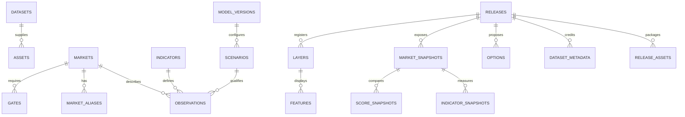

# F. Database Schema and Publication Model

## 1. Physical Contract

[database/schema.sql](database/schema.sql) is a PostgreSQL/PostGIS baseline migration contract, not an already running database. Target PostgreSQL 16+ with a compatible supported PostGIS release, UTF-8 and reviewed production migrations. The SQL creates schemas/tables/indexes/constraints and publication RLS; operators must separately provision least-privilege roles/grants, backup, credentials and approved infrastructure. Do not execute migrations against an unrelated production database.

| Schema | Purpose | Runtime access |
|---|---|---|
| `catalog` | Sources/assets, provisional market identity/aliases, indicator definitions. | Controlled stewardship/worker access; not public API tables. |
| `analysis` | Model/scenario/run versions, observations and independent gates. | Workers/reviewers through authorized backend operations. |
| `publish` | Audience-safe immutable release snapshots, layers, scores and options. | Read API/tile paths with scope and RLS. |
| `ops` | Durable jobs, publication assets and audit metadata. | Worker/publisher; job owner access enforced server-side. |
| `app_private` | Scoped database helper functions. | Explicit trusted application-role grants only. |

The original registry may remain confidential. A public snapshot is a separate approved set of names, geometries and observations, not a projection of every raw row. An exact alias or source claim is not disclosed simply because it helps internal identity matching.

## 2. Relationships and Grain

UUIDs identify assets/jobs/releases/scenarios and stable text market IDs preserve KHM identity. Do not use database row order or generated map tile IDs as business keys. Source observations retain dates, units, actual support, D/R/M/A/U and reliability independently from eligibility. Zero and null have different meaning.

Published score grain is release/market/scenario/model. A release references a fixed model, while scenarios must be validated to belong to that model by application/QA logic. Public JSON properties and option payloads use explicit API schemas and a publication allowlist; JSONB is not permission to dump raw records.

## 3. Geometry, Raster and Tiles

Exchange/publication geometry uses SRID 4326 with valid geometry checks. Analytical distances/areas use reviewed EPSG:32636/geodesic or appropriate upstream methods; raster files retain native support. GiST indexes support spatial filtering. Unverified market positions remain null in published snapshots; approximate neighborhood points are not silently promoted to entrances.

Store COG/PMTiles/source rasters in controlled object storage with hashes and rights metadata. Do not load every raster into PostGIS by default. Published `layers` records register only curated layer IDs, formats, units, zoom bounds and approved object/feature dependencies. Martin serves selected functions/queries over those records; it must not auto-expose all schemas.

## 4. Security and RLS Assumptions

Publication policies use transaction-local trusted server context (`km.audience`, `km.actor_role`). This context is not accepted from public request bodies or query parameters. The API resolves it from a validated session and policy. Always reset context on pooled connections; use transaction-scoped settings.

Runtime database roles must be nonowner, nonsuperuser, without BYPASSRLS and without DDL or arbitrary SQL capabilities. Grant only the schemas/tables/functions required for each workload. Migration/worker credentials must never be embedded in the frontend or tile URL. RLS is defense in depth assuming trusted parameterized server code, not protection against a compromised privileged service or malicious direct SQL login.

The SQL's writer/reviewer policies express allowed context but do not grant database privileges. Reviewers receive only the SELECT privileges their operations need; publisher/worker DML grants are separate. Public data policies permit published public releases; internal published snapshots require authenticated audience context; drafts require authorized review/publication context.

## 5. Release and Job State Machines

Releases progress draft -> review -> approved -> published, with rejected candidates remaining unpublished and withdrawal available after publication when required. `is_current` is unique per audience among published releases. Promotion verifies model approval, all assets ready, rights clearance, analytical QA and a separately authorized publisher, then switches the current pointer transactionally.

Checks in SQL cannot validate external file readiness, rights or every cross-model relationship alone. The publisher service and release test suite must enforce them before changing state. Published snapshots are immutable through application policy; use a new release for corrections. A future database trigger/hardening migration may enforce immutability more tightly after the actual publisher workflow is tested.

Jobs progress queued -> running -> succeeded/failed/cancelled, using lease expiry, attempts, idempotency key and creator subject. Job payloads contain validated parameters, never executable code or arbitrary remote download instructions. Private experiment result access is owner-scoped even if its inputs were public.

## 6. Migration and Acceptance

Before implementation acceptance: parse and apply the SQL to an isolated compatible PostGIS instance; test all foreign keys/constraints, RLS with actual role grants, pooled-context reset, positive/negative access, invalid geometry, null conditions, duplicate keys and state transitions. Parser validation alone is not semantic or security validation.

Map existing CSV definitions through reviewed ingestion migrations, not guessed automated public seeds. The schema contains no fake markets, sample coordinates or actual published scores. Retain the supplied fictional MCDA fixtures only in tests.